# the framework repairs its own GitLab setup when something breaks it

**Scenario:** init heals a revoked, duplicate, wrong or weakened token and an unguarded variable, and reload puts a drifted project back

<a name="storyboard-result"></a>

> [!tip] PASSED
> 28 steps · 28 frames

**On this page**

[Result](#storyboard-result) · [A revoked release token is rebuilt](#storyboard-chapter-1) · [A duplicate token and a tampered variable are repaired](#storyboard-chapter-2) · [A variable that signs in as another token is fixed](#storyboard-chapter-3) · [A release token that cannot push is rebuilt](#storyboard-chapter-4) · [A variable that lost its guards gets them back, with the same token](#storyboard-chapter-5) · [A refresh that fails keeps the release token that works](#storyboard-chapter-6) · [A refresh cut short is finished by the next init](#storyboard-chapter-7) · [A project that drifted is put back in one command](#storyboard-chapter-8) · [Replay and source](#storyboard-replay)

<a name="storyboard-chapter-1"></a>

## A revoked release token is rebuilt

<table width="100%">
<tr>
<th width="50%">

**1. Given a project the framework set up, whose release token someone then revoked in GitLab**

</th>
<th width="50%">

**2. When the developer runs the framework's init again, a brand-new release token takes the revoked one's place**

</th>
</tr>
<tr>
<td width="50%" valign="top">

[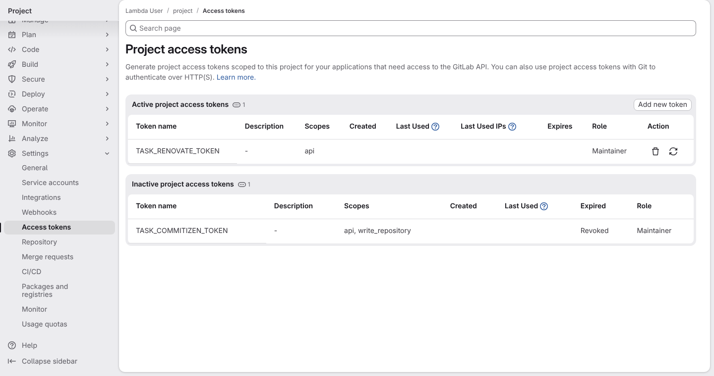](../../screenshots/base/02-daily-work/self-healing/tokens-revoked.webp)

GitLab's access-tokens page of a project after its first \`task devsecops:init\`. That run created two tokens, the release token TASK\_COMMITIZEN\_TOKEN and the dependency robot's TASK\_RENOVATE\_TOKEN.
Someone has since revoked the release token in GitLab. "Active project access tokens" lists only TASK\_RENOVATE\_TOKEN, and the release token sits under "Inactive project access tokens", marked "Revoked". Dates, last use and expiry change on every run, so they are blanked.

<details>
<summary>Command</summary>

```shell
http://gitlab/<lambda-user>/<project>/-/settings/access_tokens
```

</details>

</td>
<td width="50%" valign="top">

[](../../screenshots/base/02-daily-work/self-healing/tokens-healed.webp)

The developer runs \`task devsecops:init\` again. "Active project access tokens" lists TASK\_COMMITIZEN\_TOKEN once more: a new token, while the old one stays below, still "Revoked".
The same run stored the new token in the CI/CD variable of the same name. The test checks that this variable, like the dependency robot's, signs in to GitLab as its own active token.

<details>
<summary>Command</summary>

```shell
task devsecops:init
```

</details>

</td>
</tr>
</table>

<table width="100%">
<tr>
<th width="50%">

**3. When the developer runs init a second time, GitLab keeps that release token and revokes nothing**

</th>
<th width="50%">


</th>
</tr>
<tr>
<td width="50%" valign="top">

[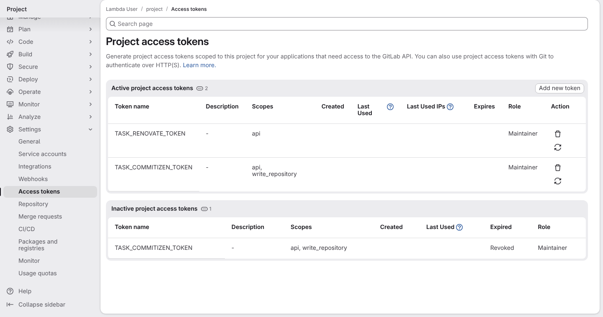](../../screenshots/base/02-daily-work/self-healing/tokens-idempotent.webp)

A second \`task devsecops:init\` on the healed project. The page has not changed: the same release token is active, and "Inactive project access tokens" still holds one row. The init run found a working token and left it alone.

<details>
<summary>Command</summary>

```shell
task devsecops:init
```

</details>

</td>
<td width="50%" valign="top">


</td>
</tr>
</table>

<a name="storyboard-chapter-2"></a>

## A duplicate token and a tampered variable are repaired

<table width="100%">
<tr>
<th width="50%">

**4. When someone plants a second release token with the same name in GitLab**

</th>
<th width="50%">

**5. And someone overwrites the release token's CI/CD variable with a bad value**

</th>
</tr>
<tr>
<td width="50%" valign="top">

[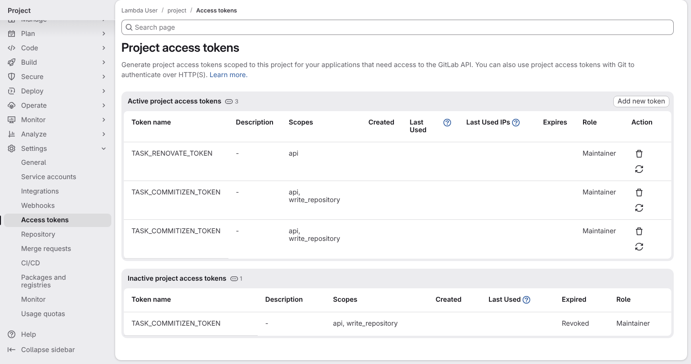](../../screenshots/base/02-daily-work/self-healing/tokens-duplicate.webp)

The same project. Someone creates a second token named TASK\_COMMITIZEN\_TOKEN in GitLab, so "Active project access tokens" now lists two release tokens where there should be one.

<details>
<summary>Command</summary>

```shell
http://gitlab/<lambda-user>/<project>/-/settings/access_tokens
```

</details>

</td>
<td width="50%" valign="top">

[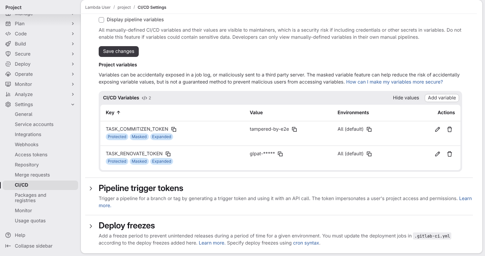](../../screenshots/base/02-daily-work/self-healing/variables-tampered.webp)

Someone also overwrites the release token's CI/CD variable. The project's CI/CD settings, values revealed (the button now reads "Hide values"): TASK\_COMMITIZEN\_TOKEN now holds "tampered-by-e2e", which no pipeline can sign in with.
TASK\_RENOVATE\_TOKEN still holds a real token. It starts with "glpat-" like every GitLab token, and its secret part is masked as "\*\*\*\*\*".

<details>
<summary>Command</summary>

```shell
http://gitlab/<lambda-user>/<project>/-/settings/ci_cd
```

</details>

</td>
</tr>
</table>

<table width="100%">
<tr>
<th width="50%">

**6. When the developer runs the framework's init once more, a single release token is left**

</th>
<th width="50%">

**7. Then the CI/CD variable holds a GitLab token again instead of the bad value**

</th>
</tr>
<tr>
<td width="50%" valign="top">

[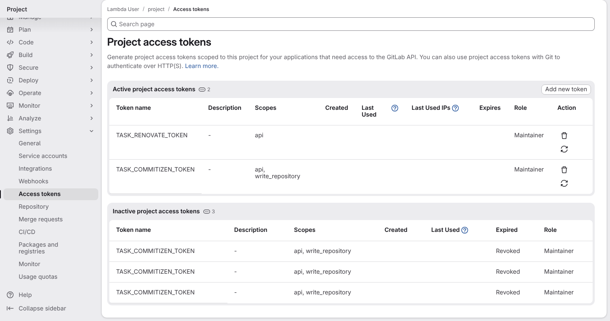](../../screenshots/base/02-daily-work/self-healing/tokens-purged.webp)

One more \`task devsecops:init\`. "Active project access tokens" lists a single release token again, and "Inactive project access tokens" now holds three.
The first is the token revoked in chapter 1. The second is the older of the two duplicates, which the init run revoked. The third is the one it kept, which it then replaced with a new token because the CI/CD variable no longer matched it.

<details>
<summary>Command</summary>

```shell
task devsecops:init
```

</details>

</td>
<td width="50%" valign="top">

[](../../screenshots/base/02-daily-work/self-healing/variables-healed.webp)

The same CI/CD settings page, values revealed. TASK\_COMMITIZEN\_TOKEN holds a GitLab token again, "glpat-" with its secret part masked, where it held "tampered-by-e2e". The test checks that this value signs in to GitLab as the new release token.

<details>
<summary>Command</summary>

```shell
http://gitlab/<lambda-user>/<project>/-/settings/ci_cd
```

</details>

</td>
</tr>
</table>

<a name="storyboard-chapter-3"></a>

## A variable that signs in as another token is fixed

<table width="100%">
<tr>
<th width="50%">

**8. When someone pastes the dependency robot's token into the release token's CI/CD variable**

</th>
<th width="50%">

**9. When the developer runs init again, it replaces the release token the variable did not sign in as**

</th>
</tr>
<tr>
<td width="50%" valign="top">

[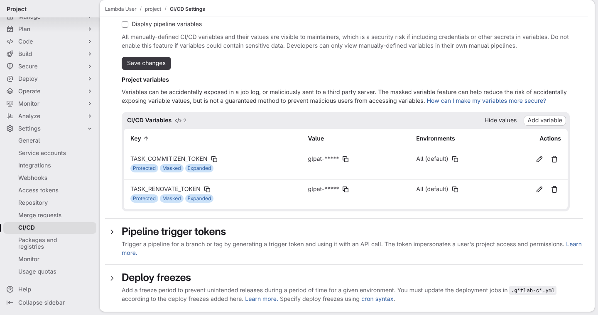](../../screenshots/base/02-daily-work/self-healing/variables-wrong-token.webp)

The same CI/CD settings, values revealed. Someone pasted the dependency robot's token into the release token's variable, so TASK\_COMMITIZEN\_TOKEN and TASK\_RENOVATE\_TOKEN now hold the same value.
Nothing on this page gives it away. Both read "glpat-\*\*\*\*\*" and both keep their "Protected" and "Masked" badges, because the value is a real token that signs in to GitLab. The test checks that it signs in as the dependency robot's token, not as the release token.

<details>
<summary>Command</summary>

```shell
http://gitlab/<lambda-user>/<project>/-/settings/ci_cd
```

</details>

</td>
<td width="50%" valign="top">

[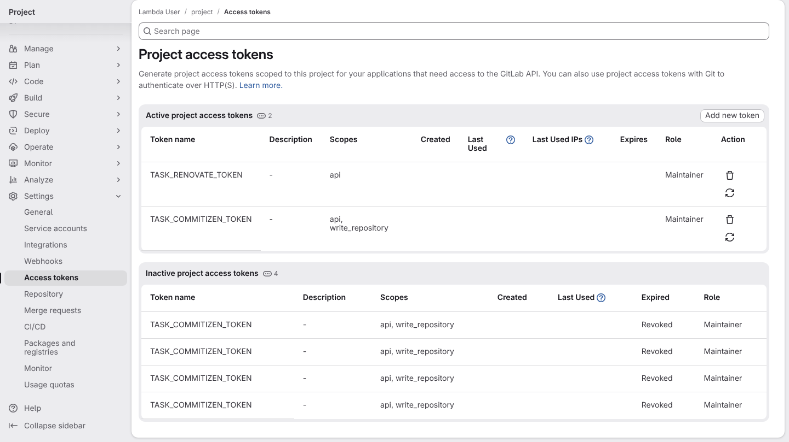](../../screenshots/base/02-daily-work/self-healing/tokens-wrong-token-replaced.webp)

One more \`task devsecops:init\`. It asks GitLab which token the variable signs in as. The answer is not the release token, so init replaced the release token with a new one and stored that one in the variable.
"Inactive project access tokens" now counts 4: the replaced release token joined the three from chapters 1 and 2. TASK\_RENOVATE\_TOKEN is still the same token, and the test checks that each variable signs in as its own token again.

<details>
<summary>Command</summary>

```shell
task devsecops:init
```

</details>

</td>
</tr>
</table>

<a name="storyboard-chapter-4"></a>

## A release token that cannot push is rebuilt

<table width="100%">
<tr>
<th width="50%">

**10. When someone swaps the release token for one that cannot push to the repository**

</th>
<th width="50%">

**11. When the developer runs init again, the release token can push to the repository again**

</th>
</tr>
<tr>
<td width="50%" valign="top">

[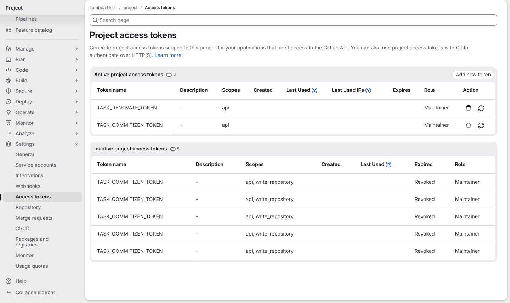](../../screenshots/base/02-daily-work/self-healing/tokens-cannot-push.webp)

Someone revoked the release token, made a new TASK\_COMMITIZEN\_TOKEN by hand and stored it in the variable. Its "Scopes" column reads only "api". It lacks "write\_repository", the right to push to the repository, which the release job needs.
"Inactive project access tokens" counts 5 with the token revoked by hand. The new token signs in and the variable holds it, so only its scopes give it away.

<details>
<summary>Command</summary>

```shell
http://gitlab/<lambda-user>/<project>/-/settings/access_tokens
```

</details>

</td>
<td width="50%" valign="top">

[](../../screenshots/base/02-daily-work/self-healing/tokens-can-push-again.webp)

One more \`task devsecops:init\`. It compared the token's scopes with the ones it needs, revoked the hand-made token and created a new one. The active TASK\_COMMITIZEN\_TOKEN reads "api, write\_repository" again, and "Inactive project access tokens" counts 6, with the hand-made token, the row that reads only "api", among them.
The same run stored the new token in the CI/CD variable. The test checks that the variable signs in as it.

<details>
<summary>Command</summary>

```shell
task devsecops:init
```

</details>

</td>
</tr>
</table>

<a name="storyboard-chapter-5"></a>

## A variable that lost its guards gets them back, with the same token

<table width="100%">
<tr>
<th width="50%">

**12. When someone turns masking off on the release token's CI/CD variable**

</th>
<th width="50%">

**13. And someone turns protection off on that variable as well**

</th>
</tr>
<tr>
<td width="50%" valign="top">

[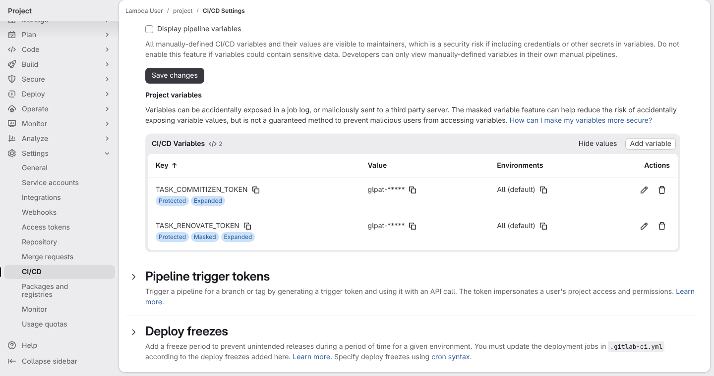](../../screenshots/base/02-daily-work/self-healing/variables-unmasked.webp)

The CI/CD settings again. Someone turned masking off on TASK\_COMMITIZEN\_TOKEN. Under its name the "Masked" badge is gone, and only "Protected" and "Expanded" are left. Masked means GitLab hides the value in every job log.

<details>
<summary>Command</summary>

```shell
http://gitlab/<lambda-user>/<project>/-/settings/ci_cd
```

</details>

</td>
<td width="50%" valign="top">

[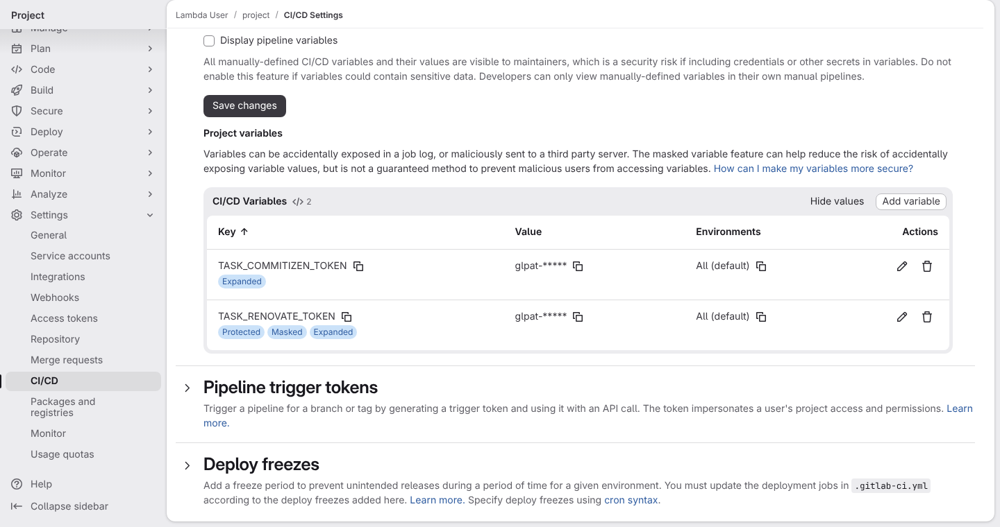](../../screenshots/base/02-daily-work/self-healing/variables-unprotected.webp)

Someone also turned protection off. Only "Expanded" is left under TASK\_COMMITIZEN\_TOKEN. Protected means only pipelines on protected branches, such as the main branch, can read the value.

<details>
<summary>Command</summary>

```shell
http://gitlab/<lambda-user>/<project>/-/settings/ci_cd
```

</details>

</td>
</tr>
</table>

<table width="100%">
<tr>
<th width="50%">

**14. When the developer runs init again, the variable is masked and protected again**

</th>
<th width="50%">

**15. Then GitLab still lists the same release token, because init replaced nothing**

</th>
</tr>
<tr>
<td width="50%" valign="top">

[](../../screenshots/base/02-daily-work/self-healing/variables-guarded.webp)

One more \`task devsecops:init\`. TASK\_COMMITIZEN\_TOKEN shows "Protected" and "Masked" again, like TASK\_RENOVATE\_TOKEN below it. Its value still reads "glpat-\*\*\*\*\*", and the test checks that it is the very same token as before.

<details>
<summary>Command</summary>

```shell
task devsecops:init
```

</details>

</td>
<td width="50%" valign="top">

[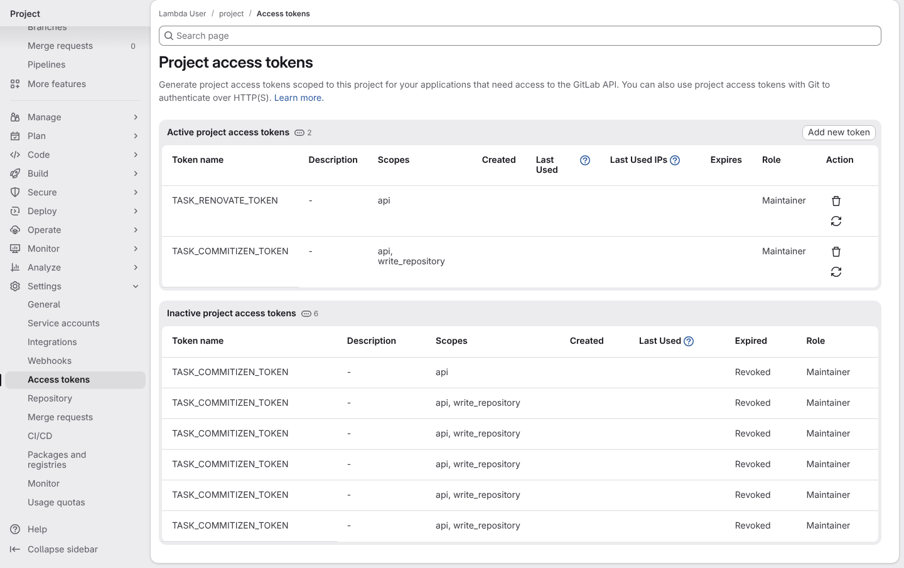](../../screenshots/base/02-daily-work/self-healing/tokens-kept.webp)

The access-tokens page after that run looks exactly as it did at the end of the previous chapter: one active release token, and "Inactive project access tokens" still counts 6. The token was right, so init fixed the variable's settings and replaced nothing.

<details>
<summary>Command</summary>

```shell
http://gitlab/<lambda-user>/<project>/-/settings/access_tokens
```

</details>

</td>
</tr>
</table>

<a name="storyboard-chapter-6"></a>

## A refresh that fails keeps the release token that works

<table width="100%">
<tr>
<th width="50%">

**16. When someone forces a new release token while signed in with the robot's token, GitLab refuses to make it and the old one stays active**

</th>
<th width="50%">

**17. When someone turns CI/CD off in the project's settings**

</th>
</tr>
<tr>
<td width="50%" valign="top">

[](../../screenshots/base/02-daily-work/self-healing/tokens-refresh-refused.webp)

\`task glab:commitizen-token TASK\_GLAB\_COMMITIZEN\_TOKEN\_FORCE\=true\` replaces the release token even when it works, as \`task devsecops:reload\` does. This run is signed in to GitLab with TASK\_RENOVATE\_TOKEN, the dependency robot's token, and GitLab never lets a project access token make another one.
The refresh asks GitLab for the new token before it revokes anything, so the refusal changes nothing. The release token is still under "Active project access tokens", and "Inactive project access tokens" still counts 6. The test checks that the old token still signs in to GitLab.

<details>
<summary>Command</summary>

```shell
task glab:commitizen-token TASK_GLAB_COMMITIZEN_TOKEN_FORCE=true
```

</details>

</td>
<td width="50%" valign="top">

[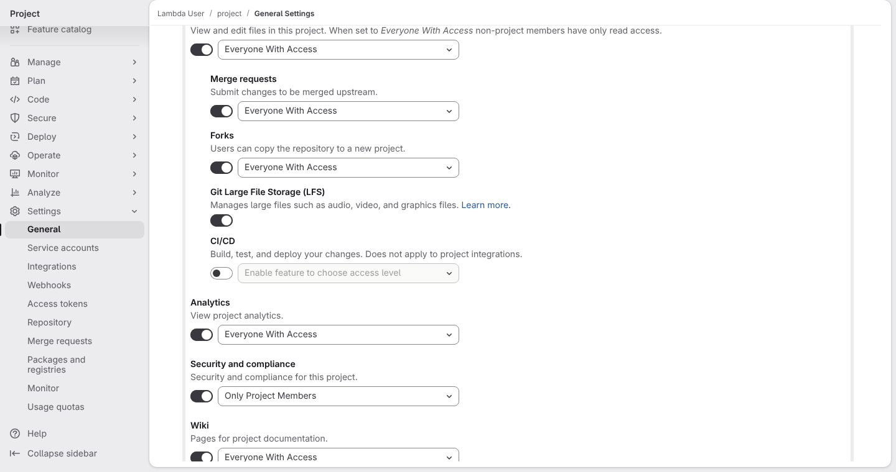](../../screenshots/base/02-daily-work/self-healing/settings-ci-cd-off.webp)

The project's general settings, in its list of features. Someone switched "CI/CD" off: its switch is grey, and "Build" has gone from the menu on the left, like "CI/CD" under "Settings".
While CI/CD is off, GitLab refuses every change to the project's CI/CD variables, where the pipeline finds the release token.

<details>
<summary>Command</summary>

```shell
http://gitlab/<lambda-user>/<project>/edit
```

</details>

</td>
</tr>
</table>

<table width="100%">
<tr>
<th width="50%">

**18. And the developer forces a new release token again, GitLab refuses to store it, and the refresh revokes the new token**

</th>
<th width="50%">

**19. When CI/CD is back on, the same refresh replaces the release token and revokes the old one last**

</th>
</tr>
<tr>
<td width="50%" valign="top">

[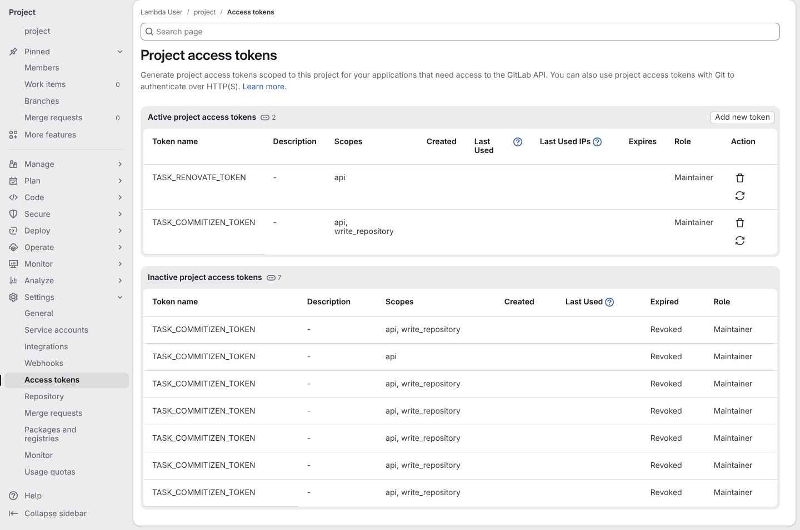](../../screenshots/base/02-daily-work/self-healing/tokens-store-refused.webp)

The same command, signed in as the developer this time. GitLab makes the new token, then refuses to store it in the CI/CD variable, because CI/CD is off. The refresh revokes that new token at once: it is the row added under "Inactive project access tokens", which now counts 7.
The release token under "Active project access tokens" is still the old one, and the test checks that it still signs in to GitLab. The menu on the left still has no "Build", because CI/CD is still off.

<details>
<summary>Command</summary>

```shell
task glab:commitizen-token TASK_GLAB_COMMITIZEN_TOKEN_FORCE=true
```

</details>

</td>
<td width="50%" valign="top">

[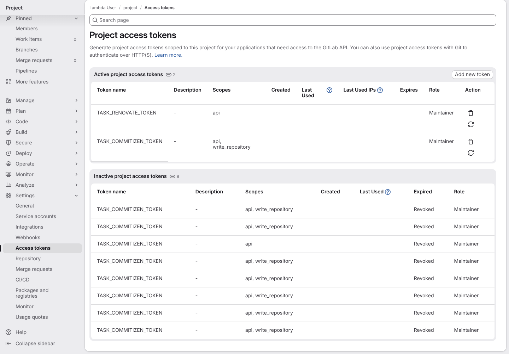](../../screenshots/base/02-daily-work/self-healing/tokens-refresh-done.webp)

CI/CD is switched back on, "Build" is back in the menu on the left, and the developer runs the same command. The active release token is a new one, and "Inactive project access tokens" counts 8 with the old one. The refresh revoked it last, once the new token was stored in the CI/CD variable and signed in to GitLab from there.
A job that was already running had read the old token when it started. It works until the old token is revoked, a few seconds after the new one is stored. A job that starts later reads the new one.

<details>
<summary>Command</summary>

```shell
task glab:commitizen-token TASK_GLAB_COMMITIZEN_TOKEN_FORCE=true
```

</details>

</td>
</tr>
</table>

<a name="storyboard-chapter-7"></a>

## A refresh cut short is finished by the next init

<table width="100%">
<tr>
<th width="50%">

**20. When a forced refresh stops right after GitLab makes its new token**

</th>
<th width="50%">

**21. When the developer runs init again, it keeps the release token the CI/CD variable holds and revokes the other**

</th>
</tr>
<tr>
<td width="50%" valign="top">

[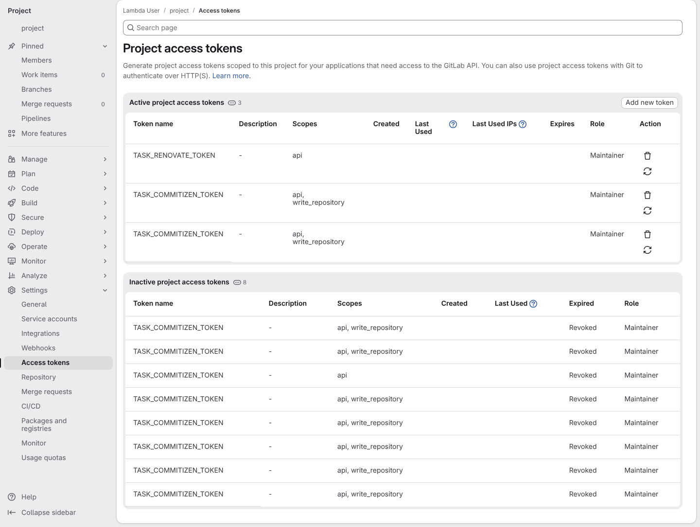](../../screenshots/base/02-daily-work/self-healing/tokens-refresh-cut-short.webp)

A refresh that stops right after GitLab made its new token, because the terminal was closed or the connection dropped, leaves a second release token that no CI/CD variable holds. The test makes that token the way the refresh does.
"Active project access tokens" lists TASK\_COMMITIZEN\_TOKEN twice. The CI/CD variable still holds the first one, and the test checks that it still signs in to GitLab.

<details>
<summary>Command</summary>

```shell
http://gitlab/<lambda-user>/<project>/-/settings/access_tokens
```

</details>

</td>
<td width="50%" valign="top">

[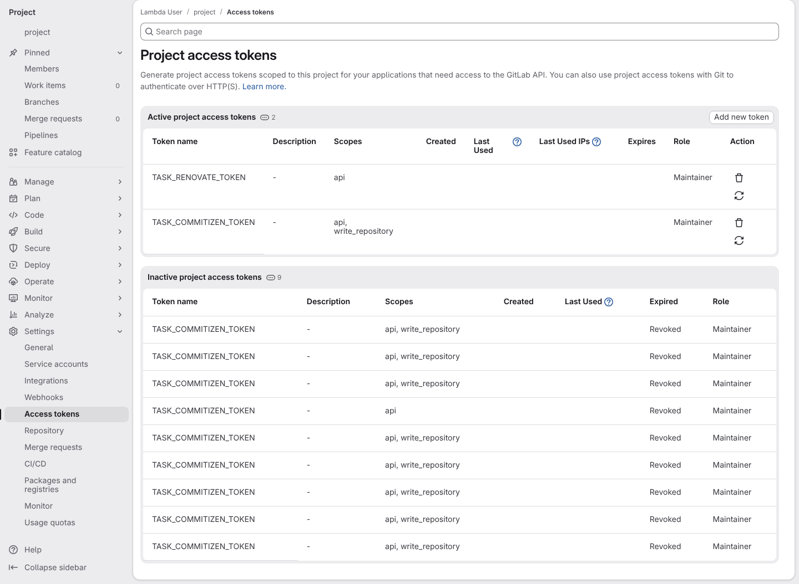](../../screenshots/base/02-daily-work/self-healing/tokens-leftover-revoked.webp)

One more \`task devsecops:init\`. It found two release tokens and asked GitLab which one the CI/CD variable signs in as. It kept that one and revoked the leftover, so "Inactive project access tokens" counts 9. The test checks that the variable still signs in as the same token.

<details>
<summary>Command</summary>

```shell
task devsecops:init
```

</details>

</td>
</tr>
</table>

<a name="storyboard-chapter-8"></a>

## A project that drifted is put back in one command

<table width="100%">
<tr>
<th width="50%">

**22. Given a project the framework set up, whose main branch someone then loosened by hand**

</th>
<th width="50%">

**23. And the project added its own settings to .env.dist, .env.dev, the MegaLinter settings and the Trivy ignore list**

</th>
</tr>
<tr>
<td width="50%" valign="top">

[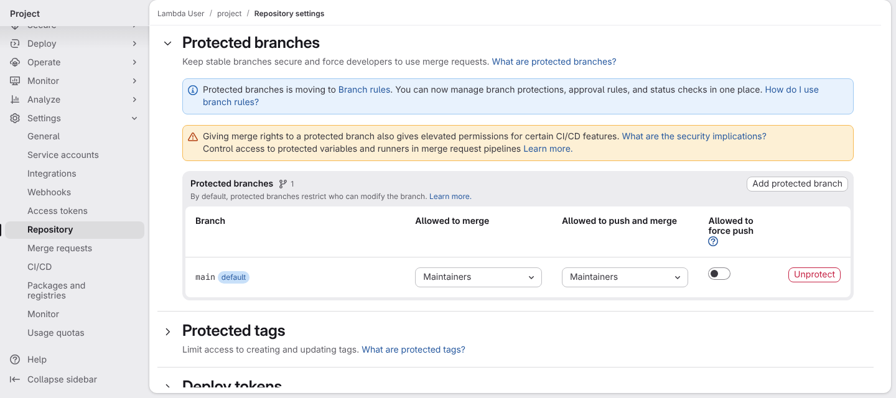](../../screenshots/base/02-daily-work/self-healing/reload-branch-loosened.webp)

A new project, generated from the toolbox and set up on install day. Its repository settings, "Protected branches": the main branch says "Allowed to push and merge: Maintainers".
The toolbox sets that to "No one", so every change reaches the main branch through a merge request. Someone loosened it by hand.

<details>
<summary>Command</summary>

```shell
http://gitlab/<lambda-user>/<project>/-/settings/repository
```

</details>

</td>
<td width="50%" valign="top">

[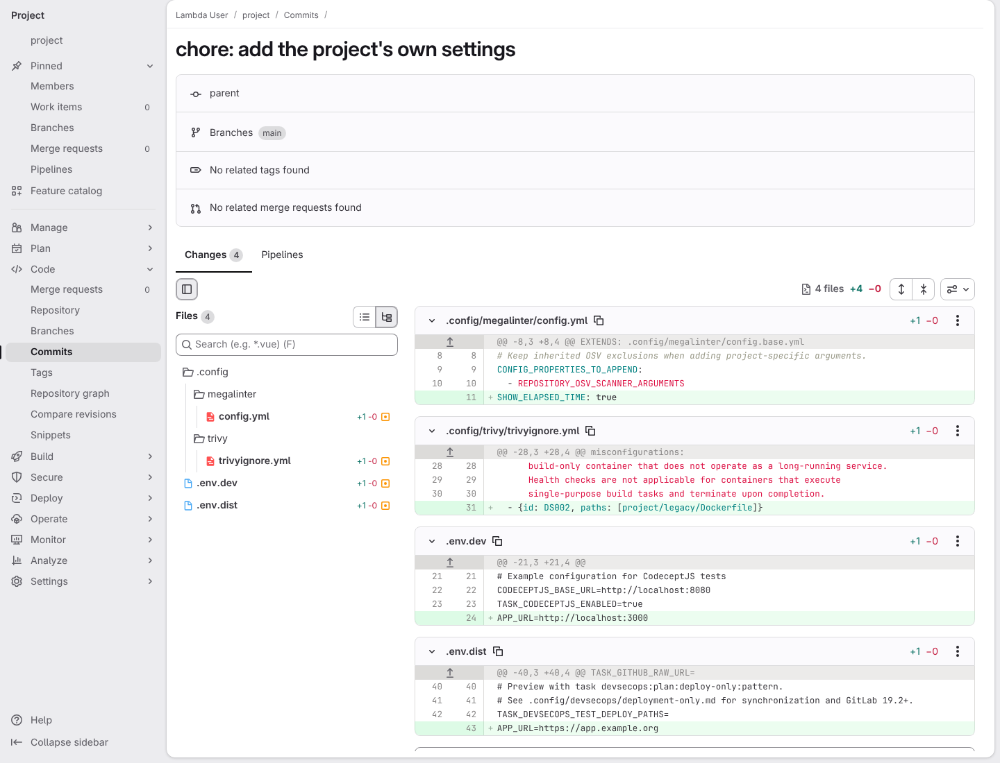](../../screenshots/base/02-daily-work/self-healing/reload-project-lines.webp)

Four files hold a few lines from the toolbox and everything else from the project: .env.dist, .env.dev, the MegaLinter settings .config/megalinter/config.yml and the Trivy ignore list .config/trivy/trivyignore.yml.
GitLab's page for the commit "chore: add the project's own settings": four changed files, with one green line of the project's own added at the end of each.

<details>
<summary>Command</summary>

```shell
git commit -am "chore: add the project's own settings" && git push origin main
```

</details>

</td>
</tr>
</table>

<table width="100%">
<tr>
<th width="50%">

**24. And the project released version 0.2.0, written to VERSION and to the Commitizen settings**

</th>
<th width="50%">

**25. And someone pushed a hand edit of the pipeline file straight to the main branch**

</th>
</tr>
<tr>
<td width="50%" valign="top">

[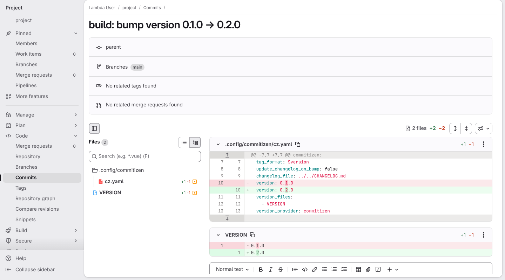](../../screenshots/base/02-daily-work/self-healing/reload-release-version.webp)

A release writes the new version in two files: VERSION, and the version line of .config/commitizen/cz.yaml, the settings of Commitizen, the tool that makes the release. Commitizen stops when the two disagree.
GitLab's page for the commit "build: bump version 0.1.0 → 0.2.0": two changed files, .config/commitizen/cz.yaml and VERSION, each going from 0.1.0 in red to 0.2.0 in green.

<details>
<summary>Command</summary>

```shell
git commit -am "build: bump version 0.1.0 → 0.2.0" && git push origin main
```

</details>

</td>
<td width="50%" valign="top">

[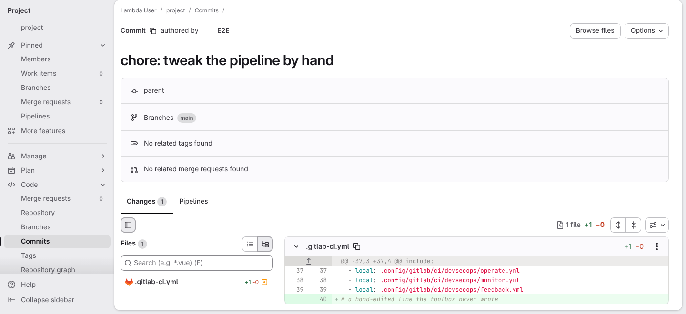](../../screenshots/base/02-daily-work/self-healing/reload-hand-edit.webp)

That loosening lets someone push a hand edit straight to the main branch. GitLab's page for the commit "chore: tweak the pipeline by hand": one changed file, .gitlab-ci.yml, with one green line added at its end, "\# a hand-edited line the toolbox never wrote".

<details>
<summary>Command</summary>

```shell
git commit -am "chore: tweak the pipeline by hand" && git push origin main
```

</details>

</td>
</tr>
</table>

<table width="100%">
<tr>
<th width="50%">

**26. When the developer reloads the framework, both automation tokens are revoked and replaced by new ones**

</th>
<th width="50%">

**27. Then the main branch is locked down again**

</th>
</tr>
<tr>
<td width="50%" valign="top">

[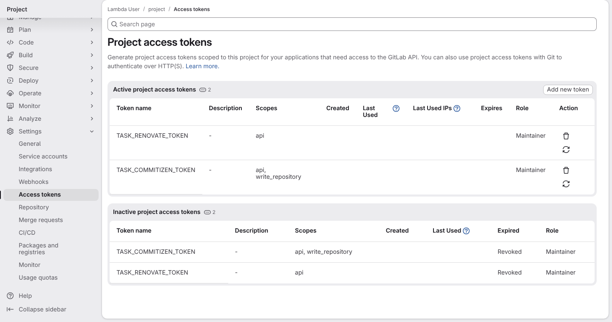](../../screenshots/base/02-daily-work/self-healing/reload-tokens-replaced.webp)

The developer runs \`task devsecops:reload\`. It re-applies the project's own answers to the framework files, then redoes the GitLab setup. On the access-tokens page both tokens are active, and both install-day tokens sit under "Inactive project access tokens", marked "Revoked".
The reload replaced them even though they still worked, and stored each new token in its CI/CD variable. \`task devsecops:init\` never replaces a working token, as chapters 1 and 5 showed.

<details>
<summary>Command</summary>

```shell
task devsecops:reload
```

</details>

</td>
<td width="50%" valign="top">

[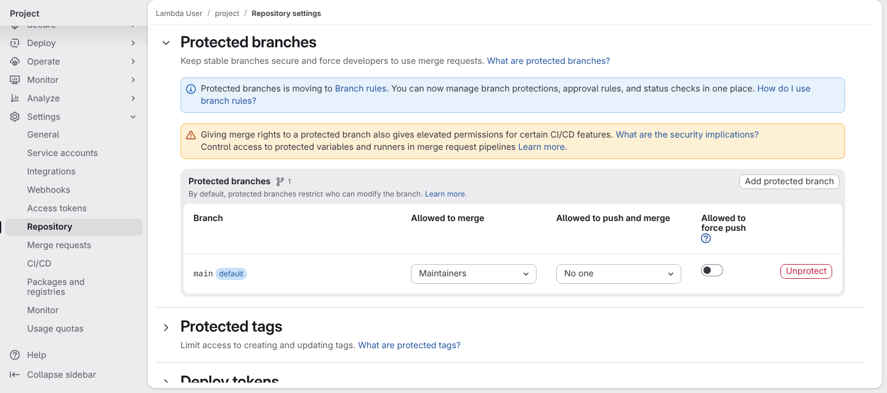](../../screenshots/base/02-daily-work/self-healing/reload-branch-strict.webp)

The same "Protected branches" settings as before the reload. The main branch says "Allowed to push and merge: No one" again, and "Allowed to merge: Maintainers": a change now reaches the main branch only through a merge request.

<details>
<summary>Command</summary>

```shell
http://gitlab/<lambda-user>/<project>/-/settings/repository
```

</details>

</td>
</tr>
</table>

<table width="100%">
<tr>
<th width="50%">

**28. And the developer sends the restored pipeline file back through a merge request**

</th>
<th width="50%">


</th>
</tr>
<tr>
<td width="50%" valign="top">

[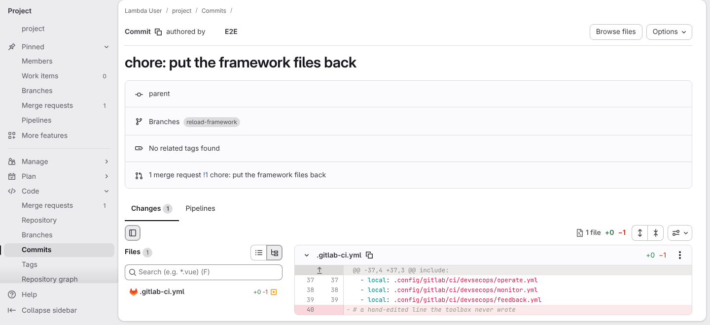](../../screenshots/base/02-daily-work/self-healing/reload-restore.webp)

The reload also put .gitlab-ci.yml back on disk, without the hand-written line. The main branch is locked, so the developer commits it on a branch and opens a merge request with the push.
GitLab's page for that commit, the same kind of page as the hand edit: "1 merge request", one changed file, .gitlab-ci.yml, and the red line "\# a hand-edited line the toolbox never wrote" removed.
The four files with the project's own settings are not in the commit: the reload left those lines where the project put them.
.config/commitizen/cz.yaml is not in it either: its version is still 0.2.0, the same as VERSION, so the next release starts from there.

<details>
<summary>Command</summary>

```shell
git switch -c reload-framework && git commit -am "chore: put the framework files back" && git push -o merge_request.create -o merge_request.target=main origin reload-framework
```

</details>

</td>
<td width="50%" valign="top">


</td>
</tr>
</table>

<a name="storyboard-replay"></a>

<details>
<summary>Replay this scenario · source and checks</summary>

```shell
task test -- --grep "@self-healing"
```

**Source**

```text
project/tests/e2e/features/02-daily-work/self-healing.feature
```

Every frame is its own pixel baseline (tolerance: 0).

</details>
