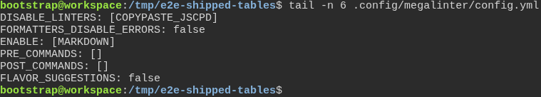
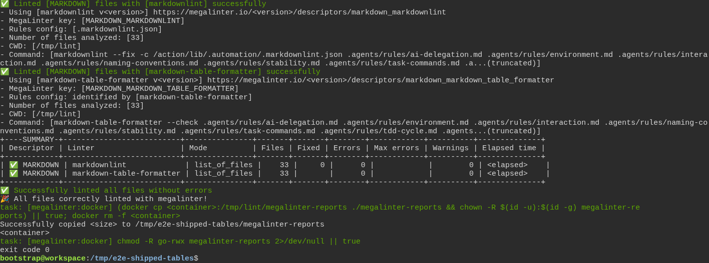

# a freshly generated project passes its own quality gate

**Scenario:** A project with its own list of disabled linters still passes the table formatter on every Markdown file the toolbox ships

<a name="storyboard-result"></a>

> [!tip] PASSED
> 2 steps · 2 frames

**On this page**

[Result](#storyboard-result) · [Replay and source](#storyboard-replay)

<table width="100%">
<tr>
<th width="50%">

**1. Given a generated project sets its own list of disabled linters, so the table formatter runs again**

</th>
<th width="50%">

**2. Then markdown-table-formatter accepts every Markdown table the toolbox ships**

</th>
</tr>
<tr>
<td width="50%" valign="top">

[](../../screenshots/base/02-daily-work/shipped-tables/own-disabled-linters.webp)

A project generated by the toolbox with every default answer. The last lines of its MegaLinter settings, on top, set its own DISABLE\_LINTERS. That list replaces the one of the base settings, which turns markdown-table-formatter off.
FORMATTERS\_DISABLE\_ERRORS: false makes a formatter error fail the run. ENABLE: \[MARKDOWN\] limits the run to the Markdown checks. Every Markdown file of the project comes from the toolbox.

<details>
<summary>Command</summary>

```shell
tail -n 6 .config/megalinter/config.yml
```

</details>

</td>
<td width="50%" valign="top">

[](../../screenshots/base/02-daily-work/shipped-tables/formatter-accepts-shipped-tables.webp)

The developer runs MegaLinter. markdown-table-formatter checks every Markdown file of the project, the guides under .config included, and finds no table to fix.
The run ends with "exit code 0".

<details>
<summary>Command</summary>

```shell
task megalinter; echo "exit code $?"
```

</details>

</td>
</tr>
</table>

<a name="storyboard-replay"></a>

<details>
<summary>Replay this scenario · source and checks</summary>

```shell
task test -- --grep "@shipped-tables"
```

**Source**

```text
project/tests/e2e/features/02-daily-work/quality-gate.feature
```

Every frame is its own pixel baseline (tolerance: 0).

</details>
