# Publishing the source of a private project, without the parts that must stay private

**Scenario:** The source reaches the public project only after an owner approved the exact list of files

<a name="storyboard-result"></a>

> [!tip] PASSED
> 24 steps · 24 frames

**On this page**

[Result](#storyboard-result) · [What would leave the private project](#storyboard-chapter-1) · [Nothing leaves until somebody has said yes](#storyboard-chapter-2) · [The right person has to be the one who says yes](#storyboard-chapter-3) · [Later changes do not slip through](#storyboard-chapter-4) · [The doctor says whether the project is ready](#storyboard-chapter-5) · [Replay and source](#storyboard-replay)

<a name="storyboard-chapter-1"></a>

## What would leave the private project

<table width="100%">
<tr>
<th width="50%">

**1. Given a private project whose source has to be published somewhere public**

</th>
<th width="50%">

**2. When a reviewer opens the file that says what may be published**

</th>
</tr>
<tr>
<td width="50%" valign="top">

[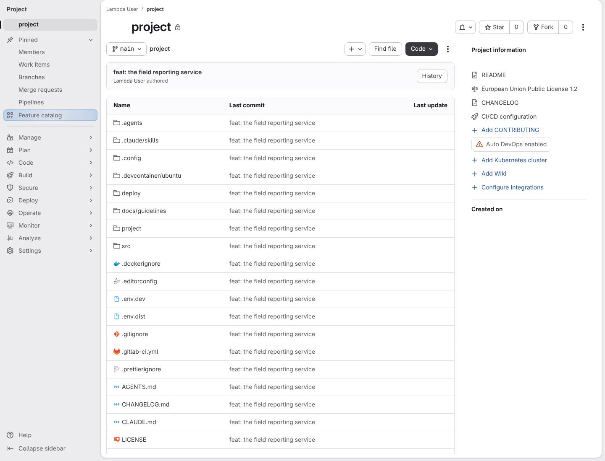](../../screenshots/base/02-daily-work/source-publication/publication-private-before.webp)

The private project's page on GitLab. The padlock next to its name says it is private: only the team can open it. That is deliberate, because it holds deployment files and a key that must never be public.
The file list shows what is at stake. The project's own src/ sits next to deploy/ and the framework's files. Some of it may leave and some of it must not, and the whole story is about telling the two apart.

<details>
<summary>Command</summary>

```shell
http://gitlab/<lambda-user>/<project>
```

</details>

</td>
<td width="50%" valign="top">

[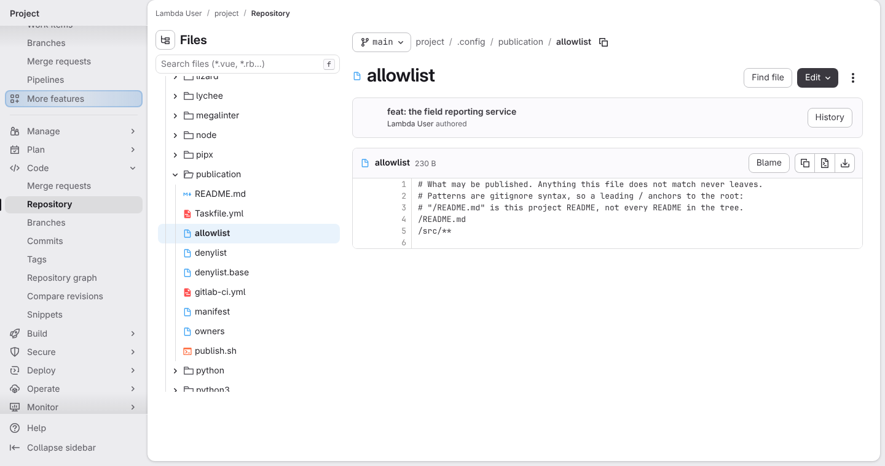](../../screenshots/base/02-daily-work/source-publication/publication-allowlist.webp)

.config/publication/allowlist, the file that decides what may leave, opened on GitLab. It names the README at the root and everything under src/. Whatever it does not name never leaves, so deploy/ stays private without anyone having to say so.
The leading slash matters. These are gitignore patterns, where a bare name matches at any depth: plain "README.md" would also publish every README buried in a subfolder.

<details>
<summary>Command</summary>

```shell
http://gitlab/<lambda-user>/<project>/-/blob/main/.config/publication/allowlist
```

</details>

</td>
</tr>
</table>

<table width="100%">
<tr>
<th width="50%">

**3. And the file that takes files back out of it, which always wins**

</th>
<th width="50%">


</th>
</tr>
<tr>
<td width="50%" valign="top">

[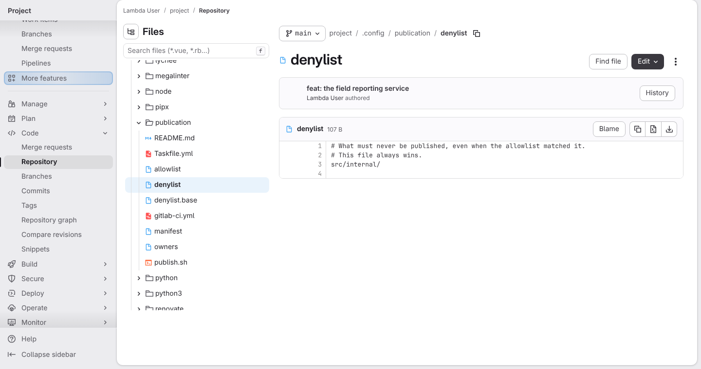](../../screenshots/base/02-daily-work/source-publication/publication-denylist.webp)

The same page for the file beside it, the denylist. Its one line, src/internal/, takes that folder back out of the allowed src/, and the denylist always wins.
In the Files panel, denylist.base is the framework's own floor: private keys, .env files, terraform state. A project can add to it with its own denylist, never take from it.

<details>
<summary>Command</summary>

```shell
http://gitlab/<lambda-user>/<project>/-/blob/main/.config/publication/denylist
```

</details>

</td>
<td width="50%" valign="top">


</td>
</tr>
</table>

<a name="storyboard-chapter-2"></a>

## Nothing leaves until somebody has said yes

<table width="100%">
<tr>
<th width="50%">

**4. Then the pipeline refuses to publish a list nobody approved**

</th>
<th width="50%">

**5. And the public project is still empty**

</th>
</tr>
<tr>
<td width="50%" valign="top">

[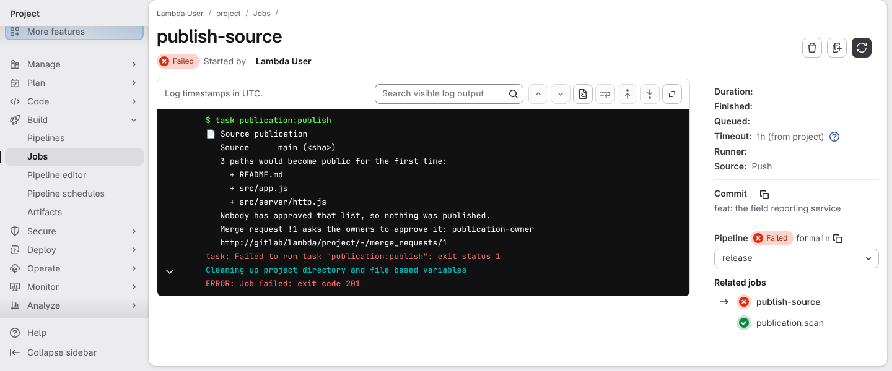](../../screenshots/base/02-daily-work/source-publication/publication-ci-unapproved.webp)

The push started a pipeline on the main branch, and this is its publish-source job. It stopped: three paths would become public for the first time, and it names all three.
The reason is the line under them: "Nobody has approved that list, so nothing was published." A pattern matching a file is not enough. A person has to have looked at the list first.

<details>
<summary>Command</summary>

```shell
http://gitlab/<lambda-user>/<project>/-/jobs/<id>
```

</details>

</td>
<td width="50%" valign="top">

[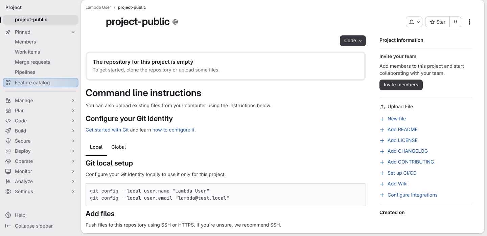](../../screenshots/base/02-daily-work/source-publication/publication-public-empty.webp)

The public project, the place the source is published to, as GitLab shows it right now. The globe next to its name says anyone can read it, and the page says "The repository for this project is empty". Not one file was pushed.
That is the point of the refusal. Once a file is public it stays public: people clone, forks exist, search engines keep a copy. So the pipeline stops before the push, never after it.

<details>
<summary>Command</summary>

```shell
http://gitlab/<lambda-user>/<project>-public
```

</details>

</td>
</tr>
</table>

<table width="100%">
<tr>
<th width="50%">

**6. And the job opens a merge request asking the owners to approve the list**

</th>
<th width="50%">

**7. And that merge request shows the exact list of paths that would become public**

</th>
</tr>
<tr>
<td width="50%" valign="top">

[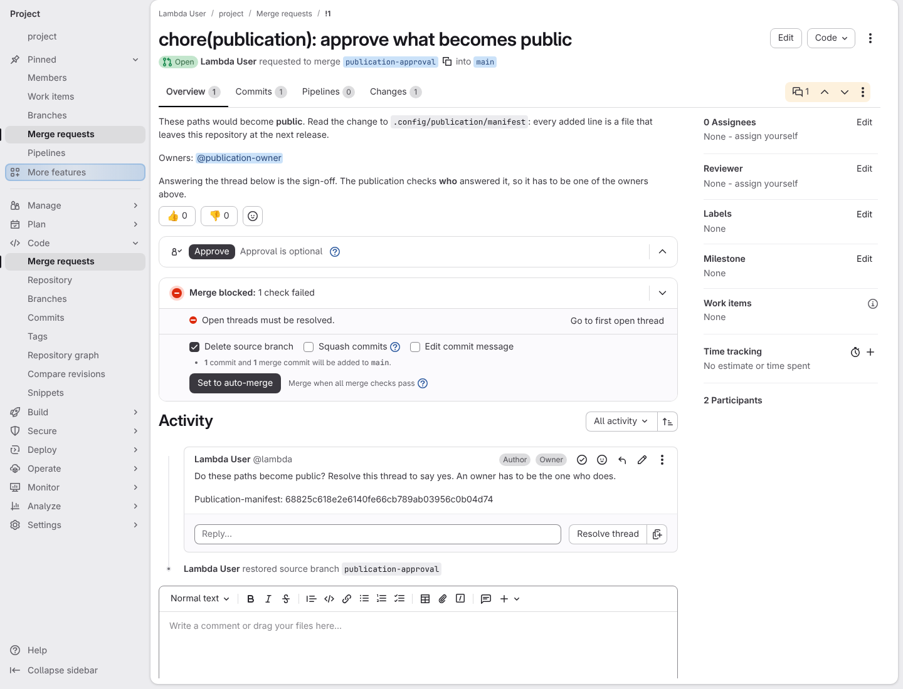](../../screenshots/base/02-daily-work/source-publication/publication-approval-mr.webp)

Instead of publishing, the job opened this merge request on the private project. Its description names the owners, so GitLab notifies them, and the question waits at the bottom as an open thread: "Do these paths become public? Resolve this thread to say yes."
The box in the middle is GitLab's own: "Merge blocked", because open threads must be resolved. Until somebody resolves that thread, this merge request cannot go in. GitLab enforces that itself, on the free tier.

<details>
<summary>Command</summary>

```shell
http://gitlab/<lambda-user>/<project>/-/merge_requests/1
```

</details>

</td>
<td width="50%" valign="top">

[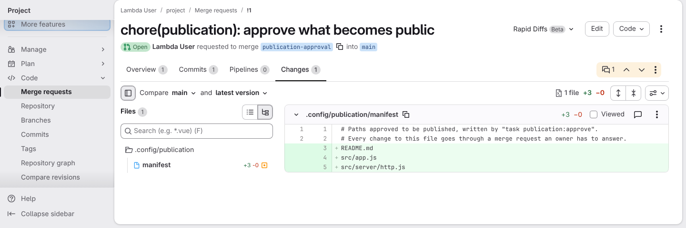](../../screenshots/base/02-daily-work/source-publication/publication-approval-diff.webp)

The Changes tab of the same merge request is where the decision is made. One file changed, .config/publication/manifest, with three added lines, and those three lines are exactly the three paths that would become public.
So approving means reading a diff of file names. Nothing to install and nothing to run: whoever reviews this sees the publication itself, line by line.

<details>
<summary>Command</summary>

```shell
http://gitlab/<lambda-user>/<project>/-/merge_requests/1/diffs
```

</details>

</td>
</tr>
</table>

<a name="storyboard-chapter-3"></a>

## The right person has to be the one who says yes

<table width="100%">
<tr>
<th width="50%">

**8. When the developer answers the question themselves and merges it**

</th>
<th width="50%">

**9. Then the pipeline still refuses, and names the person who answered**

</th>
</tr>
<tr>
<td width="50%" valign="top">

[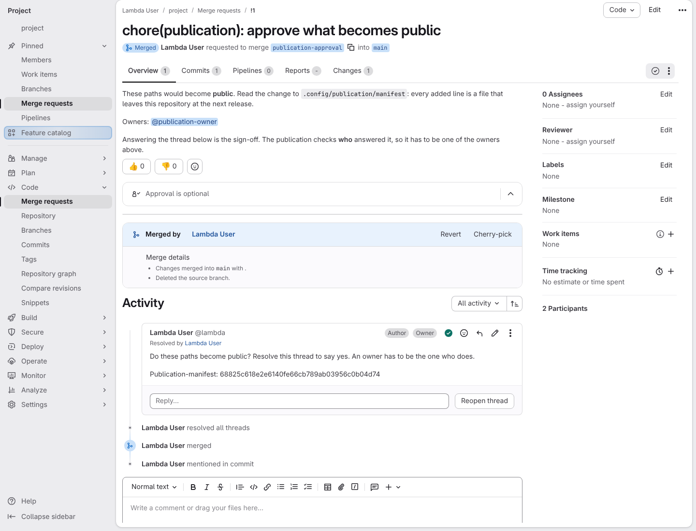](../../screenshots/base/02-daily-work/source-publication/publication-mr-merged.webp)

The same merge request after the developer resolved the thread and merged it. GitLab is satisfied: the page says "Merged by Lambda User", and the thread says it was resolved by Lambda User, the developer who opened the merge request.
That is as far as GitLab goes on the free tier. It makes sure somebody answered the question. It cannot require that the somebody is one of the people the project trusts with this decision.

<details>
<summary>Command</summary>

```shell
http://gitlab/<lambda-user>/<project>/-/merge_requests/1
```

</details>

</td>
<td width="50%" valign="top">

[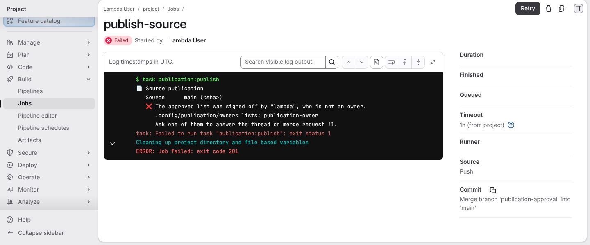](../../screenshots/base/02-daily-work/source-publication/publication-ci-wrong-signer.webp)

The merge started a new pipeline on the main branch, and the publish-source job refuses again. This time it says why in one line: the list was signed off by "lambda", who is not an owner.
Under it, the job names the file that decides, .config/publication/owners, and who is in it. GitLab checks that the thread was resolved. The toolbox checks who resolved it, and that second check is what makes the sign-off mean something.

<details>
<summary>Command</summary>

```shell
http://gitlab/<lambda-user>/<project>/-/jobs/<id>
```

</details>

</td>
</tr>
</table>

<table width="100%">
<tr>
<th width="50%">

**10. When an owner reopens the question and answers it instead**

</th>
<th width="50%">

**11. Then the pipeline publishes the approved files, and only them**

</th>
</tr>
<tr>
<td width="50%" valign="top">

[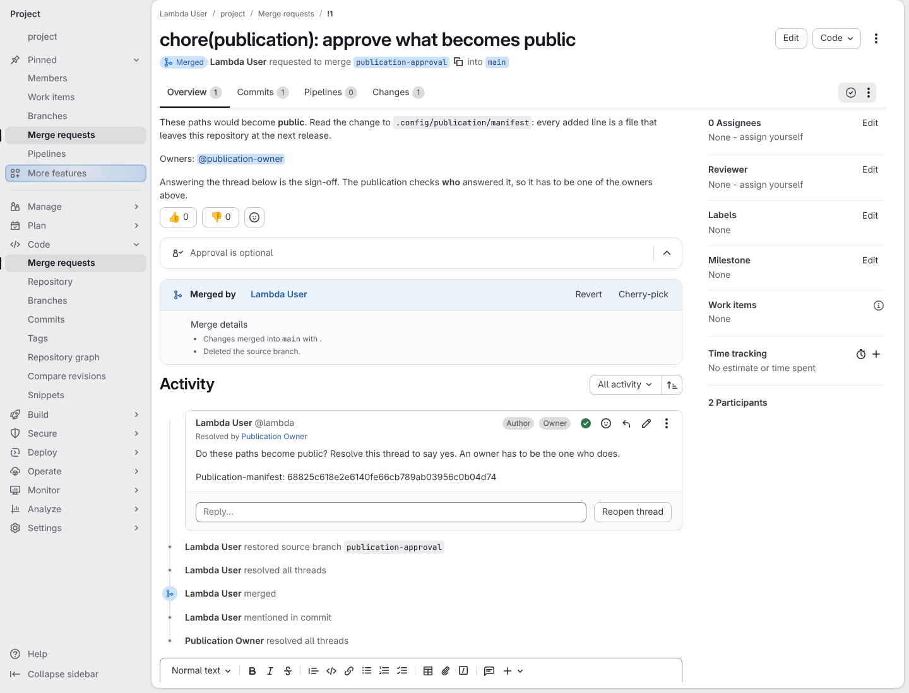](../../screenshots/base/02-daily-work/source-publication/publication-owner-answered.webp)

The same merge request page, at the same size, after an owner reopened the thread and resolved it again. The thread now says it was resolved by Publication Owner, and the owner's own "resolved all threads" closes the activity.
Nothing else moved. Same merge request, same three paths. The only thing that changed is who put their name on it.

<details>
<summary>Command</summary>

```shell
http://gitlab/<lambda-user>/<project>/-/merge_requests/1
```

</details>

</td>
<td width="50%" valign="top">

[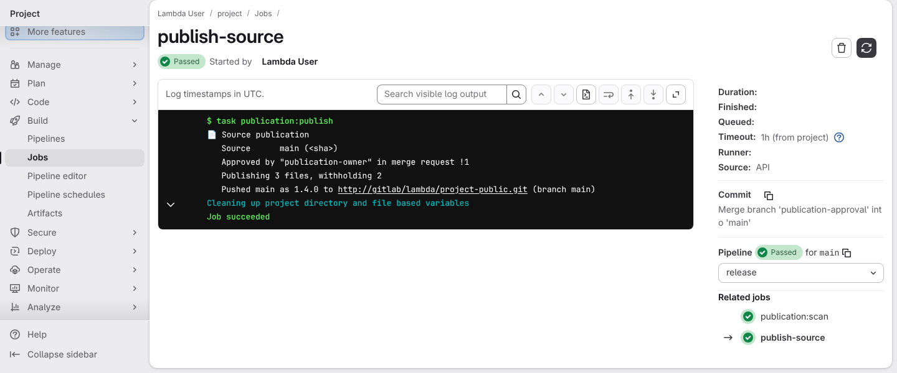](../../screenshots/base/02-daily-work/source-publication/publication-ci-published.webp)

The pipeline runs once more on the same commit, and this time the publish-source job goes through. It says what it did: approved by publication-owner in merge request !1, "Publishing 3 files, withholding 2", then "Pushed main as 1.4.0" to the public project.
The test starts this pipeline itself, because an answer on a merge request that is already merged pushes nothing. The job reads the current approval every time it runs.

<details>
<summary>Command</summary>

```shell
http://gitlab/<lambda-user>/<project>/-/jobs/<id>
```

</details>

</td>
</tr>
</table>

<table width="100%">
<tr>
<th width="50%">

**12. And the public project now carries README.md and src/, without the folders that never leave**

</th>
<th width="50%">

**13. And the published history is one commit for that release**

</th>
</tr>
<tr>
<td width="50%" valign="top">

[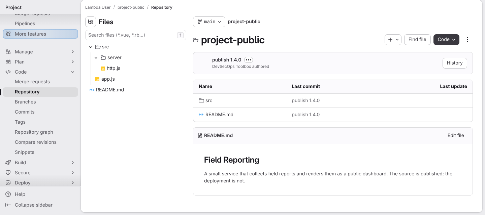](../../screenshots/base/02-daily-work/source-publication/publication-public-after.webp)

The public project's files, with every folder unfolded in the Files panel on the left: README.md, src/app.js and src/server/http.js. That is the whole public tree, and its last commit is "publish 1.4.0".
What is missing matters as much. No deploy/, no src/internal/, no src/certs/ with its key. They were filtered out before the push, not deleted after it, so they were never public for a second.

<details>
<summary>Command</summary>

```shell
http://gitlab/<lambda-user>/<project>-public/-/tree/main
```

</details>

</td>
<td width="50%" valign="top">

[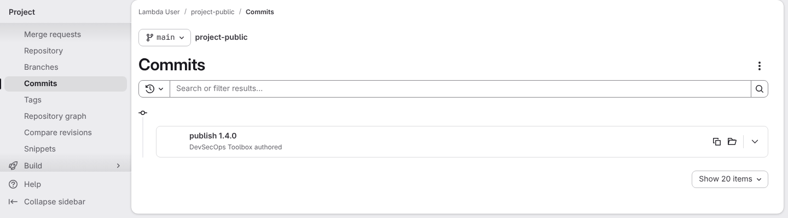](../../screenshots/base/02-daily-work/source-publication/publication-public-history.webp)

The whole history of the public project: one commit, "publish 1.4.0", authored by DevSecOps Toolbox rather than by a person.
Each release adds exactly one commit, so the public history reads as a publication log, and a file that was held back was never in it to be found later.

<details>
<summary>Command</summary>

```shell
http://gitlab/<lambda-user>/<project>-public/-/commits/main
```

</details>

</td>
</tr>
</table>

<a name="storyboard-chapter-4"></a>

## Later changes do not slip through

<table width="100%">
<tr>
<th width="50%">

**14. When a developer pushes a new file into a published folder, and the pipeline asks the owners again**

</th>
<th width="50%">

**15. And a secret committed into a published file is stopped by the scan before the publication starts, and its log prints REDACTED instead of the password**

</th>
</tr>
<tr>
<td width="50%" valign="top">

[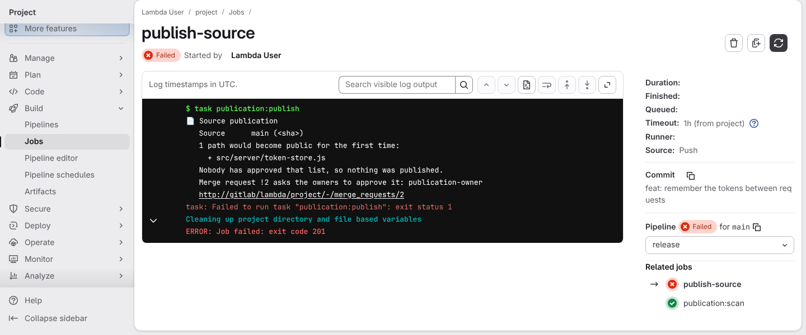](../../screenshots/base/02-daily-work/source-publication/publication-ci-late-arrival.webp)

A developer pushes src/server/token-store.js to the main branch. No list changed: the allowlist has named src/ all along, so the new file matches it.
The publish-source job still refuses, names that one file and opens merge request !2 to ask the owners. A file that lands in a folder that is already public waits for its own yes.

<details>
<summary>Command</summary>

```shell
http://gitlab/<lambda-user>/<project>/-/jobs/<id>
```

</details>

</td>
<td width="50%" valign="top">

[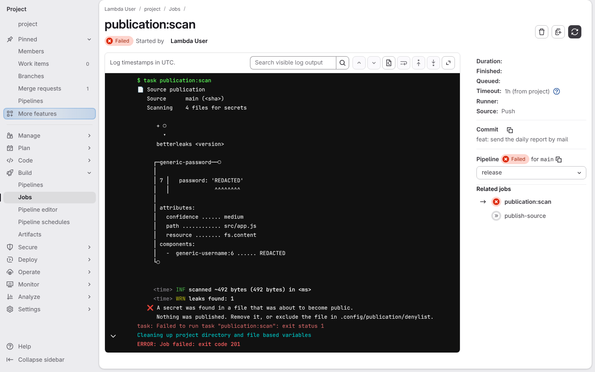](../../screenshots/base/02-daily-work/source-publication/publication-ci-secret.webp)

Next, a developer commits staging mailer credentials into src/app.js, a file that has been public since the first release. The pipeline's first job, publication:scan, reads what would become public and finds the password: rule generic-password, path src/app.js, line 7. The log prints "REDACTED" where the password and the user name were, because everyone on the private project can read it.
Under Related jobs on the right, publish-source never started: it waits on the scan. The approval answers "may this file be public", the scan answers "is there a secret in it", and both have to say yes.

<details>
<summary>Command</summary>

```shell
http://gitlab/<lambda-user>/<project>/-/jobs/<id>
```

</details>

</td>
</tr>
</table>

<table width="100%">
<tr>
<th width="50%">

**16. And the same scan, run in Docker on a machine without betterleaks, stops on the same password and prints REDACTED too**

</th>
<th width="50%">

**17. And a scan that is switched off fails instead of passing, and a pipeline refuses to publish without it**

</th>
</tr>
<tr>
<td width="50%" valign="top">

[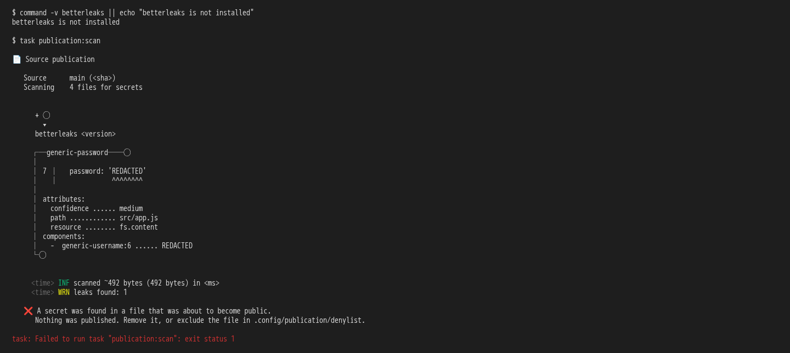](../../screenshots/base/02-daily-work/source-publication/publication-docker-secret.webp)

The developer runs the same scan in their copy of the project, on a machine where betterleaks is not installed: the first command says so. The publication then runs the scanner from its Docker image instead.
It stops on the same finding, rule generic-password, path src/app.js, line 7, and prints "REDACTED" there too. The scan still fails, so nothing can be published from this machine either.

<details>
<summary>Command</summary>

```shell
task publication:scan
```

</details>

</td>
<td width="50%" valign="top">

[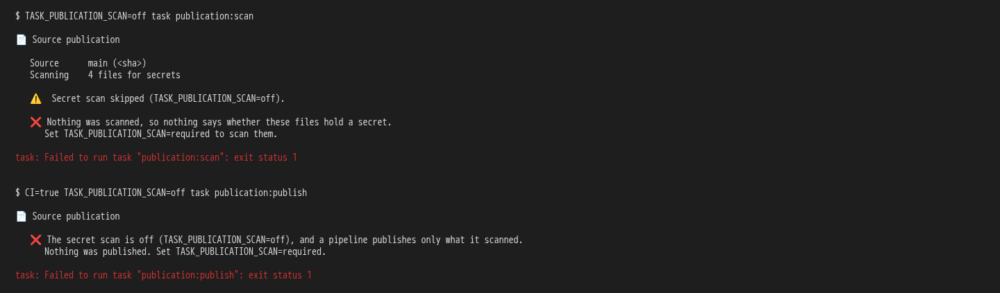](../../screenshots/base/02-daily-work/source-publication/publication-scan-off.webp)

The developer then switches the scan off for one run, with TASK\_PUBLICATION\_SCAN\=off. The scan says it was skipped and fails: nothing was scanned, so it cannot say that no secret was found.
The second command starts the publication the way a pipeline does: CI\=true is what GitLab sets in every job. It refuses at once, because a pipeline publishes only what it scanned.

<details>
<summary>Command</summary>

```shell
TASK_PUBLICATION_SCAN=off task publication:scan
```

</details>

</td>
</tr>
</table>

<table width="100%">
<tr>
<th width="50%">

**18. And a scan whose scanner cannot run, or stops on an error, fails and says so**

</th>
<th width="50%">

**19. And only a scan that read every file to the end says no secret was found, here on release 1.4.0**

</th>
</tr>
<tr>
<td width="50%" valign="top">

[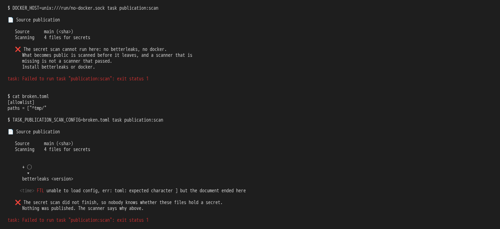](../../screenshots/base/02-daily-work/source-publication/publication-scan-error.webp)

Two more scans that never get to the files. In the first, Docker is installed but cannot be reached: DOCKER\_HOST points at a socket that does not exist. The scan says it cannot run here.
The second reads its rules from broken.toml, a scanner configuration missing its closing bracket. betterleaks stops on it with "unable to load config", and the scan says it did not finish. Both fail, and neither one says that a secret was found, or that none was.

<details>
<summary>Command</summary>

```shell
TASK_PUBLICATION_SCAN_CONFIG=broken.toml task publication:scan
```

</details>

</td>
<td width="50%" valign="top">

[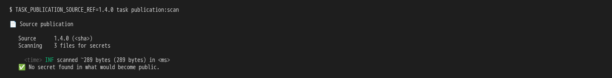](../../screenshots/base/02-daily-work/source-publication/publication-scan-clean.webp)

Last, the same scan of release 1.4.0, the three files the public project holds today: TASK\_PUBLICATION\_SOURCE\_REF names the tag. betterleaks reads them to the end, "scanned \~289 bytes", and finds nothing.
This is the only run on this machine that says "No secret found in what would become public", and the only one that passes.

<details>
<summary>Command</summary>

```shell
TASK_PUBLICATION_SOURCE_REF=1.4.0 task publication:scan
```

</details>

</td>
</tr>
</table>

<table width="100%">
<tr>
<th width="50%">

**20. Then the public project still holds the first release, without the new file or the password**

</th>
<th width="50%">


</th>
</tr>
<tr>
<td width="50%" valign="top">

[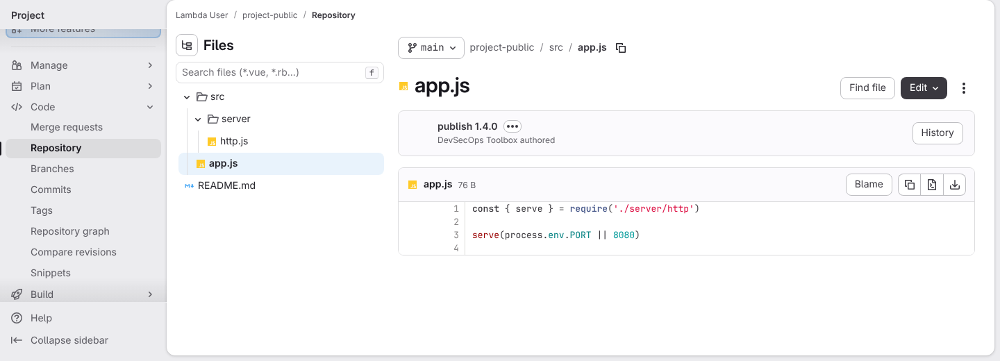](../../screenshots/base/02-daily-work/source-publication/publication-public-unchanged.webp)

The public project's src/app.js, as anyone on the internet would open it. It is still the three lines of release 1.4.0: no mailer and no password. In the Files panel, server/ holds only http.js, so token-store.js never arrived either.
The last commit is still "publish 1.4.0". What gets published is what an owner approved, file by file, and what the scan let through, never what a pattern happened to match.

<details>
<summary>Command</summary>

```shell
http://gitlab/<lambda-user>/<project>-public/-/blob/main/src/app.js
```

</details>

</td>
<td width="50%" valign="top">


</td>
</tr>
</table>

<a name="storyboard-chapter-5"></a>

## The doctor says whether the project is ready

<table width="100%">
<tr>
<th width="50%">

**21. When the developer opens the project's CI/CD variables, where both tokens are stored, neither masked nor protected**

</th>
<th width="50%">

**22. Then the doctor names both tokens and fails**

</th>
</tr>
<tr>
<td width="50%" valign="top">

[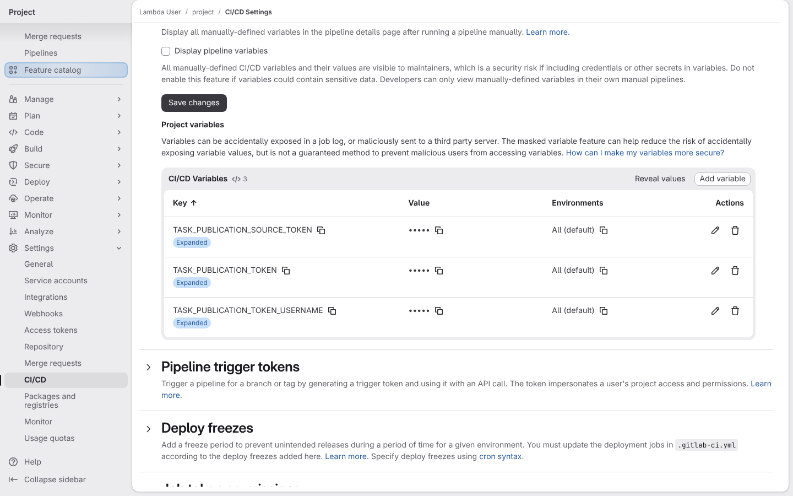](../../screenshots/base/02-daily-work/source-publication/publication-doctor-variables-open.webp)

The private project's CI/CD variables, in GitLab's settings. TASK\_PUBLICATION\_TOKEN and TASK\_PUBLICATION\_SOURCE\_TOKEN have held the two tokens since the first chapter, and every pipeline of this story used them. Each one carries only the Expanded label: neither Masked nor Protected.
Without Masked, GitLab does not hide the value when a job log prints it. Without Protected, a pipeline on any branch receives the token, not only the pipelines of the main branch.

<details>
<summary>Command</summary>

```shell
http://gitlab/<lambda-user>/<project>/-/settings/ci_cd
```

</details>

</td>
<td width="50%" valign="top">

[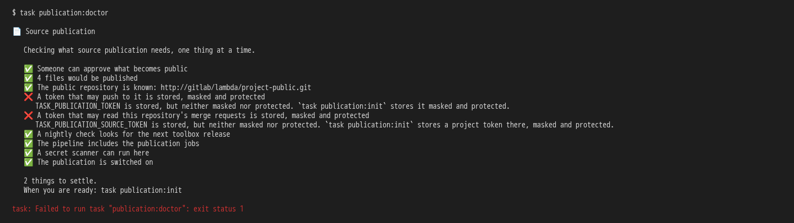](../../screenshots/base/02-daily-work/source-publication/publication-doctor-not-ready.webp)

The developer runs task publication:doctor, the command that checks the setup, with their own GitLab token in the environment. It reads both variables on GitLab and says what is wrong with each one: "is stored, but neither masked nor protected".
Everything else is in place, the nightly schedule included. The doctor counts "2 things to settle", and task ends on "exit status 1": a script that runs the doctor stops here as well.

<details>
<summary>Command</summary>

```shell
task publication:doctor
```

</details>

</td>
</tr>
</table>

<table width="100%">
<tr>
<th width="50%">

**23. When the developer marks both tokens masked and protected**

</th>
<th width="50%">

**24. Then the doctor finds nothing missing and passes, and without a token it fails on what it could not check**

</th>
</tr>
<tr>
<td width="50%" valign="top">

[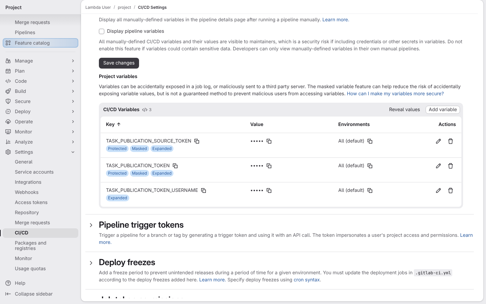](../../screenshots/base/02-daily-work/source-publication/publication-doctor-variables-guarded.webp)

The same settings page after the developer edited both variables and ticked Masked and Protected on each one. Both now carry the two labels, and their values did not change.

<details>
<summary>Command</summary>

```shell
http://gitlab/<lambda-user>/<project>/-/settings/ci_cd
```

</details>

</td>
<td width="50%" valign="top">

[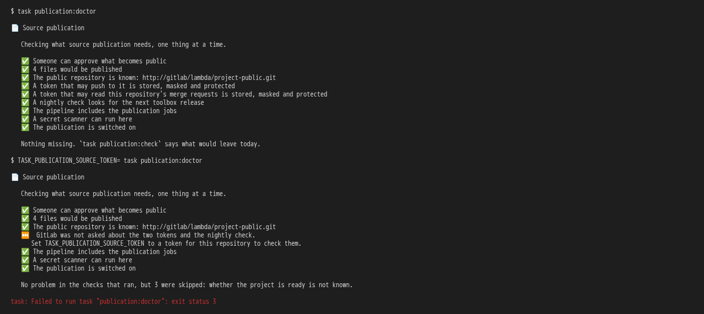](../../screenshots/base/02-daily-work/source-publication/publication-doctor-ready.webp)

The doctor again. Every line is a ✅ and the run ends on "Nothing missing", with no exit status: it passed.
The second run empties TASK\_PUBLICATION\_SOURCE\_TOKEN, so the doctor has no token for GitLab. It says "GitLab was not asked about the two tokens and the nightly check", and ends on "exit status 3" instead of a yes: it cannot know.

<details>
<summary>Command</summary>

```shell
TASK_PUBLICATION_SOURCE_TOKEN= task publication:doctor
```

</details>

</td>
</tr>
</table>

<a name="storyboard-replay"></a>

<details>
<summary>Replay this scenario · source and checks</summary>

```shell
task test -- --grep "@source-publication"
```

**Source**

```text
project/tests/e2e/features/02-daily-work/source-publication.feature
```

Every frame is its own pixel baseline (tolerance: 0).

</details>
