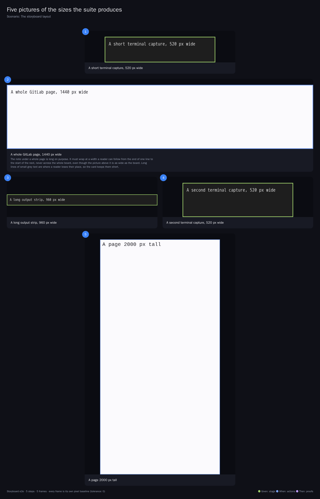

# A storyboard shows every picture as large as it can

**Scenario:** A whole GitLab page gets a row of its own in a storyboard, at its real size

<a name="storyboard-result"></a>

> [!tip] PASSED
> 1 steps · 1 frames

**On this page**

[Result](#storyboard-result) · [Replay and source](#storyboard-replay)

<table width="100%">
<tr>
<th width="50%">

**1. Then a storyboard gives a whole GitLab page a full row at its real size and keeps shorter captures two per row**

</th>
<th width="50%">


</th>
</tr>
<tr>
<td width="50%" valign="top">

[](../../screenshots/base/02-daily-work/storyboard-wide-card/storyboard-wide-card.webp)

A storyboard drawn by the real engine from five pictures: a short terminal capture, a whole GitLab page 1440 pixels wide, a long output strip 960 pixels wide, a second terminal capture and a page 2000 pixels tall.
The 1440 pixel page takes the full width of the board and keeps its real size, so its small text stays readable. Its long note wraps at a comfortable width instead of running across the whole board.
The other pictures share rows two by two. The 960 pixel strip is shrunk into its half of the row. The tall page has to be shrunk to fit the height limit anyway, so it keeps a half row. A picture alone on its row sits in the middle of it.

</td>
<td width="50%" valign="top">


</td>
</tr>
</table>

<a name="storyboard-replay"></a>

<details>
<summary>Replay this scenario · source and checks</summary>

```shell
task test -- --grep "@storyboard-wide-card"
```

**Source**

```text
project/tests/e2e/features/02-daily-work/storyboard-layout.feature
```

Every frame is its own pixel baseline (tolerance: 0).

</details>
