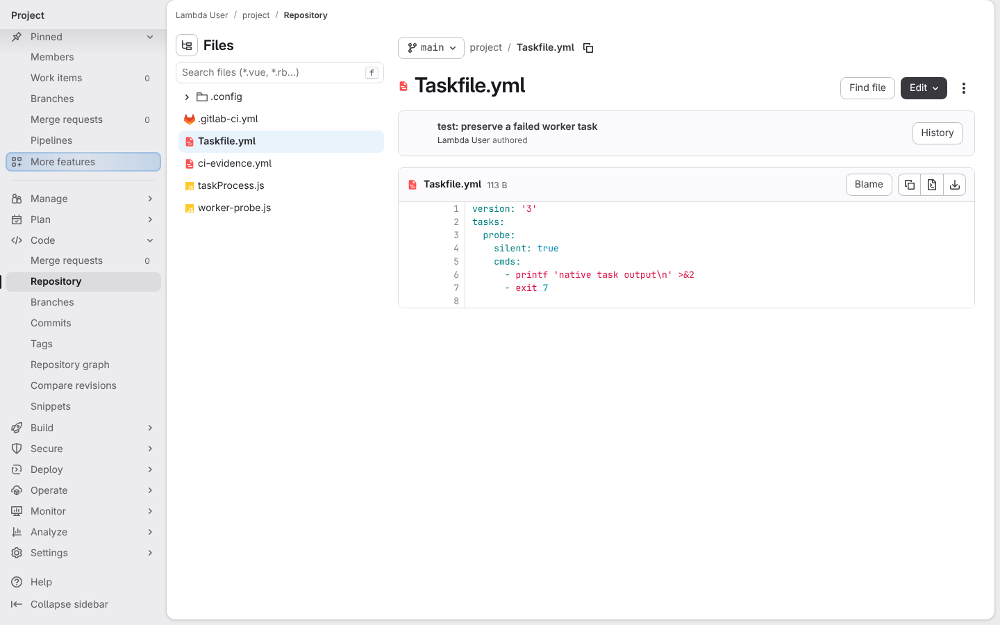
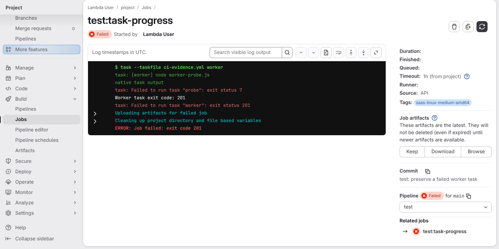

# a freshly generated project passes its own quality gate

**Scenario:** a worker reports real task progress and preserves failures

<a name="storyboard-result"></a>

> [!tip] PASSED
> 2 steps · 2 frames

**On this page**

[Result](#storyboard-result) · [Replay and source](#storyboard-replay)

<table width="100%">
<tr>
<th width="50%">

**1. Given a task emits real output before failing**

</th>
<th width="50%">

**2. Then the CI job log shows the worker's real task output and keeps the job failed**

</th>
</tr>
<tr>
<td width="50%" valign="top">

[](../../screenshots/base/02-daily-work/task-progress/failing-task.webp)

GitLab shows the disposable Taskfile.yml: its probe task prints "native task output", then exits with code 7.

</td>
<td width="50%" valign="top">

[](../../screenshots/base/02-daily-work/task-progress/failed-task-progress.webp)

The real CI job runs that task through the test suite's worker, the helper that streams a task's output back while the task runs. The log shows "native task output", then Task's own "exit status 7".
The worker reports "Worker task exit code: 201", the code Task gives a failed command, and GitLab marks the job Failed: the failure is not swallowed.

</td>
</tr>
</table>

<a name="storyboard-replay"></a>

<details>
<summary>Replay this scenario · source and checks</summary>

```shell
task test -- --grep "@task-progress"
```

**Source**

```text
project/tests/e2e/features/02-daily-work/quality-gate.feature
```

Every frame is its own pixel baseline (tolerance: 0).

</details>
