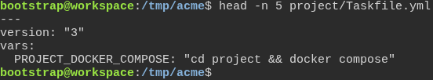
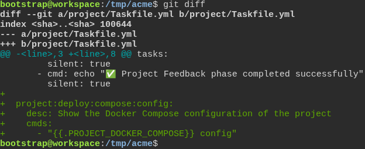
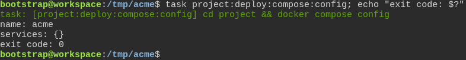

# A team's own task runs Docker Compose through the project Taskfile

**Scenario:** A task the team adds runs Docker Compose through PROJECT\_DOCKER\_COMPOSE

<a name="storyboard-result"></a>

> [!tip] PASSED
> 3 steps · 3 frames

**On this page**

[Result](#storyboard-result) · [Replay and source](#storyboard-replay)

<table width="100%">
<tr>
<th width="50%">

**1. Given a new project's Taskfile names its Docker Compose command at the top**

</th>
<th width="50%">

**2. When the team adds a task of its own that calls PROJECT\_DOCKER\_COMPOSE**

</th>
</tr>
<tr>
<td width="50%" valign="top">

[](../../screenshots/base/02-daily-work/team-compose-task/compose-command-at-the-top.webp)

A new project named acme, generated with every default answer. Its project/Taskfile.yml starts with one variable, before any task: PROJECT\_DOCKER\_COMPOSE, set to "cd project &amp;&amp; docker compose".
Tasks run from the root of the project, so the command first moves into the project folder, where project/docker-compose.yml lives.

<details>
<summary>Command</summary>

```shell
head -n 5 project/Taskfile.yml
```

</details>

</td>
<td width="50%" valign="top">

[](../../screenshots/base/02-daily-work/team-compose-task/team-adds-a-compose-task.webp)

The team adds one task at the end of the same file: project:deploy:compose:config. Its only command is the variable followed by config. git diff shows those lines and nothing else.

<details>
<summary>Command</summary>

```shell
git diff
```

</details>

</td>
</tr>
</table>

<table width="100%">
<tr>
<th width="50%">

**3. Then the team's task runs Docker Compose on the project's own compose file**

</th>
<th width="50%">


</th>
</tr>
<tr>
<td width="50%" valign="top">

[](../../screenshots/base/02-daily-work/team-compose-task/team-task-runs-compose.webp)

task prints the command it built from the variable: cd project &amp;&amp; docker compose config. Docker Compose then prints the configuration it read from project/docker-compose.yml, which starts with "name: acme", the name of the project.
The exit code is 0.

<details>
<summary>Command</summary>

```shell
task project:deploy:compose:config; echo "exit code: $?"
```

</details>

</td>
<td width="50%" valign="top">


</td>
</tr>
</table>

<a name="storyboard-replay"></a>

<details>
<summary>Replay this scenario · source and checks</summary>

```shell
task test -- --grep "@team-compose-task"
```

**Source**

```text
project/tests/e2e/features/02-daily-work/team-compose-task.feature
```

Every frame is its own pixel baseline (tolerance: 0).

</details>
