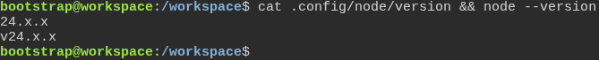

# The test engine runs on the Node version the toolbox pins

**Scenario:** The test image runs the Node version pinned for generated projects

<a name="storyboard-result"></a>

> [!tip] PASSED
> 1 steps · 1 frames

**On this page**

[Result](#storyboard-result) · [Replay and source](#storyboard-replay)

<table width="100%">
<tr>
<th width="50%">

**1. Then the test image runs the Node version the toolbox pins**

</th>
<th width="50%">


</th>
</tr>
<tr>
<td width="50%" valign="top">

[](../../screenshots/base/02-daily-work/test-image-node/node-version.webp)

The first line is the Node version the toolbox pins for the projects it generates. The second is the Node that runs the tests in this image. The picture keeps only the major version, so a patch update from Renovate leaves it unchanged. The test still compares both versions in full.

<details>
<summary>Command</summary>

```shell
cat .config/node/version && node --version
```

</details>

</td>
<td width="50%" valign="top">


</td>
</tr>
</table>

<a name="storyboard-replay"></a>

<details>
<summary>Replay this scenario · source and checks</summary>

```shell
task test -- --grep "@test-image-node"
```

**Source**

```text
project/tests/e2e/features/02-daily-work/test-image-node.feature
```

Every frame is its own pixel baseline (tolerance: 0).

</details>
