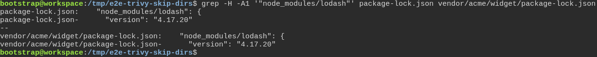
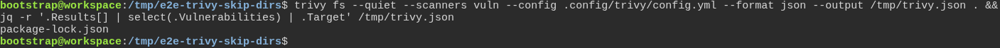
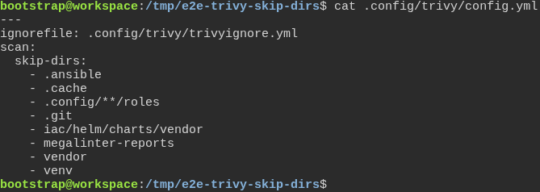

# a freshly generated project passes its own quality gate

**Scenario:** Trivy skips the folders its settings list and still reports the project's own dependencies

<a name="storyboard-result"></a>

> [!tip] PASSED
> 3 steps · 3 frames

**On this page**

[Result](#storyboard-result) · [Replay and source](#storyboard-replay)

<table width="100%">
<tr>
<th width="50%">

**1. Given a generated project holds the same vulnerable lockfile at its root and in a library under vendor/**

</th>
<th width="50%">

**2. When the developer scans the project with Trivy's settings, it reports the root lockfile and skips vendor/**

</th>
</tr>
<tr>
<td width="50%" valign="top">

[](../../screenshots/base/02-daily-work/trivy-skip-dirs/trivy-lockfiles.webp)

A project generated from the toolbox holds the same lockfile twice. package-lock.json, at the root, lists the project's own dependencies. vendor/acme/widget/package-lock.json stands for a library a package manager installed under vendor/. Both pin lodash 4.17.20, a version with a known vulnerability.

<details>
<summary>Command</summary>

```shell
grep -H -A1 '"node_modules/lodash"' package-lock.json vendor/acme/widget/package-lock.json
```

</details>

</td>
<td width="50%" valign="top">

[](../../screenshots/base/02-daily-work/trivy-skip-dirs/trivy-scan.webp)

Trivy scans the project with its settings file and saves what it finds as JSON. jq, a JSON reader, then lists the files in which Trivy found a vulnerability.
There is one: package-lock.json, the project's own lockfile. vendor/acme/widget/package-lock.json pins the same lodash 4.17.20 and is not listed: Trivy skipped the vendor folder.

<details>
<summary>Command</summary>

```shell
trivy fs --quiet --scanners vuln --config .config/trivy/config.yml --format json --output /tmp/trivy.json . && jq -r '.Results[] | select(.Vulnerabilities) | .Target' /tmp/trivy.json
```

</details>

</td>
</tr>
</table>

<table width="100%">
<tr>
<th width="50%">

**3. Then Trivy's settings file lists the folders to skip and still points to the file of accepted findings**

</th>
<th width="50%">


</th>
</tr>
<tr>
<td width="50%" valign="top">

[](../../screenshots/base/02-daily-work/trivy-skip-dirs/trivy-settings.webp)

The settings file MegaLinter hands Trivy. Its scan.skip-dirs list names vendor next to the other folders that hold no code of the project's own, such as .cache, .git and venv. Trivy reads the list from this file.
Its ignorefile line still points Trivy to trivyignore.yml, the file of findings the project accepts.

<details>
<summary>Command</summary>

```shell
cat .config/trivy/config.yml
```

</details>

</td>
<td width="50%" valign="top">


</td>
</tr>
</table>

<a name="storyboard-replay"></a>

<details>
<summary>Replay this scenario · source and checks</summary>

```shell
task test -- --grep "@trivy-skip-dirs"
```

**Source**

```text
project/tests/e2e/features/02-daily-work/quality-gate.feature
```

Every frame is its own pixel baseline (tolerance: 0).

</details>
