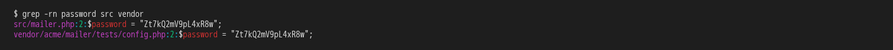
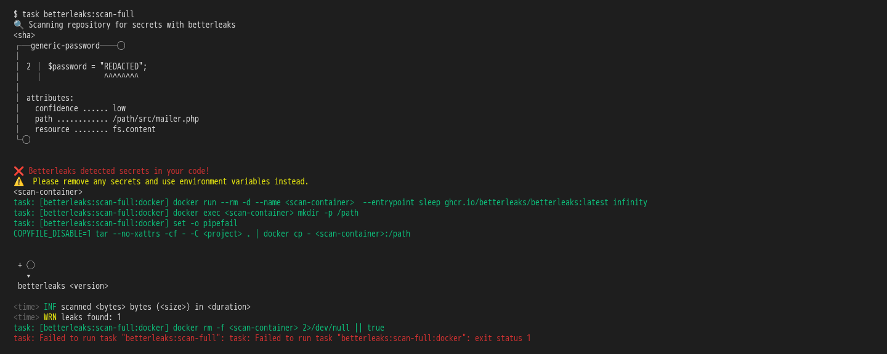
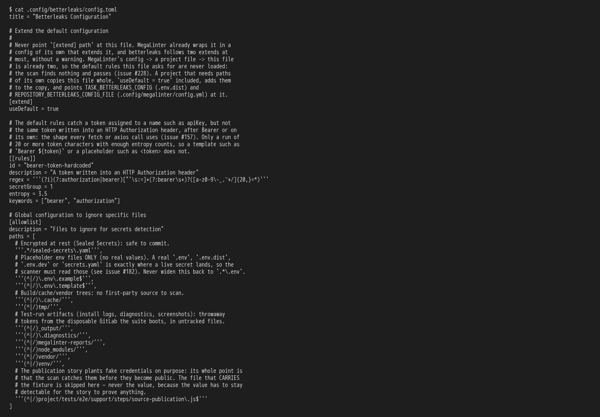

# the framework guards what reaches the repository: clean commits and no secrets

**Scenario:** the full scan skips the libraries under vendor/ and still blocks a password in the project's own code

<a name="storyboard-result"></a>

> [!tip] PASSED
> 3 steps · 3 frames

**On this page**

[Result](#storyboard-result) · [Replay and source](#storyboard-replay)

<table width="100%">
<tr>
<th width="50%">

**1. Given a generated project holds the same made-up password in its own src/ and in a library under vendor/**

</th>
<th width="50%">

**2. When the developer runs the full secret scan, it blocks src/mailer.php and skips vendor/**

</th>
</tr>
<tr>
<td width="50%" valign="top">

[](../../screenshots/base/02-daily-work/vendor-allowlist/vendor-files.webp)

A project generated from the toolbox. vendor/acme/mailer stands for a library that Composer, the PHP package manager, installed there, and one of its test files holds a made-up password. The developer wrote the same line in src/mailer.php.

<details>
<summary>Command</summary>

```shell
grep -rn password src vendor
```

</details>

</td>
<td width="50%" valign="top">

[](../../screenshots/base/02-daily-work/vendor-allowlist/vendor-scan.webp)

The full scan reads every file of the project. It finds the password in src/mailer.php, line 2, prints "REDACTED" where the value was, and fails: "❌ Betterleaks detected secrets in your code!".
The same line under vendor/ is not reported: "leaks found: 1".

<details>
<summary>Command</summary>

```shell
task betterleaks:scan-full
```

</details>

</td>
</tr>
</table>

<table width="100%">
<tr>
<th width="50%">

**3. Then the scan's config lists vendor/ and tells a project allowlist to stand on its own, never to extend it**

</th>
<th width="50%">


</th>
</tr>
<tr>
<td width="50%" valign="top">

[](../../screenshots/base/02-daily-work/vendor-allowlist/vendor-config.webp)

The file every scan of the project reads. Its allowlist, the list of paths the scan skips, names '''(^\|/)vendor/''' with the other folders that hold no code of the project's own.
Above \[extend\], it says how a project adds paths of its own: copy this file whole, then point TASK\_BETTERLEAKS\_CONFIG and REPOSITORY\_BETTERLEAKS\_CONFIG\_FILE at the copy. It also says "Never point \`\[extend\] path\` at this file": MegaLinter already wraps this file, betterleaks follows two extends at most, and the MegaLinter scan would load no rule and pass.

<details>
<summary>Command</summary>

```shell
cat .config/betterleaks/config.toml
```

</details>

</td>
<td width="50%" valign="top">


</td>
</tr>
</table>

<a name="storyboard-replay"></a>

<details>
<summary>Replay this scenario · source and checks</summary>

```shell
task test -- --grep "@vendor-allowlist"
```

**Source**

```text
project/tests/e2e/features/02-daily-work/secret-scans.feature
```

Every frame is its own pixel baseline (tolerance: 0).

</details>
