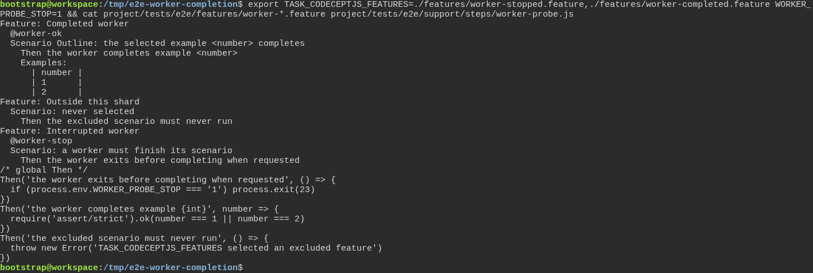
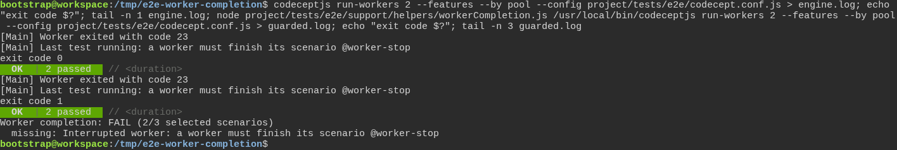
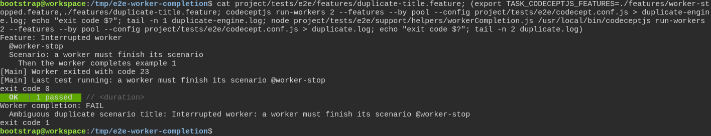
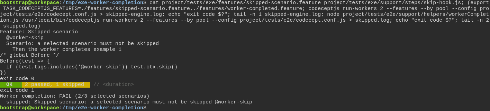
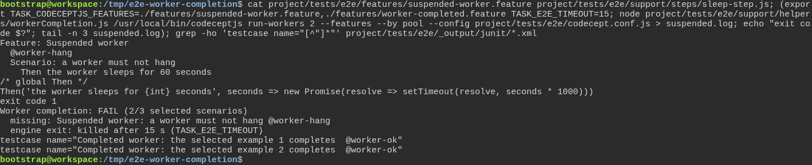
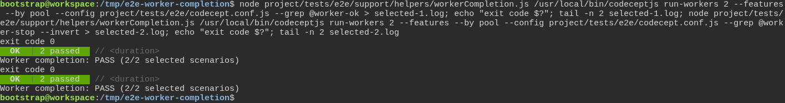

# The toolbox checks the test really failed first, instead of taking anyone's word for it

**Scenario:** Every selected scenario must finish before a parallel run can succeed

<a name="storyboard-result"></a>

> [!tip] PASSED
> 6 steps · 6 frames

**On this page**

[Result](#storyboard-result) · [A worker can disappear before its result exists](#storyboard-chapter-1) · [A run can look complete without being complete](#storyboard-chapter-2) · [A complete selection still passes](#storyboard-chapter-3) · [Replay and source](#storyboard-replay)

<a name="storyboard-chapter-1"></a>

## A worker can disappear before its result exists

<table width="100%">
<tr>
<th width="50%">

**1. Given parallel test files contain an interruptible worker and two completing examples**

</th>
<th width="50%">

**2. When a worker exits early, the engine alone still says OK, and the toolbox guard fails the same run**

</th>
</tr>
<tr>
<td width="50%" valign="top">

[](../../screenshots/base/02-daily-work/worker-completion/worker-completion-setup.webp)

The card shows three test files and one step file of a throwaway copy of the toolbox. One scenario's only step ends its own worker with the code 23 when WORKER\_PROBE\_STOP is 1, the way a crash would. Two examples always pass. The third file, Outside this shard, must never run.
The export selects worker-stopped.feature and worker-completed.feature, the way a CI shard does, and turns the crash on for the rest of the session.

<details>
<summary>Command</summary>

```shell
export TASK_CODECEPTJS_FEATURES=./features/worker-stopped.feature,./features/worker-completed.feature WORKER_PROBE_STOP=1 && cat project/tests/e2e/features/worker-*.feature project/tests/e2e/support/steps/worker-probe.js
```

</details>

</td>
<td width="50%" valign="top">

[](../../screenshots/base/02-daily-work/worker-completion/worker-completion-engine-ok-guard-fails.webp)

The selected scenarios run twice, with two workers. First the engine alone: it loses a worker, "Worker exited with code 23", and still exits with the code 0 after "OK \| 2 passed". A pipeline would call that a success.
Then the line task project:test:e2e really runs: the same engine inside the toolbox's guard. The guard counts 2 of the 3 selected scenarios finished, names the missing one and exits with the code 1.
Off camera, the guard refuses the same way when the interrupted scenario runs alone, and when an earlier successful run left its reports behind: it empties the report folder first.

<details>
<summary>Command</summary>

```shell
codeceptjs run-workers 2 --features --by pool --config project/tests/e2e/codecept.conf.js > engine.log; echo "exit code $?"; tail -n 1 engine.log; node project/tests/e2e/support/helpers/workerCompletion.js /usr/local/bin/codeceptjs run-workers 2 --features --by pool --config project/tests/e2e/codecept.conf.js > guarded.log; echo "exit code $?"; tail -n 3 guarded.log
```

</details>

</td>
</tr>
</table>

<a name="storyboard-chapter-2"></a>

## A run can look complete without being complete

<table width="100%">
<tr>
<th width="50%">

**3. And a copy repeats the name of the interrupted scenario, the engine alone says OK, and the guard refuses the duplicate**

</th>
<th width="50%">

**4. And a hook skips a selected scenario, the engine alone says OK, and the guard refuses the skip**

</th>
</tr>
<tr>
<td width="50%" valign="top">

[](../../screenshots/base/02-daily-work/worker-completion/worker-completion-duplicate-title.webp)

A new file, duplicate-title.feature, repeats the interrupted scenario word for word, but its only step passes. The line runs the interrupted scenario and this copy, with the crash still on.
The engine alone loses its worker again and says "OK \| 1 passed", exit code 0. That one pass belongs to the copy, not to the scenario that crashed.
The guard refuses before anything runs: "Ambiguous duplicate scenario title". Two selected scenarios share one name, so no result could tell which of them finished.

<details>
<summary>Command</summary>

```shell
cat project/tests/e2e/features/duplicate-title.feature; (export TASK_CODECEPTJS_FEATURES=./features/worker-stopped.feature,./features/duplicate-title.feature; codeceptjs run-workers 2 --features --by pool --config project/tests/e2e/codecept.conf.js > duplicate-engine.log; echo "exit code $?"; tail -n 1 duplicate-engine.log; node project/tests/e2e/support/helpers/workerCompletion.js /usr/local/bin/codeceptjs run-workers 2 --features --by pool --config project/tests/e2e/codecept.conf.js > duplicate.log; echo "exit code $?"; tail -n 2 duplicate.log)
```

</details>

</td>
<td width="50%" valign="top">

[](../../screenshots/base/02-daily-work/worker-completion/worker-completion-skipped.webp)

skipped-scenario.feature holds one more scenario, and skip-hook.js a Before hook that skips every scenario tagged @worker-skip, the way a test skips itself when something it needs is missing. The line runs it beside the two examples.
The engine alone says "OK \| 2 passed, 1 skipped" and exits with the code 0. A skipped scenario checked nothing.
The guard counts 2 of the 3 selected scenarios, names the skipped one and exits with the code 1.

<details>
<summary>Command</summary>

```shell
cat project/tests/e2e/features/skipped-scenario.feature project/tests/e2e/support/steps/skip-hook.js; (export TASK_CODECEPTJS_FEATURES=./features/skipped-scenario.feature,./features/worker-completed.feature; codeceptjs run-workers 2 --features --by pool --config project/tests/e2e/codecept.conf.js > skipped-engine.log; echo "exit code $?"; tail -n 1 skipped-engine.log; node project/tests/e2e/support/helpers/workerCompletion.js /usr/local/bin/codeceptjs run-workers 2 --features --by pool --config project/tests/e2e/codecept.conf.js > skipped.log; echo "exit code $?"; tail -n 2 skipped.log)
```

</details>

</td>
</tr>
</table>

<table width="100%">
<tr>
<th width="50%">

**5. And a worker hangs, and the guard stops the run at its time limit and keeps the report already written**

</th>
<th width="50%">


</th>
</tr>
<tr>
<td width="50%" valign="top">

[](../../screenshots/base/02-daily-work/worker-completion/worker-completion-suspended.webp)

The step of suspended-worker.feature sleeps for 60 seconds: its worker stops answering. The line runs it beside the two examples with TASK\_E2E\_TIMEOUT\=15, a limit of 15 seconds for the whole run. Without a value, the limit is 2400 seconds.
At 15 seconds the guard stops the engine: "engine exit: killed after 15 s (TASK\_E2E\_TIMEOUT)". It counts 2 of the 3 selected scenarios, names the one that hung and exits with the code 1.
The report the other worker wrote stays on disk for whoever investigates: the last two lines are its two examples. Off camera, the guard fails the same way when a step kills the whole engine.

<details>
<summary>Command</summary>

```shell
cat project/tests/e2e/features/suspended-worker.feature project/tests/e2e/support/steps/sleep-step.js; (export TASK_CODECEPTJS_FEATURES=./features/suspended-worker.feature,./features/worker-completed.feature TASK_E2E_TIMEOUT=15; node project/tests/e2e/support/helpers/workerCompletion.js /usr/local/bin/codeceptjs run-workers 2 --features --by pool --config project/tests/e2e/codecept.conf.js > suspended.log; echo "exit code $?"; tail -n 3 suspended.log); grep -ho 'testcase name="[^"]*"' project/tests/e2e/_output/junit/*.xml
```

</details>

</td>
<td width="50%" valign="top">


</td>
</tr>
</table>

<a name="storyboard-chapter-3"></a>

## A complete selection still passes

<table width="100%">
<tr>
<th width="50%">

**6. Then complete selections pass with either a grep filter or its inverse**

</th>
<th width="50%">


</th>
</tr>
<tr>
<td width="50%" valign="top">

[](../../screenshots/base/02-daily-work/worker-completion/worker-completion-selected.webp)

The guard follows the real selection, not every scenario of the repository. A grep on the two examples passes, 2 of 2, and so does the inverse grep that leaves the interrupted scenario out.
The interrupted scenario is never selected, so no worker stops, and the third file stays out as the export said.

<details>
<summary>Command</summary>

```shell
node project/tests/e2e/support/helpers/workerCompletion.js /usr/local/bin/codeceptjs run-workers 2 --features --by pool --config project/tests/e2e/codecept.conf.js --grep @worker-ok; node project/tests/e2e/support/helpers/workerCompletion.js /usr/local/bin/codeceptjs run-workers 2 --features --by pool --config project/tests/e2e/codecept.conf.js --grep @worker-stop --invert
```

</details>

</td>
<td width="50%" valign="top">


</td>
</tr>
</table>

<a name="storyboard-replay"></a>

<details>
<summary>Replay this scenario · source and checks</summary>

```shell
task test -- --grep "@worker-completion"
```

**Source**

```text
project/tests/e2e/features/02-daily-work/tdd-cycle-reports.feature
```

Every frame is its own pixel baseline (tolerance: 0).

</details>
