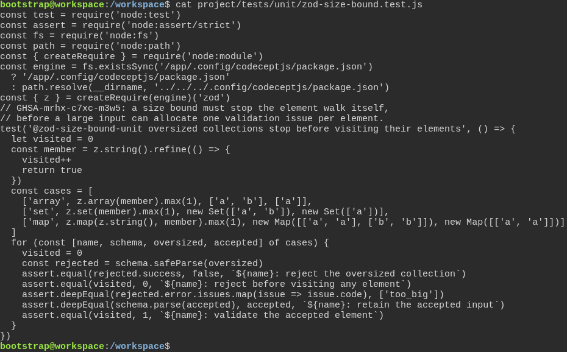
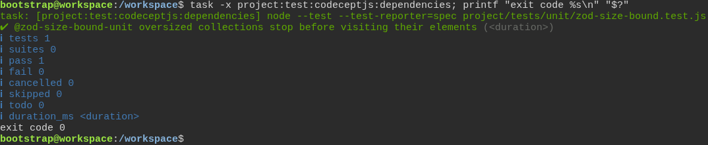

# The test engine rejects oversized collections before parsing their elements

**Scenario:** The installed Zod rejects oversized arrays, sets and maps before visiting their elements

<a name="storyboard-result"></a>

> [!tip] PASSED
> 2 steps · 2 frames

**On this page**

[Result](#storyboard-result) · [Replay and source](#storyboard-replay)

<table width="100%">
<tr>
<th width="50%">

**1. Given the test engine has a regression for collection size limits and accepted values**

</th>
<th width="50%">

**2. Then the installed test engine passes the collection size regression**

</th>
</tr>
<tr>
<td width="50%" valign="top">

[](../../screenshots/base/02-daily-work/zod-size-bound/collection-specification.webp)

The real regression test counts element validations. For arrays, sets and maps, an oversized collection must be rejected with no element visited. A collection inside the limit must still validate its member and preserve its value.

<details>
<summary>Command</summary>

```shell
cat project/tests/unit/zod-size-bound.test.js
```

</details>

</td>
<td width="50%" valign="top">

[](../../screenshots/base/02-daily-work/zod-size-bound/collection-result.webp)

The task runs the regression against the Zod installed in this test image. The passing test proves both rejection before element traversal and validation of accepted values. Only measured execution times are hidden.

<details>
<summary>Command</summary>

```shell
task -x project:test:codeceptjs:dependencies
```

</details>

</td>
</tr>
</table>

<a name="storyboard-replay"></a>

<details>
<summary>Replay this scenario · source and checks</summary>

```shell
task test -- --grep "@zod-size-bound"
```

**Source**

```text
project/tests/e2e/features/02-daily-work/dependency-safety.feature
```

Every frame is its own pixel baseline (tolerance: 0).

</details>
