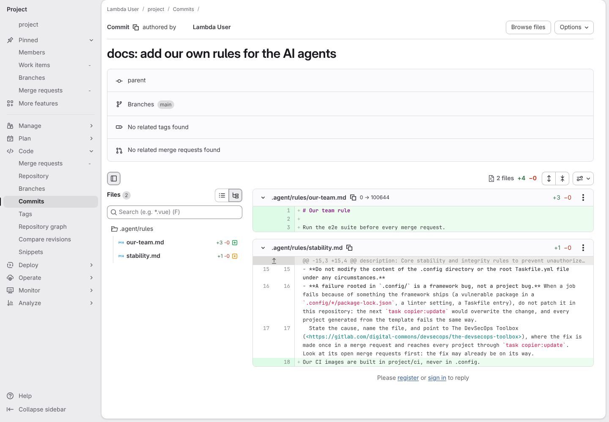
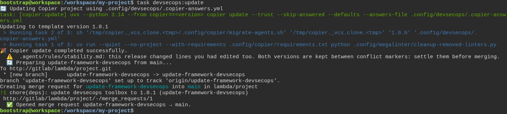
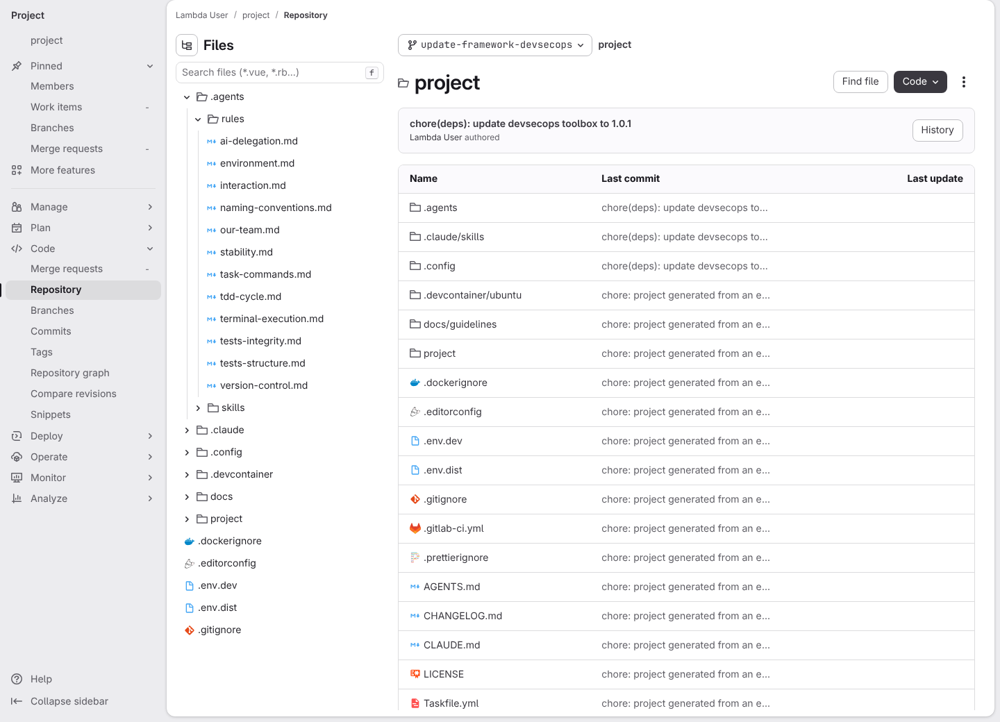
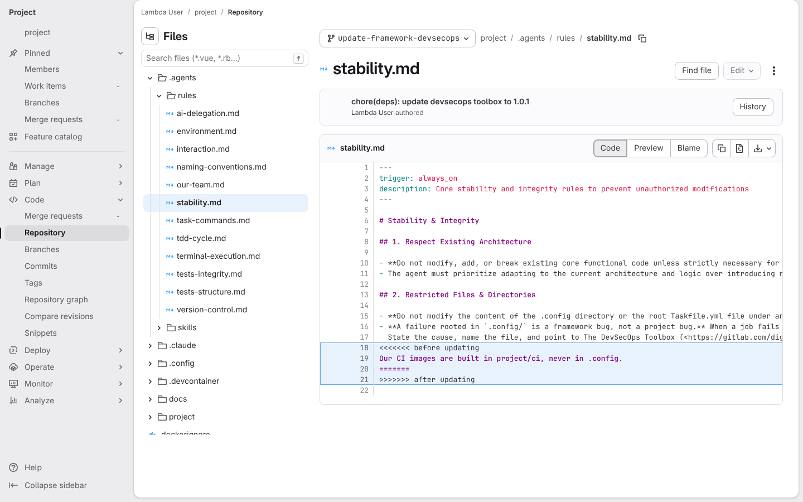

# A toolbox release changes a line I edited myself, and the update merge request shows both

**Scenario:** a toolbox update moves the AI agent files to .agents and keeps the team's own work

<a name="storyboard-result"></a>

> [!tip] PASSED
> 4 steps · 4 frames

**On this page**

[Result](#storyboard-result) · [The team's work sits in the old .agent folder](#storyboard-chapter-1) · [The release moves the folder, and only the team's edit is left to settle](#storyboard-chapter-2) · [Replay and source](#storyboard-replay)

<a name="storyboard-chapter-1"></a>

## The team's work sits in the old .agent folder

<table width="100%">
<tr>
<th width="50%">

**1. Given the team added a rule of its own and a line to a toolbox rule in the old .agent folder, on the main branch**

</th>
<th width="50%">


</th>
</tr>
<tr>
<td width="50%" valign="top">

[](../../screenshots/base/03-evolution/agents-move/team-commit.webp)

The project came from toolbox release 1.0.0, which kept the AI agent files in a folder named .agent, without the s. The developer adds a rule of the team's own, .agent/rules/our-team.md, and one line to a toolbox rule, .agent/rules/stability.md, then pushes the commit to the main branch.
GitLab's page for that commit, "docs: add our own rules for the AI agents": the new file and the added line, in green.

<details>
<summary>Command</summary>

```shell
printf '# Our team rule\n\nRun the e2e suite before every merge request.\n' > .agent/rules/our-team.md && echo 'Our CI images are built in project/ci, never in .config.' >> .agent/rules/stability.md && git add -A && git commit -qm "docs: add our own rules for the AI agents" && git push -q
```

</details>

</td>
<td width="50%" valign="top">


</td>
</tr>
</table>

<a name="storyboard-chapter-2"></a>

## The release moves the folder, and only the team's edit is left to settle

<table width="100%">
<tr>
<th width="50%">

**2. When the developer runs the toolbox update to the release that moves the AI agent files to .agents**

</th>
<th width="50%">

**3. Then GitLab shows the team's rule in .agents/rules on the update branch, and no .agent folder left**

</th>
</tr>
<tr>
<td width="50%" valign="top">

[](../../screenshots/base/03-evolution/agents-move/update-run.webp)

Release 1.0.1 moves the AI agent files to .agents, the folder AI tools read today, and adds a line to two toolbox rules the team never touched. The developer asks for it with one command, from the main branch.
Copier first runs the release's migration, migrate-agents.sh: a toolbox file the team never changed is removed, so the release writes it fresh in .agents, and every other file moves there with git. One warning follows, for .agents/rules/stability.md and no other file. The update then opens merge request !1.

<details>
<summary>Command</summary>

```shell
task devsecops:update
```

</details>

</td>
<td width="50%" valign="top">

[](../../screenshots/base/03-evolution/agents-move/update-branch.webp)

GitLab's page for the update branch, update-framework-devsecops, the Files panel open on .agents and its rules: our-team.md moved there, next to the toolbox rules.
The table lists .agents and .claude/skills, and no .agent folder is left. .agents holds rules and skills only: the eight step-by-step guides of release 1.0.0 came back as skills.

</td>
</tr>
</table>

<table width="100%">
<tr>
<th width="50%">

**4. And the team's line in that toolbox rule waits between conflict markers in the rule's new place**

</th>
<th width="50%">


</th>
</tr>
<tr>
<td width="50%" valign="top">

[](../../screenshots/base/03-evolution/agents-move/conflict-in-moved-rule.webp)

The page of .agents/rules/stability.md on the update branch, the conflict highlighted. The release did not change this rule, it moved it, so Copier cannot tell the team's line from the toolbox's copy.
The team's line waits under "&lt;&lt;&lt;&lt;&lt;&lt;&lt; before updating", for the developer to keep or drop before merging. Nothing was lost.

</td>
<td width="50%" valign="top">


</td>
</tr>
</table>

<a name="storyboard-replay"></a>

<details>
<summary>Replay this scenario · source and checks</summary>

```shell
task test -- --grep "@agents-move"
```

**Source**

```text
project/tests/e2e/features/03-evolution/update-conflict.feature
```

Every frame is its own pixel baseline (tolerance: 0).

</details>
