# Choose a runner according to the work a job does

**Scenario:** Generate a self-hosted project with separate runners for checks and Docker

<a name="storyboard-result"></a>

> [!tip] PASSED
> 11 steps · 11 frames

**On this page**

[Result](#storyboard-result) · [Choose the Docker runners](#storyboard-chapter-1) · [Add the application](#storyboard-chapter-2) · [Run the checks on real runners](#storyboard-chapter-3) · [Keep the project settings through an update](#storyboard-chapter-4) · [Containers keep their own runner](#storyboard-chapter-5) · [GitLab reads the test results](#storyboard-chapter-6) · [Replay and source](#storyboard-replay)

<a name="storyboard-chapter-1"></a>

## Choose the Docker runners

<table width="100%">
<tr>
<th width="50%">

**1. Given I generate a self-hosted project using the saas-linux-medium-amd64 Docker runner tag and push it to GitLab**

</th>
<th width="50%">


</th>
</tr>
<tr>
<td width="50%" valign="top">

[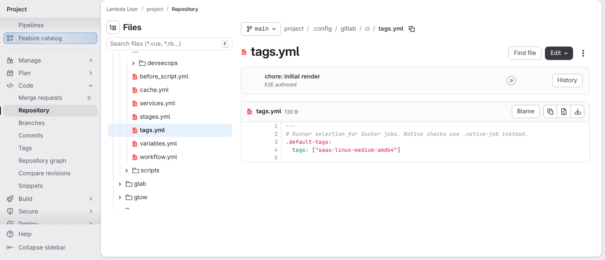](../../screenshots/base/03-evolution/hybrid-ci/docker-runner-selection.webp)

GitLab's page for .config/gitlab/ci/tags.yml on the main branch of the generated project. The file keeps the runner tag given to Copier, \["saas-linux-medium-amd64"\], and its comment says who uses it: "Runner selection for Docker jobs. Native checks use .native-job instead."
The project's random name shows as "project". Its only commit is "chore: initial render".

<details>
<summary>Command</summary>

```shell
http://gitlab/<lambda-user>/<project>/-/blob/main/.config/gitlab/ci/tags.yml
```

</details>

</td>
<td width="50%" valign="top">


</td>
</tr>
</table>

<a name="storyboard-chapter-2"></a>

## Add the application

<table width="100%">
<tr>
<th width="50%">

**2. When I open a merge request that adds the web application, its own lint settings and two deliberate mistakes**

</th>
<th width="50%">


</th>
</tr>
<tr>
<td width="50%" valign="top">

[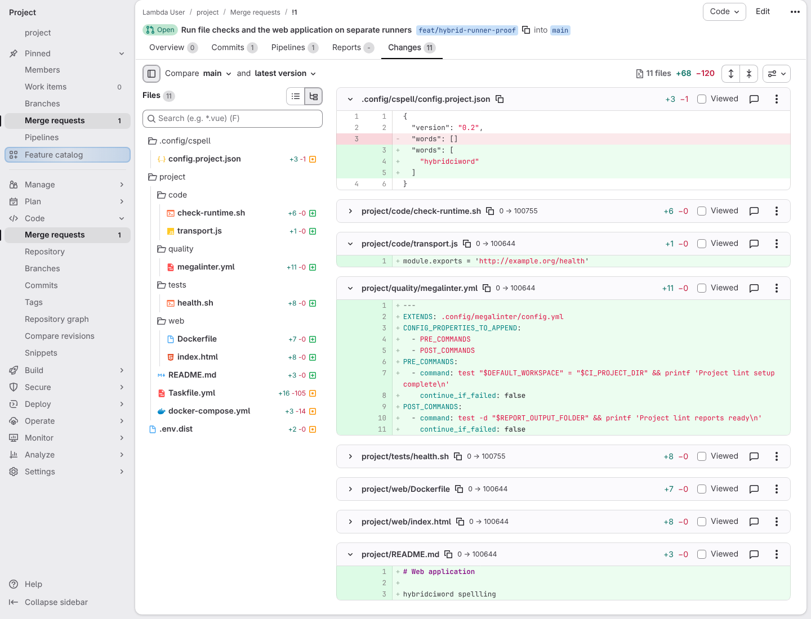](../../screenshots/base/03-evolution/hybrid-ci/merge-request-changes.webp)

The merge request's Changes tab. The file tree lists the 11 files it adds or changes, and .gitlab-ci.yml is not one of them: the web application runs on the generated pipeline as it is.
The web application's plumbing is folded to its file names. The open diffs give the project dictionary .config/cspell/config.project.json its own word, "hybridciword", and add the project's own lint settings in project/quality/megalinter.yml. project/code/transport.js holds the first deliberate mistake, an http URL. project/README.md holds the second, the misspelled word "spellling".

<details>
<summary>Command</summary>

```shell
http://gitlab/<lambda-user>/<project>/-/merge_requests/1/diffs
```

</details>

</td>
<td width="50%" valign="top">


</td>
</tr>
</table>

<a name="storyboard-chapter-3"></a>

## Run the checks on real runners

<table width="100%">
<tr>
<th width="50%">

**3. When the project gets an unprivileged runner for file checks and a Docker runner for containers**

</th>
<th width="50%">

**4. Then MegaLinter starts directly in its own image on the unprivileged runner**

</th>
</tr>
<tr>
<td width="50%" valign="top">

[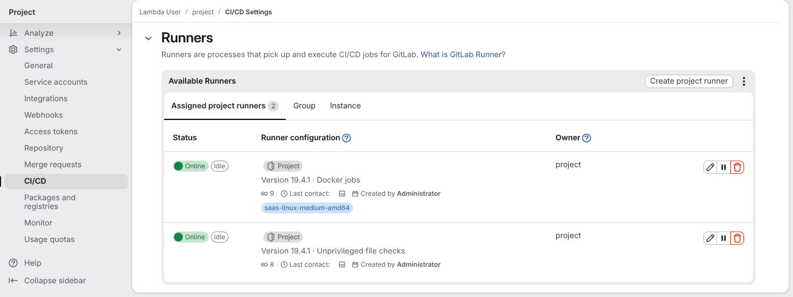](../../screenshots/base/03-evolution/hybrid-ci/project-runners.webp)

Settings, CI/CD, Runners, once the merge request pipeline has run. The project has two runners of its own: "Docker jobs" with the saas-linux-medium-amd64 tag, and "Unprivileged file checks" with no tag. The job counters read 9 for "Docker jobs" and 8 for "Unprivileged file checks": 17 of the pipeline's 18 jobs ran, and code:all, the 18th, was skipped.

<details>
<summary>Command</summary>

```shell
http://gitlab/<lambda-user>/<project>/-/settings/ci_cd
```

</details>

</td>
<td width="50%" valign="top">

[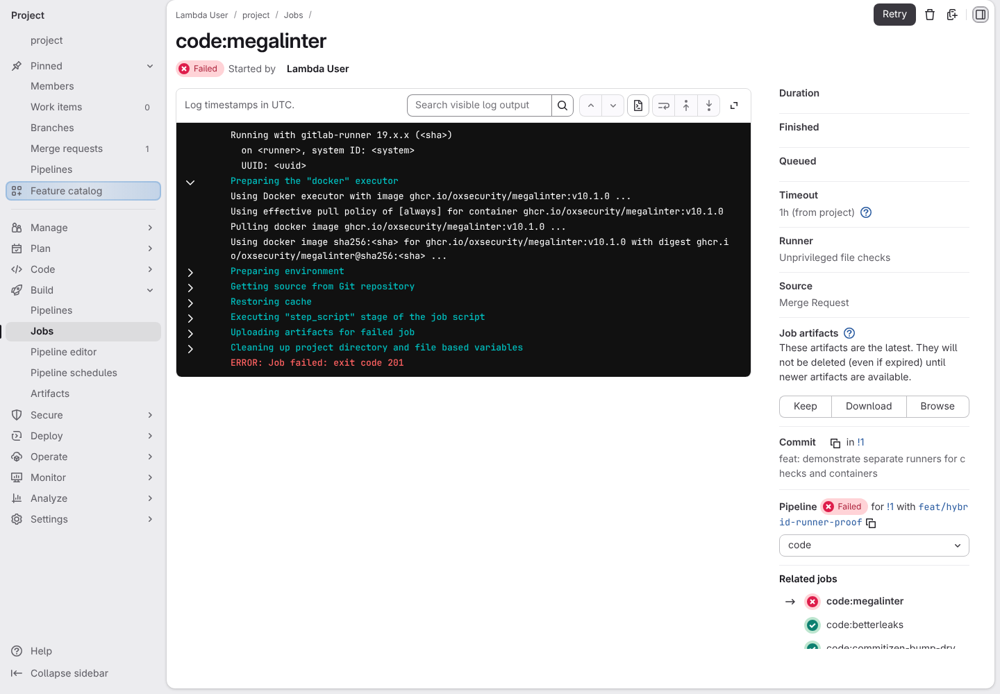](../../screenshots/base/03-evolution/hybrid-ci/megalinter-direct-image.webp)

The code:megalinter job of that pipeline. Its open section, "Preparing the "docker" executor", says "Using Docker executor with image ghcr.io/oxsecurity/megalinter": the check runs straight in MegaLinter's image, and no Docker service starts. The side panel names the runner: Unprivileged file checks.
Under "Related jobs", code:megalinter is the only red one. Commitlint and the other file checks passed, and code:all, which waits for them all, was skipped.

<details>
<summary>Command</summary>

```shell
http://gitlab/<lambda-user>/<project>/-/jobs/<code:megalinter job>
```

</details>

</td>
</tr>
</table>

<table width="100%">
<tr>
<th width="50%">

**5. And MegaLinter rejects the misspelled word and the insecure URL and keeps its reports**

</th>
<th width="50%">

**6. And code:all does not claim the checks passed while MegaLinter is red**

</th>
</tr>
<tr>
<td width="50%" valign="top">

[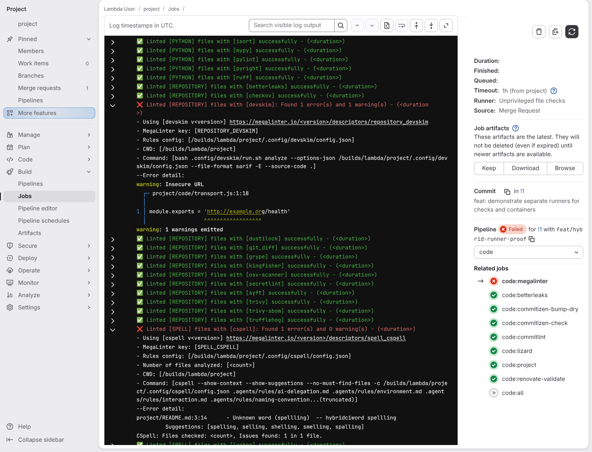](../../screenshots/base/03-evolution/hybrid-ci/megalinter-rejects-mistake.webp)

The same job further down its log, with two MegaLinter sections open. devskim reports "warning: Insecure URL" at project/code/transport.js:1:18. cspell reports "Unknown word (spellling)" in project/README.md, and does not flag "hybridciword", the project's own word.
The job failed, and its side panel still offers the reports under "Job artifacts".

</td>
<td width="50%" valign="top">

[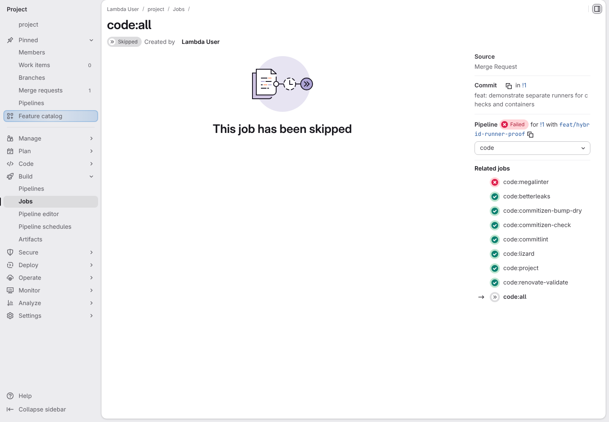](../../screenshots/base/03-evolution/hybrid-ci/code-all-skipped-while-megalinter-fails.webp)

GitLab's page for code:all in the same pipeline, the job that waits for every code check and then prints "All code checks passed." MegaLinter failed, so GitLab never started it: "This job has been skipped".
Under "Related jobs", code:megalinter is red and code:all shows GitLab's grey skipped icon. A job whose only message is "All code checks passed." no longer goes green while one of those checks is red.

<details>
<summary>Command</summary>

```shell
http://gitlab/<lambda-user>/<project>/-/jobs/<code:all job>
```

</details>

</td>
</tr>
</table>

<a name="storyboard-chapter-4"></a>

## Keep the project settings through an update

<table width="100%">
<tr>
<th width="50%">

**7. When I update the project through Copier and correct both mistakes in the same merge request**

</th>
<th width="50%">

**8. Then MegaLinter passes on the unprivileged runner and accepts both corrections**

</th>
</tr>
<tr>
<td width="50%" valign="top">

[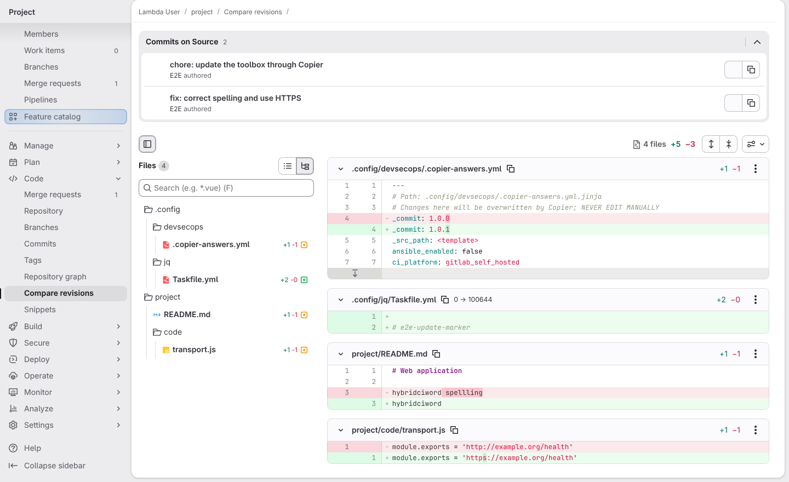](../../screenshots/base/03-evolution/hybrid-ci/copier-preserves-project-settings.webp)

GitLab's Compare revisions page, from the commit the merge request opened with to the branch after the next push. That push brought two commits: "chore: update the toolbox through Copier" and "fix: correct spelling and use HTTPS".
Only four files changed. In .copier-answers.yml, \_commit moves from 1.0.0 to 1.0.1, and the toolbox's own .config/jq/Taskfile.yml gains the line "\# e2e-update-marker". The README and transport.js carry the two fixes. The runner tag, the project dictionary and the lint settings are not in the list: Copier kept them.

<details>
<summary>Command</summary>

```shell
http://gitlab/<lambda-user>/<project>/-/compare/<before the push>...<after the push>
```

</details>

</td>
<td width="50%" valign="top">

[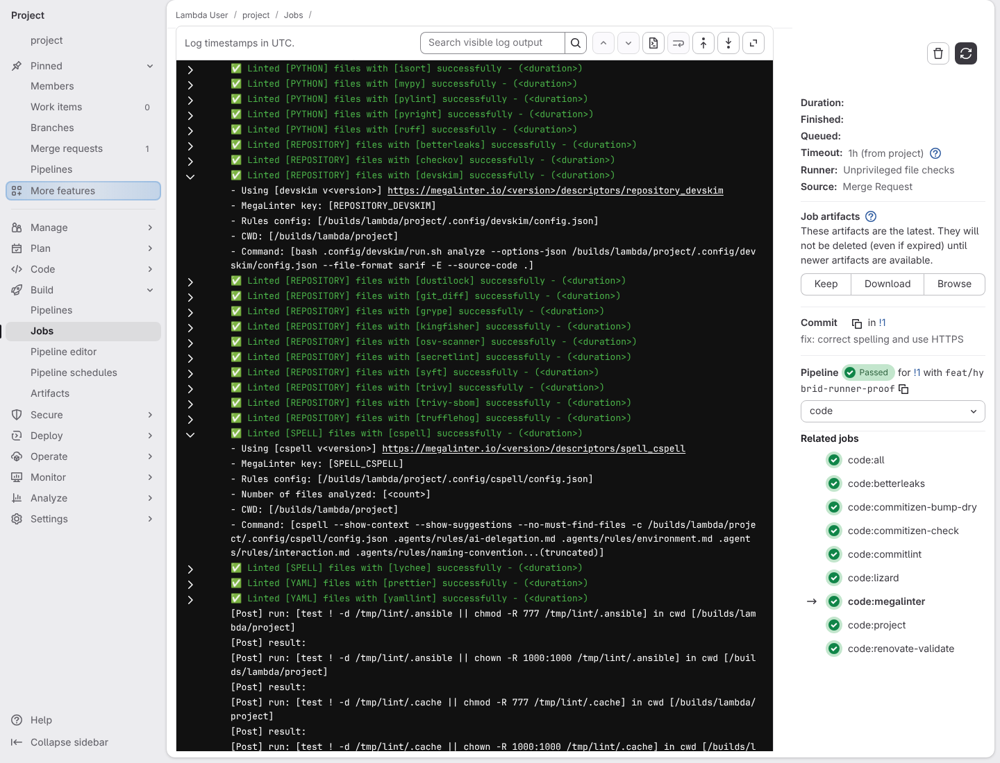](../../screenshots/base/03-evolution/hybrid-ci/megalinter-passes-directly.webp)

The code:megalinter job of the new pipeline, seen from the same place in its log. devskim and cspell now pass, with the project's own word "hybridciword" still in the README, as the compare page above shows: the project dictionary came through the update. The reports are kept again under "Job artifacts", and the runner is still Unprivileged file checks.

<details>
<summary>Command</summary>

```shell
http://gitlab/<lambda-user>/<project>/-/jobs/<code:megalinter job>
```

</details>

</td>
</tr>
</table>

<table width="100%">
<tr>
<th width="50%">

**9. And code:all now reports that every code check passed**

</th>
<th width="50%">


</th>
</tr>
<tr>
<td width="50%" valign="top">

[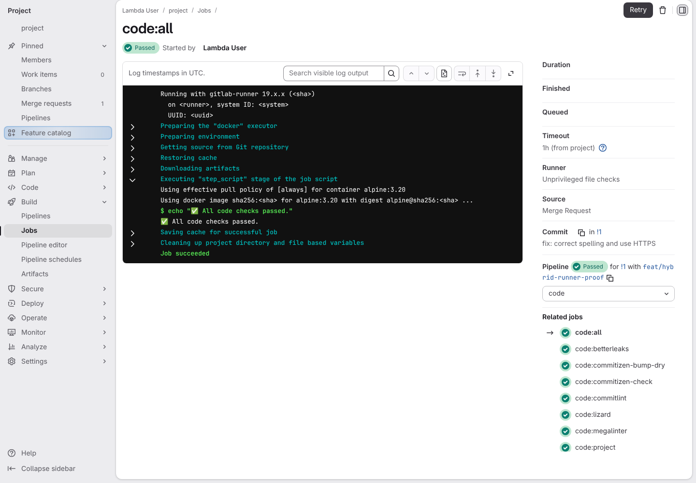](../../screenshots/base/03-evolution/hybrid-ci/code-all-passes-once-every-check-passed.webp)

The same code:all page in the new pipeline. Every code check passed, so GitLab ran code:all this time: its log prints "All code checks passed." and GitLab marks the job Passed. Under "Related jobs", every code check is green, code:megalinter included.

<details>
<summary>Command</summary>

```shell
http://gitlab/<lambda-user>/<project>/-/jobs/<code:all job>
```

</details>

</td>
<td width="50%" valign="top">


</td>
</tr>
</table>

<a name="storyboard-chapter-5"></a>

## Containers keep their own runner

<table width="100%">
<tr>
<th width="50%">

**10. And the Docker runner builds and tests the web application**

</th>
<th width="50%">


</th>
</tr>
<tr>
<td width="50%" valign="top">

[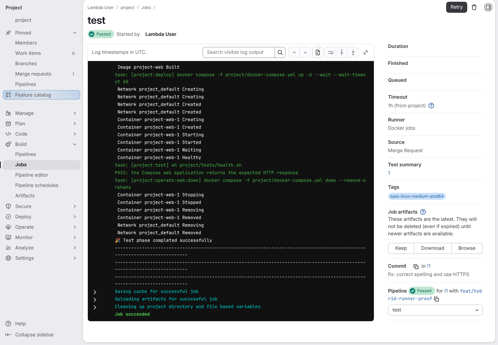](../../screenshots/base/03-evolution/hybrid-ci/docker-web-application.webp)

The test job of the same pipeline. Its side panel says "Runner: Docker jobs" and "Tags: saas-linux-medium-amd64". Its log starts the web application with Docker Compose, checks it and prints "PASS: the Compose web application returns the expected HTTP response".
The side panel also reads "Test summary: 1": GitLab counted that check, as the next card shows.

<details>
<summary>Command</summary>

```shell
http://gitlab/<lambda-user>/<project>/-/jobs/<test job>
```

</details>

</td>
<td width="50%" valign="top">


</td>
</tr>
</table>

<a name="storyboard-chapter-6"></a>

## GitLab reads the test results

<table width="100%">
<tr>
<th width="50%">

**11. And GitLab lists the web application's test on the pipeline's Tests tab**

</th>
<th width="50%">


</th>
</tr>
<tr>
<td width="50%" valign="top">

[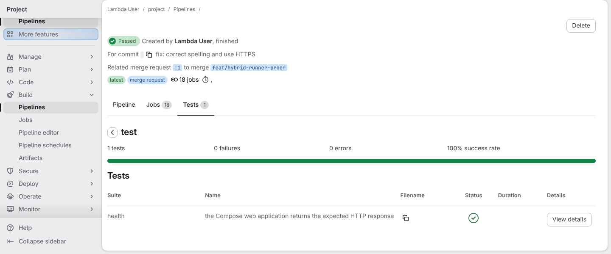](../../screenshots/base/03-evolution/hybrid-ci/gitlab-test-results.webp)

The same pipeline's Tests tab, open on the suite GitLab names after the job, "test". The health check of the card above also wrote its result as a JUnit report, project/tests/\_output/junit/health.xml, and the test job handed it to GitLab.
GitLab reads "1 tests", "0 failures", "0 errors" and "100% success rate", then lists the check by its name, "the Compose web application returns the expected HTTP response", with a green tick. The test job hands GitLab every JUnit file the tests leave in an \_output/junit folder under project/.

<details>
<summary>Command</summary>

```shell
http://gitlab/<lambda-user>/<project>/-/pipelines/<pipeline>/test_report
```

</details>

</td>
<td width="50%" valign="top">


</td>
</tr>
</table>

<a name="storyboard-replay"></a>

<details>
<summary>Replay this scenario · source and checks</summary>

```shell
task test -- --grep "@hybrid-ci"
```

**Source**

```text
project/tests/e2e/features/03-evolution/hybrid-ci.feature
```

Every frame is its own pixel baseline (tolerance: 0).

</details>
