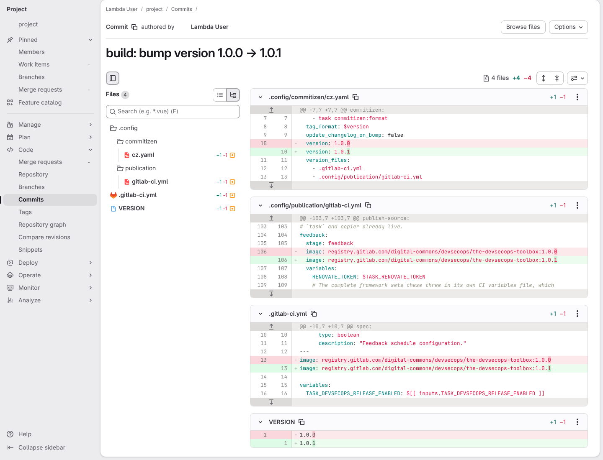

# A toolbox release moves its CI files to the new toolbox image

**Scenario:** A toolbox version bump moves both of its CI files to the new toolbox image

<a name="storyboard-result"></a>

> [!tip] PASSED
> 1 steps · 1 frames

**On this page**

[Result](#storyboard-result) · [Replay and source](#storyboard-replay)

<table width="100%">
<tr>
<th width="50%">

**1. Then GitLab shows the version bump moving the full pipeline and the publication update job to the new toolbox image**

</th>
<th width="50%">


</th>
</tr>
<tr>
<td width="50%" valign="top">

[](../../screenshots/base/03-evolution/publication-ci-version/framework-image-version.webp)

Off camera, a throwaway copy of the toolbox, set to release 1.0.0 in its four version places so the picture never moves when the toolbox releases. One fix commit lands on its main branch, then the version bump that task release runs, here without the changelog. Before bumping, commitizen checks that both image lines hold 1.0.0, and refuses otherwise.
On screen, the bump commit as GitLab received it. The image line of .gitlab-ci.yml, the full pipeline, and the one of .config/publication/gitlab-ci.yml, the publication update job, move from 1.0.0 to 1.0.1, together with VERSION and cz.yaml.

<details>
<summary>Command</summary>

```shell
task commitizen:bump TASK_COMMITIZEN_BUMP_YES=true TASK_COMMITIZEN_BUMP_DRY_RUN=false
```

</details>

</td>
<td width="50%" valign="top">


</td>
</tr>
</table>

<a name="storyboard-replay"></a>

<details>
<summary>Replay this scenario · source and checks</summary>

```shell
task test -- --grep "@publication-ci-version"
```

**Source**

```text
project/tests/e2e/features/03-evolution/version-pins.feature
```

Every frame is its own pixel baseline (tolerance: 0).

</details>
