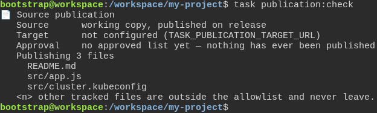
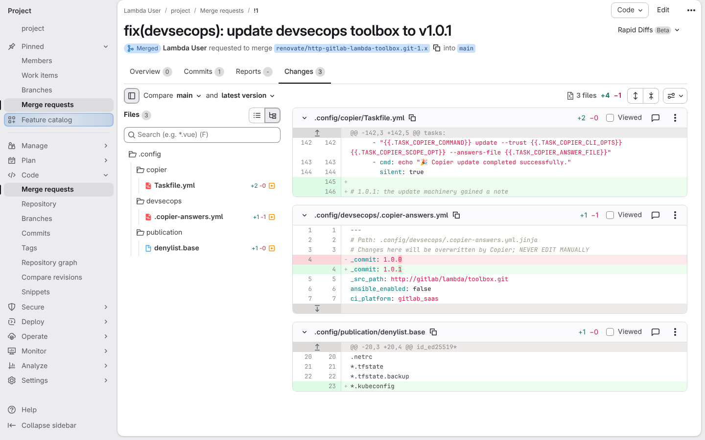
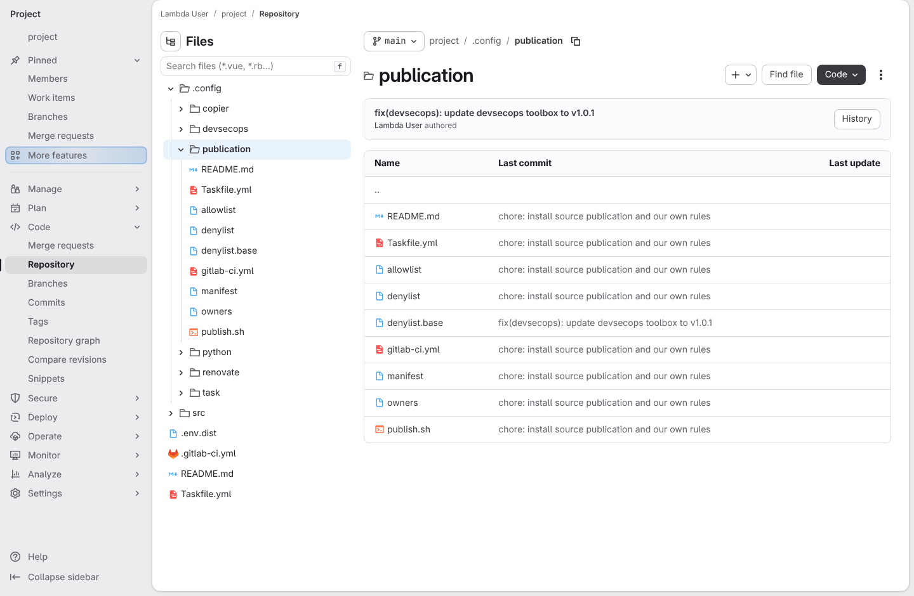
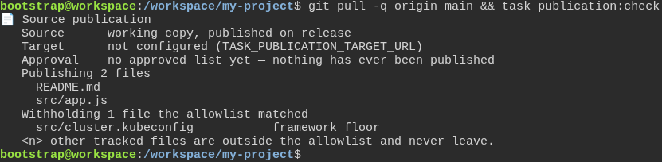

# A toolbox release reaches a project that installed only source publication

**Scenario:** the release updates the component and its spine, spares the team's rules, and brings nothing else

<a name="storyboard-result"></a>

> [!tip] PASSED
> 5 steps · 5 frames

**On this page**

[Result](#storyboard-result) · [Replay and source](#storyboard-replay)

<table width="100%">
<tr>
<th width="50%">

**1. Given a project on GitLab that installed source publication and nothing else**

</th>
<th width="50%">

**2. And what it would publish today, cluster credential included**

</th>
</tr>
<tr>
<td width="50%" valign="top">

[](../../screenshots/base/03-evolution/publication-update/update-before.webp)

GitLab's page for the folder .config/publication on the main branch. The Files panel on the left shows the whole project: .config holds only copier, devsecops, publication, python, renovate and task. There is no linter, no container tooling and no forge tooling.
The table lists the nine publication files. All of them, the team's own allowlist and owners included, sit on the team's commit "chore: install source publication and our own rules". Remember this page: the story comes back to it after the update.

<details>
<summary>Command</summary>

```shell
http://gitlab/<lambda-user>/<project>/-/tree/main/.config/publication
```

</details>

</td>
<td width="50%" valign="top">

[](../../screenshots/base/03-evolution/publication-update/update-check-before.webp)

The terminal, in the team's clone of that project. task publication:check lists what a release would publish today: "Publishing 3 files", and the third one is src/cluster.kubeconfig, a cluster credential that nobody thought to deny.
Remember this answer. The last card runs the same check again, and nobody touches a single rule in between.

<details>
<summary>Command</summary>

```shell
task publication:check
```

</details>

</td>
</tr>
</table>

<table width="100%">
<tr>
<th width="50%">

**3. When the feedback task runs, Renovate opens a merge request that applies the new release, and that merge request goes into the main branch**

</th>
<th width="50%">

**4. Then on the main branch the team's rules keep their own commit, and nothing the project never installed arrives**

</th>
</tr>
<tr>
<td width="50%" valign="top">

[](../../screenshots/base/03-evolution/publication-update/update-merge-request.webp)

The story runs task feedback, the phase GitLab's nightly schedule runs. Renovate reads the release recorded in the answers file, finds 1.0.1 on the template and opens this merge request by itself: "fix(devsecops): update devsecops toolbox to v1.0.1", from a renovate branch into the main branch. Renovate works with Lambda User's token, so GitLab names Lambda User as the author. The badge says Merged.
Renovate applied the release inside the merge request, so its Changes tab is the update itself. Three files, all three the framework's own: the update machinery in .config/copier/Taskfile.yml, the recorded release going from 1.0.0 to 1.0.1, and the publication floor in denylist.base, which gains the line \*.kubeconfig.

<details>
<summary>Command</summary>

```shell
task feedback
```

</details>

</td>
<td width="50%" valign="top">

[](../../screenshots/base/03-evolution/publication-update/update-after.webp)

The same page as the first card, after the merge. One row moved: denylist.base now sits on Renovate's commit "fix(devsecops): update devsecops toolbox to v1.0.1", the commit named in the box above the table.
allowlist and owners, the rules the team wrote, still sit on the team's commit. Copier compares the old release, the new release and the project, so it changes what the release changed and leaves the team's files alone. The Files panel still shows the same six folders in .config: the release also changed a tool this project never installed, and that change did not arrive.

<details>
<summary>Command</summary>

```shell
http://gitlab/<lambda-user>/<project>/-/tree/main/.config/publication
```

</details>

</td>
</tr>
</table>

<table width="100%">
<tr>
<th width="50%">

**5. And after a pull, the tightened floor from that release is already in force**

</th>
<th width="50%">


</th>
</tr>
<tr>
<td width="50%" valign="top">

[](../../screenshots/base/03-evolution/publication-update/update-check-after.webp)

Back in the same terminal, one line pulls the main branch and runs the same check as the second card. src/cluster.kubeconfig has moved under "Withholding 1 file", held back by the "framework floor", because the release added \*.kubeconfig to that floor.
Nobody edited a list. The project got a tighter safety floor from the release itself, which is why a component that cannot be updated is worse than no component.

<details>
<summary>Command</summary>

```shell
git pull -q origin main && task publication:check
```

</details>

</td>
<td width="50%" valign="top">


</td>
</tr>
</table>

<a name="storyboard-replay"></a>

<details>
<summary>Replay this scenario · source and checks</summary>

```shell
task test -- --grep "@publication-update"
```

**Source**

```text
project/tests/e2e/features/03-evolution/publication-update.feature
```

Every frame is its own pixel baseline (tolerance: 0).

</details>
