# Template rendering matrix, every Copier answer renders the expected project

**Scenario:** the default render is canonical, and each answer changes exactly what it promises

<a name="storyboard-result"></a>

> [!tip] PASSED
> 15 steps · 15 frames

**On this page**

[Result](#storyboard-result) · [What the default project looks like on GitLab](#storyboard-chapter-1) · [The default project passes its own YAML linter](#storyboard-chapter-2) · [Each answer changes exactly what it promises, one branch per answer](#storyboard-chapter-3) · [The default project keeps every fix of the toolbox's own files](#storyboard-chapter-4) · [Replay and source](#storyboard-replay)

<a name="storyboard-chapter-1"></a>

## What the default project looks like on GitLab

<table width="100%">
<tr>
<th width="50%">

**1. Given GitLab holds a project rendered with every default Copier answer on its main branch**

</th>
<th width="50%">

**2. Then the main branch carries the project workspace and leaves the toolbox README out**

</th>
</tr>
<tr>
<td width="50%" valign="top">

[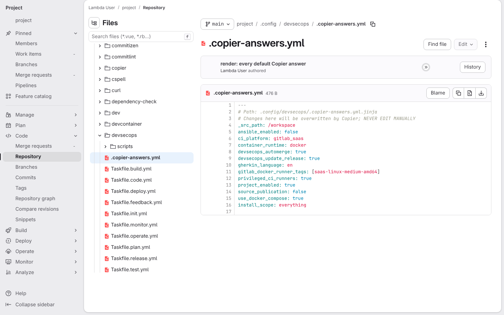](../../screenshots/base/03-evolution/render-matrix/defaults-answers.webp)

The working-branch template rendered with every default answer, then pushed as the main branch of a new GitLab project. GitLab shows the answers file Copier wrote: container\_runtime: docker, use\_docker\_compose: true, ansible\_enabled: false, ci\_platform: gitlab\_saas, gherkin\_language: en.
The project's random name shows as "project", and dates and avatars are hidden, so the picture is the same on every run.

<details>
<summary>Command</summary>

```shell
uvx --python 3.14 --from copier==9.14.3 copier copy --defaults --skip-tasks /workspace acme
```

</details>

</td>
<td width="50%" valign="top">

[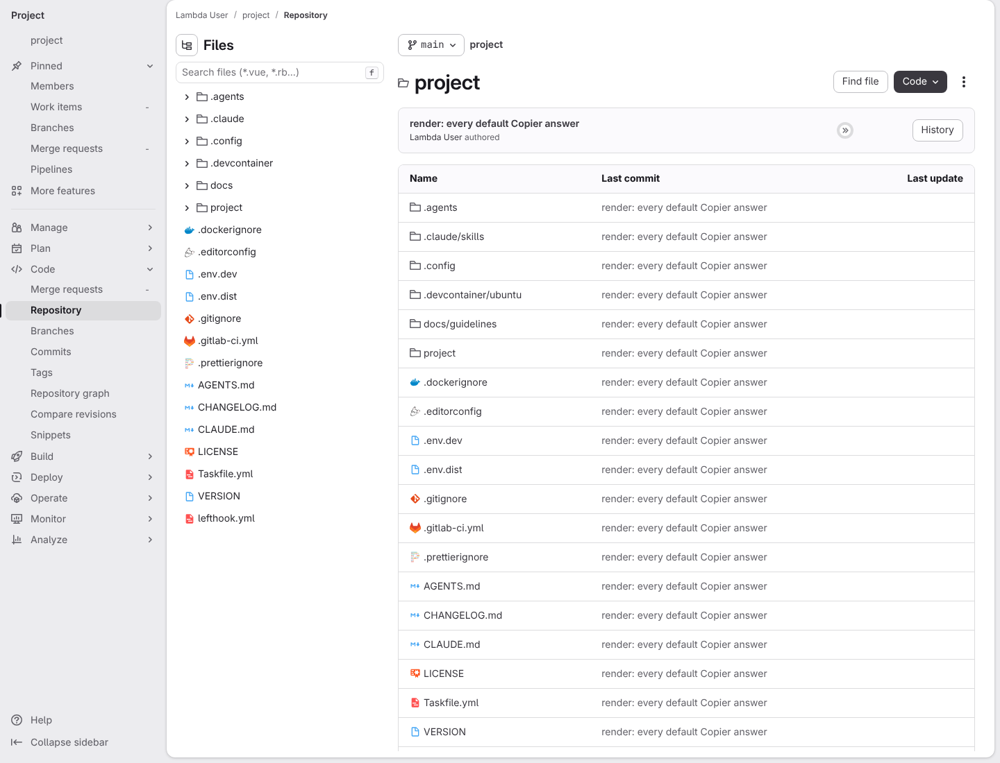](../../screenshots/base/03-evolution/render-matrix/defaults-tree.webp)

The repository page of the main branch. The project folder sits next to .agents, .claude, .config, .devcontainer and docs, and the root files run from .dockerignore to lefthook.yml.
There is no README.md between LICENSE and Taskfile.yml: the toolbox keeps its own README out of the projects it generates.

<details>
<summary>Command</summary>

```shell
http://gitlab/<lambda-user>/<project>/-/tree/main
```

</details>

</td>
</tr>
</table>

<table width="100%">
<tr>
<th width="50%">

**3. And the storyboard engine folder on the main branch ships its own manual**

</th>
<th width="50%">


</th>
</tr>
<tr>
<td width="50%" valign="top">

[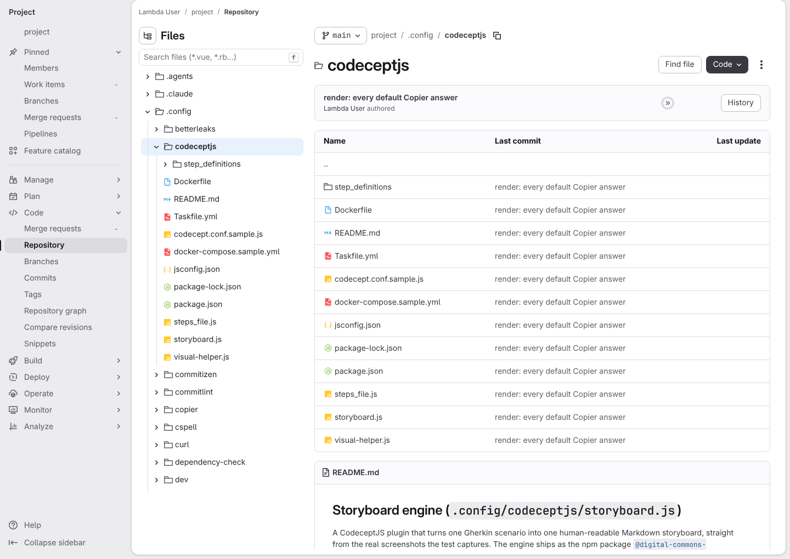](../../screenshots/base/03-evolution/render-matrix/defaults-storyboard-manual.webp)

The .config/codeceptjs folder on the main branch. README.md is in its list, and GitLab renders it under the list: "Storyboard engine (.config/codeceptjs/storyboard.js)".
This is the storyboard engine's manual, the same file as in the toolbox.

<details>
<summary>Command</summary>

```shell
http://gitlab/<lambda-user>/<project>/-/tree/main/.config/codeceptjs
```

</details>

</td>
<td width="50%" valign="top">


</td>
</tr>
</table>

<a name="storyboard-chapter-2"></a>

## The default project passes its own YAML linter

<table width="100%">
<tr>
<th width="50%">

**4. Then every YAML file of the default project passes yamllint**

</th>
<th width="50%">


</th>
</tr>
<tr>
<td width="50%" valign="top">

[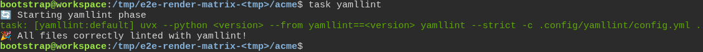](../../screenshots/base/03-evolution/render-matrix/defaults-yamllint.webp)

A terminal in the default project, the same files GitLab holds on the main branch. task yamllint runs yamllint over every YAML file of the project, the Taskfiles included, with the project's own rules from .config/yamllint/config.yml.
Those rules refuse a blank first or last line, a missing --- at the top and a wrong indentation, and --strict fails on a warning too. The run ends on "All files correctly linted with yamllint!".
The temporary folder and the yamllint and Python versions are hidden, so the picture does not move when they are upgraded.

<details>
<summary>Command</summary>

```shell
task yamllint
```

</details>

</td>
<td width="50%" valign="top">


</td>
</tr>
</table>

<a name="storyboard-chapter-3"></a>

## Each answer changes exactly what it promises, one branch per answer

<table width="100%">
<tr>
<th width="50%">

**5. Then choosing podman swaps docker-ce and compose for podman and changes nothing else**

</th>
<th width="50%">

**6. And turning off Docker Compose only deletes the compose file**

</th>
</tr>
<tr>
<td width="50%" valign="top">

[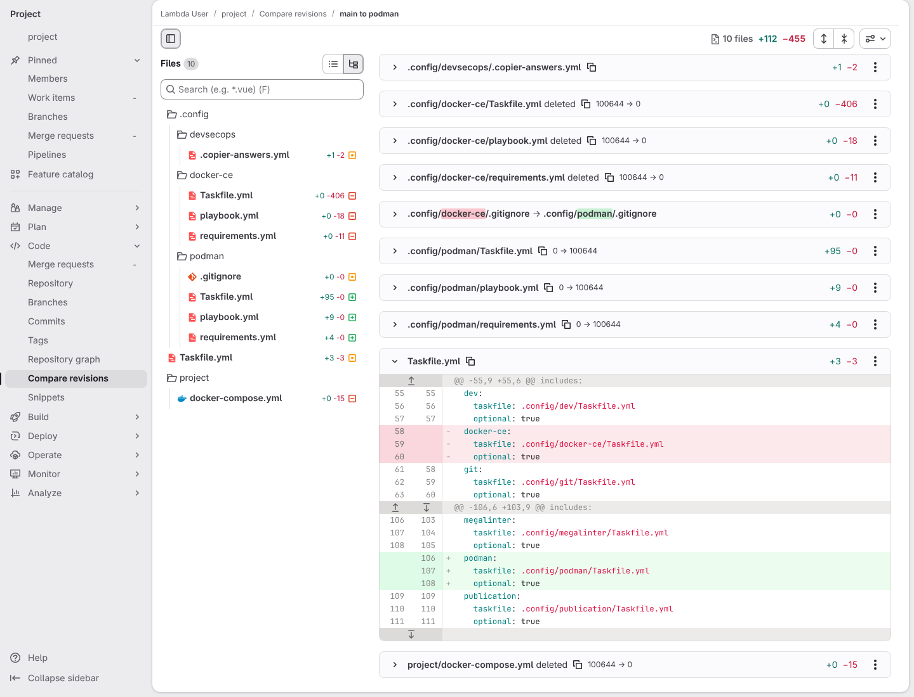](../../screenshots/base/03-evolution/render-matrix/answers-podman.webp)

The same project rendered again with container\_runtime: podman and pushed as the branch podman. GitLab's compare page shows what that branch changes against the main branch: the Files panel lists every changed file, the diffs unfold the telling ones.
Ten files change: the docker-ce files leave (their .gitignore moves to the podman folder), the podman files arrive and project/docker-compose.yml is deleted. Taskfile.yml is unfolded: its docker-ce include goes, and a podman include arrives further down.

<details>
<summary>Command</summary>

```shell
uvx --python 3.14 --from copier==9.14.3 copier copy --defaults --skip-tasks --data container_runtime=podman /workspace acme
```

</details>

</td>
<td width="50%" valign="top">

[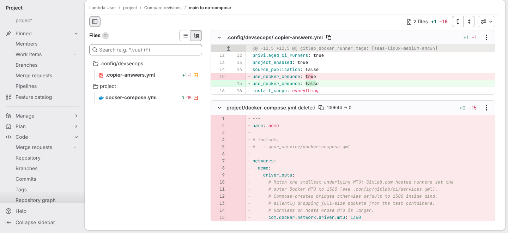](../../screenshots/base/03-evolution/render-matrix/answers-no-compose.webp)

The same page for the branch no-compose. Only two files change: the answers file, where use\_docker\_compose turns false, and project/docker-compose.yml, deleted.
The docker-ce files are not in the list, so they stay as they were.

<details>
<summary>Command</summary>

```shell
uvx --python 3.14 --from copier==9.14.3 copier copy --defaults --skip-tasks --data use_docker_compose=false /workspace acme
```

</details>

</td>
</tr>
</table>

<table width="100%">
<tr>
<th width="50%">

**7. And turning on Ansible only adds its config, its lint tooling and their Taskfile include**

</th>
<th width="50%">

**8. And a self-hosted CI platform only changes the docker-in-docker variables and the runner tags**

</th>
</tr>
<tr>
<td width="50%" valign="top">

[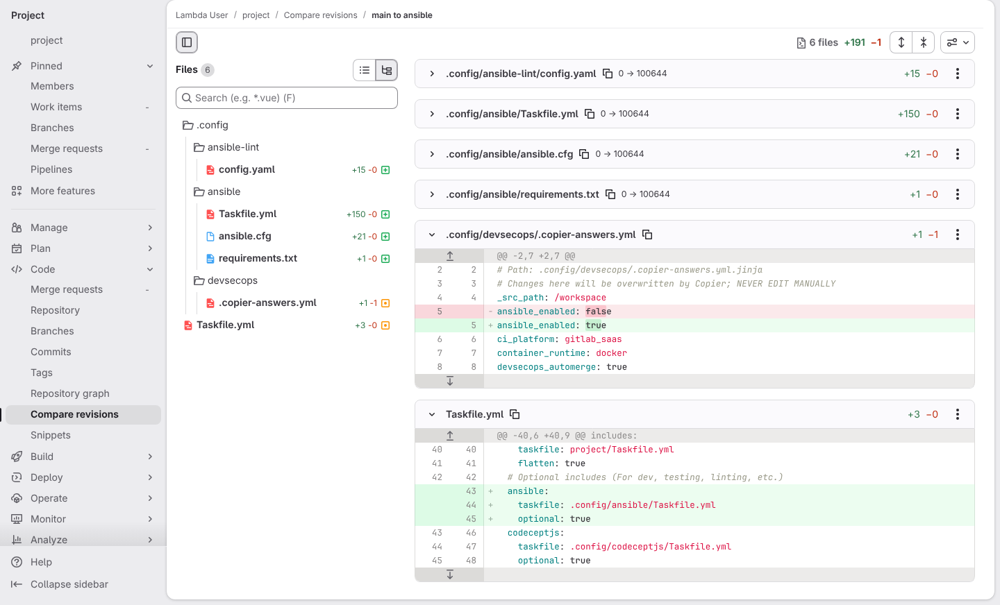](../../screenshots/base/03-evolution/render-matrix/answers-ansible.webp)

The same page for the branch ansible. Four new files arrive under .config/ansible and .config/ansible-lint, shown folded.
The answers file turns ansible\_enabled to true, and Taskfile.yml gains the ansible include.

<details>
<summary>Command</summary>

```shell
uvx --python 3.14 --from copier==9.14.3 copier copy --defaults --skip-tasks --data ansible_enabled=true /workspace acme
```

</details>

</td>
<td width="50%" valign="top">

[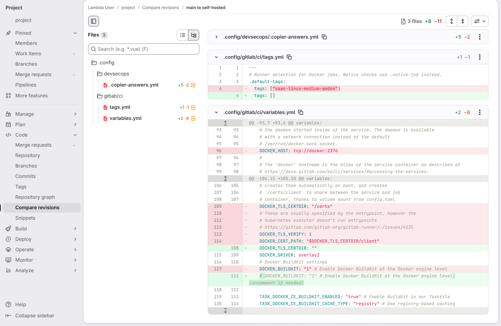](../../screenshots/base/03-evolution/render-matrix/answers-self-hosted.webp)

The same page for the branch self-hosted, rendered with an empty docker host and certificate folder. Three files change.
In tags.yml the runner tags become an empty list. In variables.yml, DOCKER\_HOST: tcp://docker:2376 and the TLS settings go, DOCKER\_TLS\_CERTDIR turns empty and the BuildKit line is commented out. The answers file stays folded to leave room for both files.

<details>
<summary>Command</summary>

```shell
uvx --python 3.14 --from copier==9.14.3 copier copy --defaults --skip-tasks --data ci_platform=gitlab_self_hosted --data gitlab_docker_host= --data gitlab_docker_tls_certdir= /workspace acme
```

</details>

</td>
</tr>
</table>

<table width="100%">
<tr>
<th width="50%">

**9. And turning off project mode deletes the project directory and every task that called into it**

</th>
<th width="50%">

**10. And turning off automerge only removes the fast-forward rule from the Renovate config**

</th>
</tr>
<tr>
<td width="50%" valign="top">

[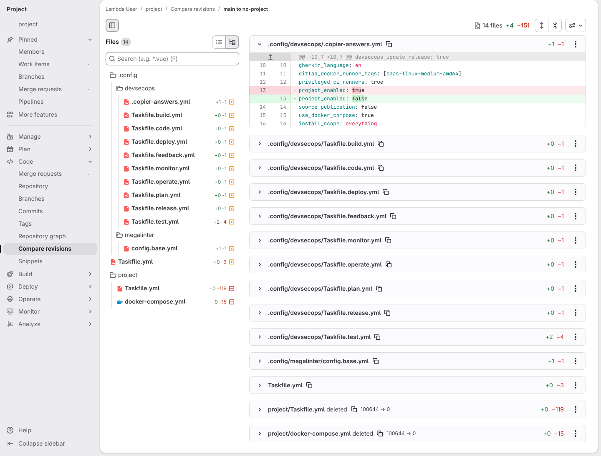](../../screenshots/base/03-evolution/render-matrix/answers-no-project.webp)

The same page for the branch no-project. The answers file shows project\_enabled turning false, and project/Taskfile.yml and project/docker-compose.yml are deleted.
Eleven files that called into the project folder change too, shown folded with their line counts: the root Taskfile.yml, the nine phase Taskfiles under .config/devsecops and the MegaLinter base config.

<details>
<summary>Command</summary>

```shell
uvx --python 3.14 --from copier==9.14.3 copier copy --defaults --skip-tasks --data project_enabled=false /workspace acme
```

</details>

</td>
<td width="50%" valign="top">

[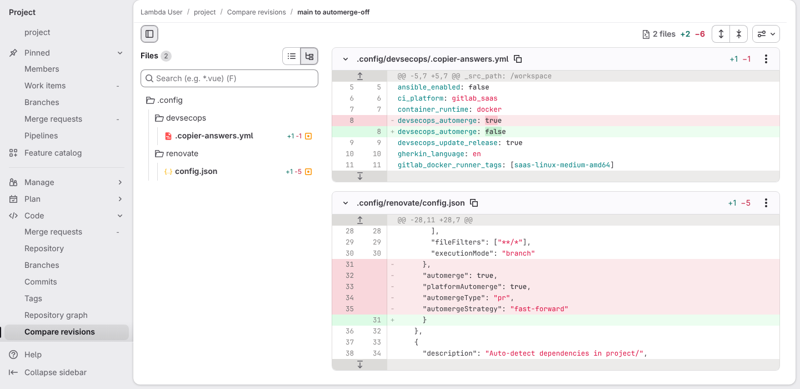](../../screenshots/base/03-evolution/render-matrix/answers-automerge-off.webp)

The same page for the branch automerge-off. The answers file turns devsecops\_automerge to false.
In .config/renovate/config.json the toolbox rule loses its four automerge lines, "automergeStrategy": "fast-forward" among them, and nothing else changes.

<details>
<summary>Command</summary>

```shell
uvx --python 3.14 --from copier==9.14.3 copier copy --defaults --skip-tasks --data devsecops_automerge=false /workspace acme
```

</details>

</td>
</tr>
</table>

<table width="100%">
<tr>
<th width="50%">

**11. And answering no to a release on toolbox updates only turns the Renovate commit type to chore**

</th>
<th width="50%">

**12. And choosing French Gherkin switches every test-writing rule and skill to French**

</th>
</tr>
<tr>
<td width="50%" valign="top">

[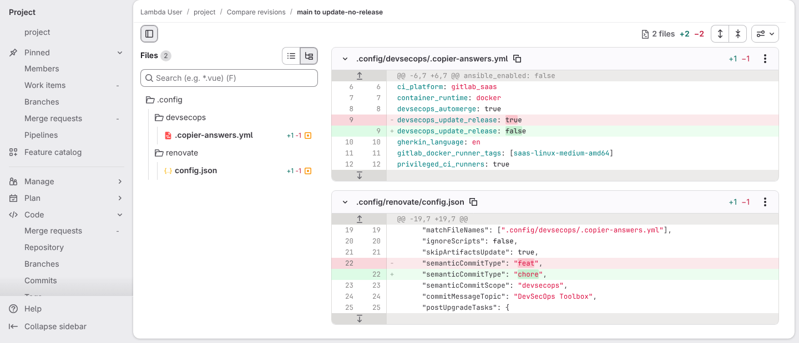](../../screenshots/base/03-evolution/render-matrix/answers-update-no-release.webp)

The same page for the branch update-no-release. The answers file turns devsecops\_update\_release to false.
In .config/renovate/config.json the commit type of the toolbox rule turns from feat to chore, and nothing else changes. A chore commit raises no version, so a toolbox update alone no longer makes a release.

<details>
<summary>Command</summary>

```shell
uvx --python 3.14 --from copier==9.14.3 copier copy --defaults --skip-tasks --data devsecops_update_release=false /workspace acme
```

</details>

</td>
<td width="50%" valign="top">

[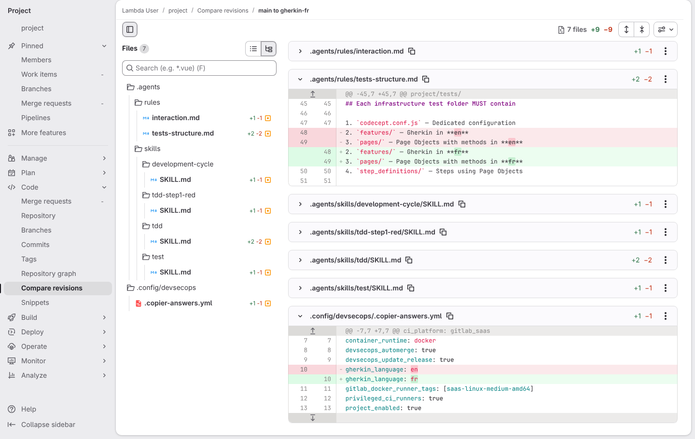](../../screenshots/base/03-evolution/render-matrix/answers-gherkin-fr.webp)

The same page for the branch gherkin-fr. Six rules and skills under .agents change, each by one or two lines.
tests-structure.md is unfolded: features/ and pages/ now ask for fr instead of en. The answers file at the bottom shows gherkin\_language turning to fr.

<details>
<summary>Command</summary>

```shell
uvx --python 3.14 --from copier==9.14.3 copier copy --defaults --skip-tasks --data gherkin_language=fr /workspace acme
```

</details>

</td>
</tr>
</table>

<a name="storyboard-chapter-4"></a>

## The default project keeps every fix of the toolbox's own files

<table width="100%">
<tr>
<th width="50%">

**13. Then the default project lists the same init, gum and glow tasks as the toolbox**

</th>
<th width="50%">

**14. And the default project's compose network uses the same 1360 MTU as the toolbox**

</th>
</tr>
<tr>
<td width="50%" valign="top">

[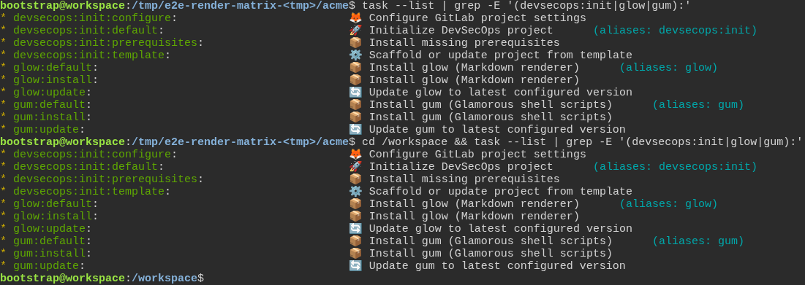](../../screenshots/base/03-evolution/render-matrix/defaults-twin-tasks.webp)

A terminal in the default project, back on the main branch. The developer lists its init, gum and glow tasks, then moves to /workspace, the toolbox's own folder, and lists the same tasks there.
Both lists hold the same ten lines. The project's init offers "⚙️ Scaffold or update project from template" and "🦊 Configure GitLab project settings", like the toolbox's, and the toolbox offers gum:install and glow:install, like the project.

<details>
<summary>Command</summary>

```shell
task --list | grep -E '(devsecops:init|glow|gum):'; cd /workspace && task --list | grep -E '(devsecops:init|glow|gum):'
```

</details>

</td>
<td width="50%" valign="top">

[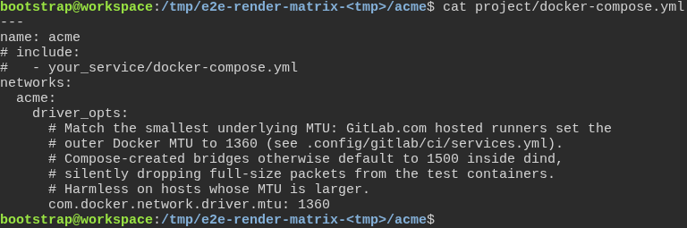](../../screenshots/base/03-evolution/render-matrix/defaults-compose-mtu.webp)

The project's own compose file, printed whole. Its network sets com.docker.network.driver.mtu: 1360, the value the toolbox's own compose file uses.
GitLab.com's runners use an MTU of 1360. Inside the CI's Docker, a network left at the usual 1500 drops the bigger packets without a word, and downloads in the test containers stall.

<details>
<summary>Command</summary>

```shell
cat project/docker-compose.yml
```

</details>

</td>
</tr>
</table>

<table width="100%">
<tr>
<th width="50%">

**15. And the default project's test job keeps its test folder, not the whole project folder**

</th>
<th width="50%">


</th>
</tr>
<tr>
<td width="50%" valign="top">

[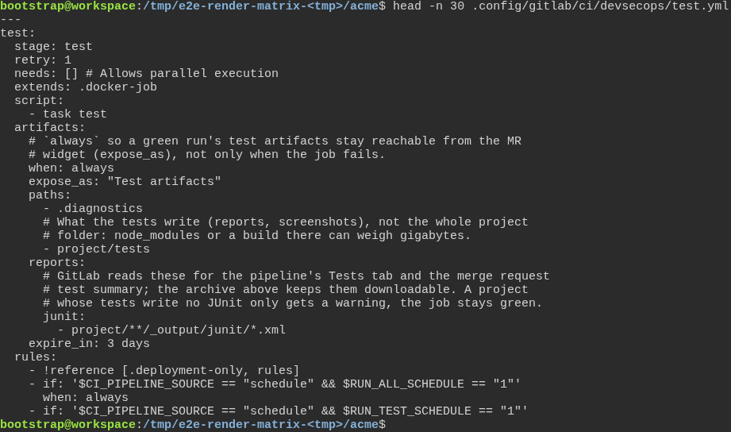](../../screenshots/base/03-evolution/render-matrix/defaults-test-artifacts.webp)

The start of the project's test job, from .config/gitlab/ci/devsecops/test.yml. After a run, GitLab keeps two folders for 3 days: .diagnostics and project/tests, where the tests write their reports and screenshots. It also reads the JUnit reports, for the pipeline's Tests tab.
The rest of the project folder stays out. A node\_modules folder or a build there can weigh gigabytes.

<details>
<summary>Command</summary>

```shell
head -n 30 .config/gitlab/ci/devsecops/test.yml
```

</details>

</td>
<td width="50%" valign="top">


</td>
</tr>
</table>

<a name="storyboard-replay"></a>

<details>
<summary>Replay this scenario · source and checks</summary>

```shell
task test -- --grep "@render-matrix"
```

**Source**

```text
project/tests/e2e/features/03-evolution/matrix.feature
```

Every frame is its own pixel baseline (tolerance: 0).

</details>
