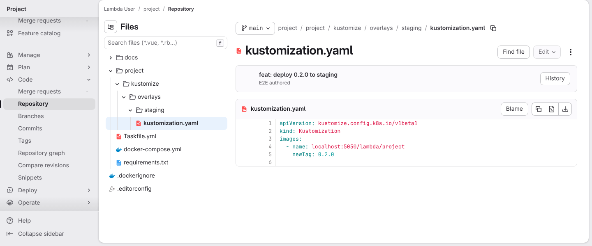
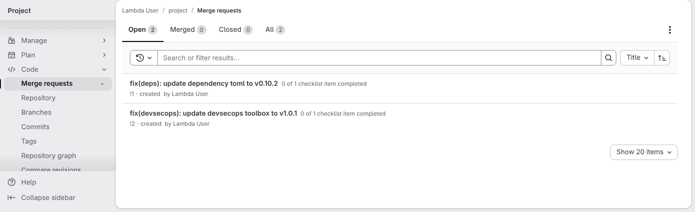
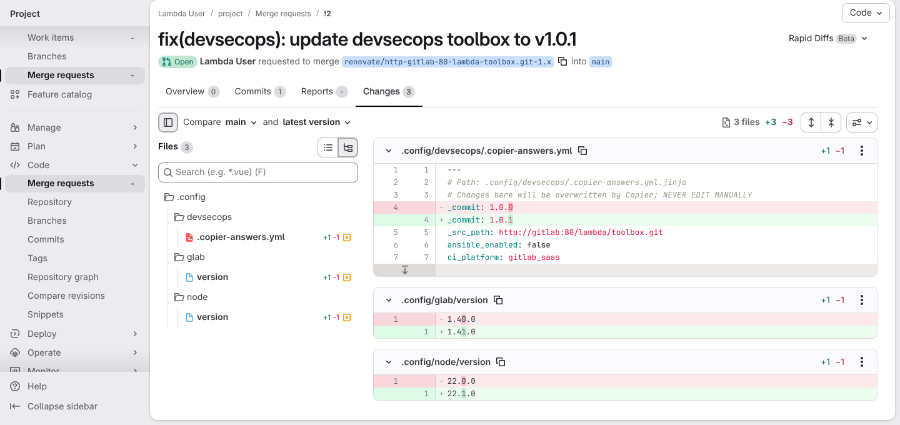
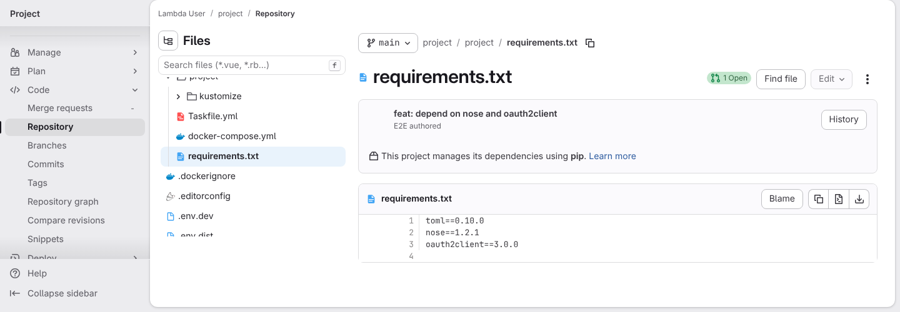
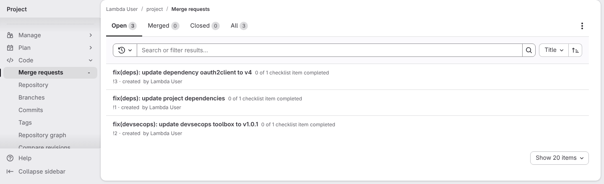
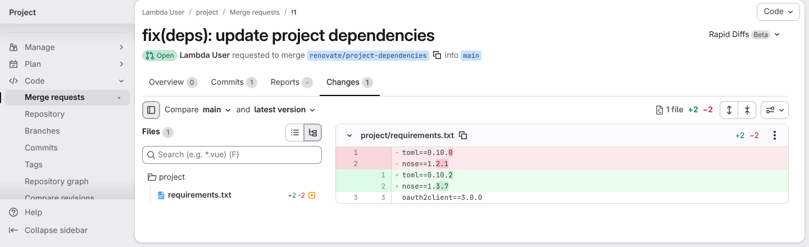
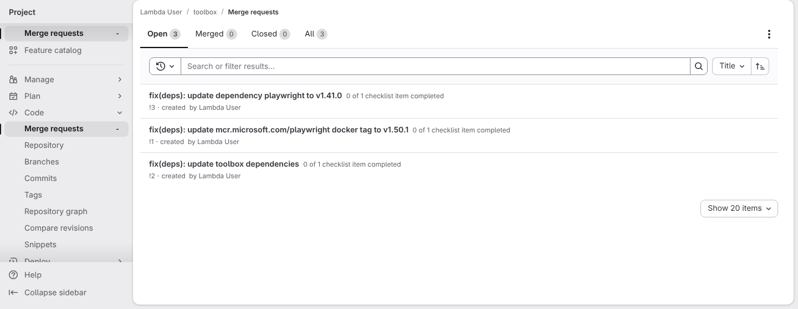
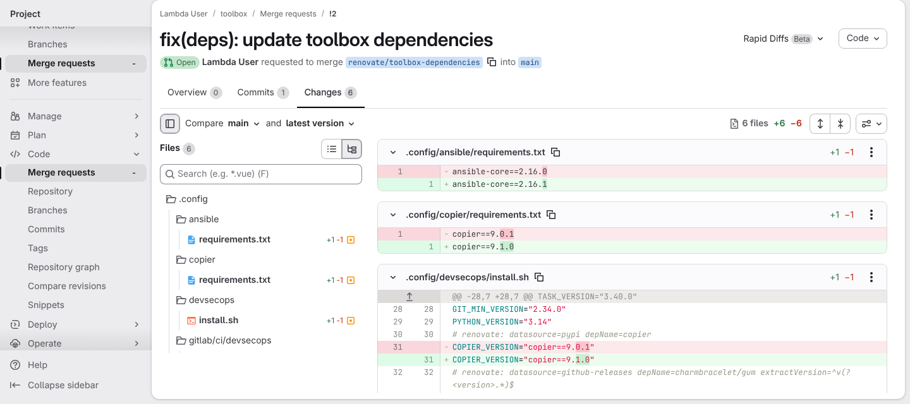
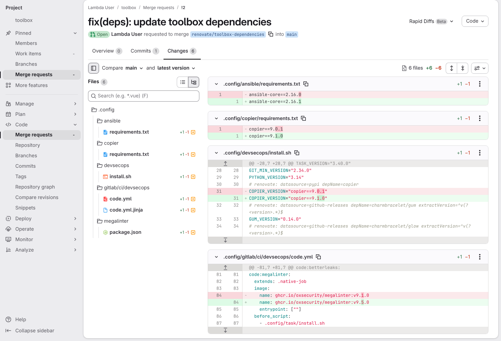

# Dependency updates flow through the framework, not around it

**Scenario:** A generated project gets its tool updates inside the toolbox update, and the toolbox groups its own small updates

<a name="storyboard-result"></a>

> [!tip] PASSED
> 9 steps · 9 frames

**On this page**

[Result](#storyboard-result) · [A generated project only receives the toolbox update](#storyboard-chapter-1) · [A generated project's own minor and patch updates share one merge request](#storyboard-chapter-2) · [The toolbox groups its own small updates, and keeps the tools its tests see apart](#storyboard-chapter-3) · [Replay and source](#storyboard-replay)

<a name="storyboard-chapter-1"></a>

## A generated project only receives the toolbox update

<table width="100%">
<tr>
<th width="50%">

**1. Given the project deploys its own image, pinned at 0.2.0 in its staging manifest**

</th>
<th width="50%">

**2. When Renovate runs on a project generated from an older toolbox release, it opens only the toolbox update and the toml update**

</th>
</tr>
<tr>
<td width="50%" valign="top">

[](../../screenshots/base/03-evolution/renovate-flow/downstream-own-image.webp)

Off camera, the test GitLab holds a copy of the toolbox with two releases. Release 1.0.0 pins node 22.0.0 and glab 1.40.0, and release 1.0.1 moves them to 22.1.0 and 1.41.0. Next to it sits a project generated from release 1.0.0, whose developer added one dependency of their own: toml 0.10.0 in project/requirements.txt.
The project also deploys its own image. GitLab shows project/kustomize/overlays/staging/kustomization.yaml, the file that says which version runs in staging: it pins that image at 0.2.0. The project's registry already holds 0.2.1. For the test, that registry is a small stand-in at localhost:5050 that knows these two versions.

<details>
<summary>Command</summary>

```shell
http://gitlab/<lambda-user>/<project>/-/blob/main/project/kustomize/overlays/staging/kustomization.yaml
```

</details>

</td>
<td width="50%" valign="top">

[](../../screenshots/base/03-evolution/renovate-flow/downstream-merge-requests.webp)

Renovate runs on that project. GitLab's list of open merge requests shows two of them, "update dependency toml to v0.10.2" and "update devsecops toolbox to v1.0.1", and neither carries a red failed check. There is none for node or glab, although the project still pins them old: those tools belong to the toolbox.
There is none for the project's own image either, and Renovate never asks the registry about it. A Renovate bump of that image was a fix commit, so it made a release, the release published a new image, and Renovate bumped it again, in a loop. A version reaches staging through a merge request a person opens.

<details>
<summary>Command</summary>

```shell
task renovate TASK_RENOVATE_PLATFORM=gitlab
```

</details>

</td>
</tr>
</table>

<table width="100%">
<tr>
<th width="50%">

**3. Then the toolbox update brings the newer tool pins with it, and no stray VERSION file**

</th>
<th width="50%">


</th>
</tr>
<tr>
<td width="50%" valign="top">

[](../../screenshots/base/03-evolution/renovate-flow/downstream-toolbox-update.webp)

The Changes tab of the toolbox update. Renovate ran the toolbox's own update command for it, from the project root and without a shell. The merge request holds what that command changed: the answers file now names release 1.0.1, and node and glab move to the pins release 1.0.1 carries.
No .config/devsecops/VERSION is among the files. That stray file is what Renovate's own Copier run used to leave, working from the folder of the answers file.

<details>
<summary>Command</summary>

```shell
http://gitlab/<lambda-user>/<project>/-/merge_requests/<iid>/diffs
```

</details>

</td>
<td width="50%" valign="top">


</td>
</tr>
</table>

<a name="storyboard-chapter-2"></a>

## A generated project's own minor and patch updates share one merge request

<table width="100%">
<tr>
<th width="50%">

**4. Given the developer adds nose 1.2.1 and oauth2client 3.0.0 to the project's own dependencies**

</th>
<th width="50%">

**5. When Renovate runs on the project again, the minor and patch updates of toml and nose share one merge request, and the major update of oauth2client gets its own**

</th>
</tr>
<tr>
<td width="50%" valign="top">

[](../../screenshots/base/03-evolution/renovate-flow/downstream-more-dependencies.webp)

Off camera, the developer pushes one more commit to the main branch of the same project. GitLab shows project/requirements.txt: toml is still pinned at 0.10.0, and two dependencies joined it.
nose 1.2.1 has a minor update waiting, to 1.3.7. oauth2client 3.0.0 has a major update waiting, to 4.1.3. A major update is the kind that can break the code.

<details>
<summary>Command</summary>

```shell
http://gitlab/<lambda-user>/<project>/-/blob/main/project/requirements.txt
```

</details>

</td>
<td width="50%" valign="top">

[](../../screenshots/base/03-evolution/renovate-flow/downstream-grouped-merge-requests.webp)

Renovate runs on the project a second time. GitLab's list of open merge requests shows three: "update dependency oauth2client to v4", "update project dependencies", which holds toml and nose, and "update devsecops toolbox to v1.0.1". The toml merge request of the first run, !1, became the project dependencies one.
The main branch only takes a merge request that sits right on top of it, so each merge makes Renovate rebase every other open one, and each rebase runs a full pipeline again. On a real project, ten merge requests cost ten pipelines of twenty jobs for a single merge. Minor and patch updates rarely break anything, so they ride together. A major update can, so it still comes alone, like the toolbox update.

<details>
<summary>Command</summary>

```shell
task renovate TASK_RENOVATE_PLATFORM=gitlab
```

</details>

</td>
</tr>
</table>

<table width="100%">
<tr>
<th width="50%">

**6. Then the project dependencies merge request moves toml and nose together, and leaves oauth2client to its own merge request**

</th>
<th width="50%">


</th>
</tr>
<tr>
<td width="50%" valign="top">

[](../../screenshots/base/03-evolution/renovate-flow/downstream-project-dependencies.webp)

The Changes tab of the project dependencies merge request, opened from the branch renovate/project-dependencies. In project/requirements.txt, toml moves from 0.10.0 to 0.10.2 and nose from 1.2.1 to 1.3.7, in one change.
The oauth2client line does not move here. Its own merge request takes it to 4.1.3.

<details>
<summary>Command</summary>

```shell
http://gitlab/<lambda-user>/<project>/-/merge_requests/<iid>/diffs
```

</details>

</td>
<td width="50%" valign="top">


</td>
</tr>
</table>

<a name="storyboard-chapter-3"></a>

## The toolbox groups its own small updates, and keeps the tools its tests see apart

<table width="100%">
<tr>
<th width="50%">

**7. When the toolbox's own Renovate runs, it groups its small updates and keeps playwright apart**

</th>
<th width="50%">

**8. Then the copier update moves its config pin and its installer pin together**

</th>
</tr>
<tr>
<td width="50%" valign="top">

[](../../screenshots/base/03-evolution/renovate-flow/toolbox-merge-requests.webp)

Off camera, the toolbox's main branch gets one more commit after both releases. It pins five dependencies back to old versions: copier and ansible-core from Python, playwright from npm, the Playwright test image from the Microsoft registry, and MegaLinter, whose number is a Docker tag.
Renovate runs on the toolbox itself. For the test, a setting limits it to these five and holds each one to a single newer release, so the picture never moves. GitLab lists three merge requests. copier, ansible-core and MegaLinter share one, "update toolbox dependencies": Renovate runs once a night and the main branch takes one merge at a time, so five merge requests would take five nights.
playwright and its test image keep a merge request each, like gitlab-ce, gitlab-runner, codeceptjs-visual-helper, python and lizard, because they change what the tests see. They come apart because npm publishes first and the image follows days later. That is why the test image installs the browser its own playwright asks for.

<details>
<summary>Command</summary>

```shell
task renovate TASK_RENOVATE_PLATFORM=gitlab
```

</details>

</td>
<td width="50%" valign="top">

[](../../screenshots/base/03-evolution/renovate-flow/toolbox-copier-update.webp)

The Changes tab of the grouped merge request, on install.sh. copier is pinned in two places: .config/copier/requirements.txt, and install.sh, which installs copier before the toolbox is on the machine. Both move from 9.0.1 to 9.1.0 in this merge request.
Before the pin-back, the test checks that every install.sh pin equals its .config source, for task, copier, gum and glow.

<details>
<summary>Command</summary>

```shell
http://gitlab/<lambda-user>/<toolbox>/-/merge_requests/<iid>/diffs
```

</details>

</td>
</tr>
</table>

<table width="100%">
<tr>
<th width="50%">

**9. And the MegaLinter update moves the local pin and both CI pins together**

</th>
<th width="50%">


</th>
</tr>
<tr>
<td width="50%" valign="top">

[](../../screenshots/base/03-evolution/renovate-flow/toolbox-megalinter-update.webp)

Further down the same merge request, the MegaLinter image of the CI template moves from 9.1.0 to 9.5.0. The Files panel shows the two other places it is pinned changing with it, code.yml.jinja and the local runner in .config/megalinter/package.json, so a local run and the pipeline never lint with two versions.
9\.5.0 only exists on ghcr.io, because Docker Hub stopped at 9.4.0. Renovate reads the registry that still publishes.

<details>
<summary>Command</summary>

```shell
http://gitlab/<lambda-user>/<toolbox>/-/merge_requests/<iid>/diffs
```

</details>

</td>
<td width="50%" valign="top">


</td>
</tr>
</table>

<a name="storyboard-replay"></a>

<details>
<summary>Replay this scenario · source and checks</summary>

```shell
task test -- --grep "@renovate-flow"
```

**Source**

```text
project/tests/e2e/features/03-evolution/renovate.feature
```

Every frame is its own pixel baseline (tolerance: 0).

</details>
