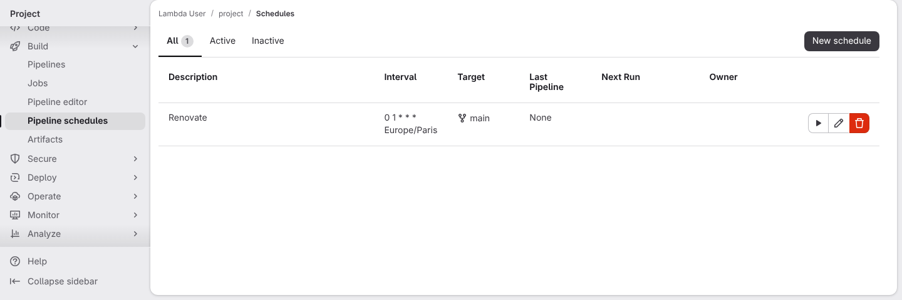
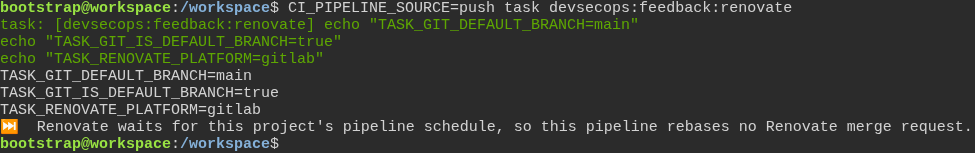

# Dependency updates flow through the framework, not around it

**Scenario:** On the main branch, a push pipeline leaves Renovate to the project's nightly schedule

<a name="storyboard-result"></a>

> [!tip] PASSED
> 2 steps · 2 frames

**On this page**

[Result](#storyboard-result) · [Replay and source](#storyboard-replay)

<table width="100%">
<tr>
<th width="50%">

**1. Given a project on GitLab with a nightly pipeline schedule**

</th>
<th width="50%">

**2. Then a push pipeline leaves Renovate to the schedule, and only the scheduled pipeline runs it**

</th>
</tr>
<tr>
<td width="50%" valign="top">

[](../../screenshots/base/03-evolution/renovate-nightly/renovate-nightly-schedule.webp)

Every Renovate run on the main branch rebases every open Renovate merge request, and every rebase starts a full pipeline. With fast-forward merges, each merge on main used to restart them all.
On screen, the project's pipeline schedules on GitLab. One schedule, "Renovate", runs the main branch every night at 1 am, Paris time, like the toolbox's own.

</td>
<td width="50%" valign="top">

[](../../screenshots/base/03-evolution/renovate-nightly/renovate-nightly-push.webp)

The terminal plays the feedback job of a push pipeline on that project's main branch. The job finds the schedule and leaves Renovate to it, without starting Renovate.
Off camera, the same job in the scheduled pipeline runs Renovate. Once the schedule is deleted, a push pipeline runs Renovate again, so a project without a schedule keeps getting its updates.

<details>
<summary>Command</summary>

```shell
CI_PIPELINE_SOURCE=push task devsecops:feedback:renovate
```

</details>

</td>
</tr>
</table>

<a name="storyboard-replay"></a>

<details>
<summary>Replay this scenario · source and checks</summary>

```shell
task test -- --grep "@renovate-nightly"
```

**Source**

```text
project/tests/e2e/features/03-evolution/renovate.feature
```

Every frame is its own pixel baseline (tolerance: 0).

</details>
