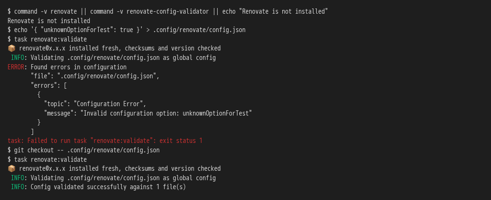
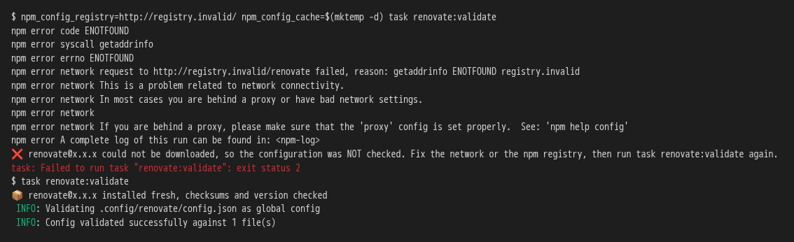
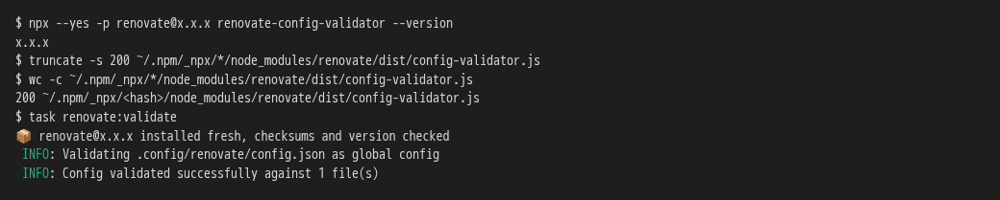

# Dependency updates flow through the framework, not around it

**Scenario:** Renovate validates through its pinned download without a global installation

<a name="storyboard-result"></a>

> [!tip] PASSED
> 3 steps · 3 frames

**On this page**

[Result](#storyboard-result) · [Replay and source](#storyboard-replay)

<table width="100%">
<tr>
<th width="50%">

**1. Then a project without Renovate installed gets the pinned validator, which refuses an unknown option and accepts the generated configuration**

</th>
<th width="50%">

**2. And when the npm registry cannot be reached, the task says the configuration was not checked, and the retry validates it once the registry answers**

</th>
</tr>
<tr>
<td width="50%" valign="top">

[](../../screenshots/base/03-evolution/renovate-runtime/runtime-validate.webp)

One terminal session in a freshly generated project, on a machine with no Renovate installed. The developer writes an option Renovate does not know into the configuration.
task renovate:validate installs the Renovate release the project pins into a fresh folder, and its first line names that release. It answers "Invalid configuration option: unknownOptionForTest" and fails with exit status 1. Once git puts the generated configuration back, the same task answers "Config validated successfully against 1 file(s)".

<details>
<summary>Command</summary>

```shell
task renovate:validate
```

</details>

</td>
<td width="50%" valign="top">

[](../../screenshots/base/03-evolution/renovate-runtime/runtime-registry-unreachable.webp)

Same project, now with npm pointed at a registry that does not exist, http://registry.invalid/, and an empty npm cache. Renovate cannot be downloaded. The task says "could not be downloaded, so the configuration was NOT checked" and fails with exit status 2, where a refused configuration fails with exit status 1.
The second run is the retry that message asks for. The registry answers again, and the same task answers "Config validated successfully against 1 file(s)".

<details>
<summary>Command</summary>

```shell
task renovate:validate
```

</details>

</td>
</tr>
</table>

<table width="100%">
<tr>
<th width="50%">

**3. And the task ignores a damaged copy that npx left in npm's cache and validates with a freshly checked copy**

</th>
<th width="50%">


</th>
</tr>
<tr>
<td width="50%" valign="top">

[](../../screenshots/base/03-evolution/renovate-runtime/runtime-damaged-copy.webp)

This card gets its own home folder, so the damage stays in it. npx runs the pinned Renovate once, and npm keeps the unpacked files in its cache, under \~/.npm/\_npx. Then truncate cuts the validator's main file down to 200 bytes, as wc shows.
npx would run that broken file the next time, and its crash would read like a refused configuration. task renovate:validate does not touch it. npm unpacks Renovate into a fresh folder and checks every package against the checksum the registry publishes, then the task checks the version. It answers "Config validated successfully against 1 file(s)".

<details>
<summary>Command</summary>

```shell
task renovate:validate
```

</details>

</td>
<td width="50%" valign="top">


</td>
</tr>
</table>

<a name="storyboard-replay"></a>

<details>
<summary>Replay this scenario · source and checks</summary>

```shell
task test -- --grep "@renovate-runtime"
```

**Source**

```text
project/tests/e2e/features/03-evolution/renovate.feature
```

Every frame is its own pixel baseline (tolerance: 0).

</details>
