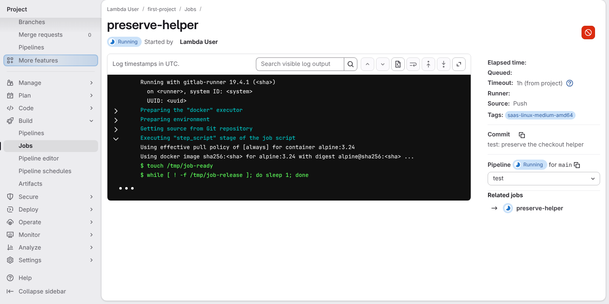
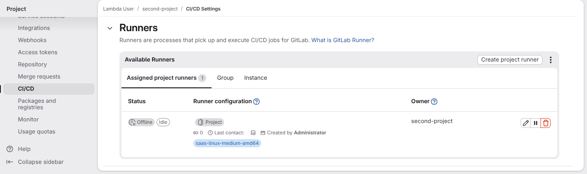
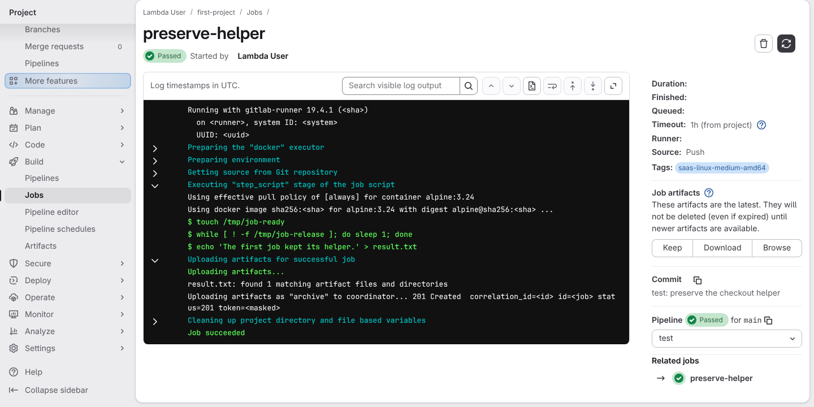

# Choose a runner according to the work a job does

**Scenario:** Register another project runner while a job still needs its checkout helper

<a name="storyboard-result"></a>

> [!tip] PASSED
> 3 steps · 3 frames

**On this page**

[Result](#storyboard-result) · [Replay and source](#storyboard-replay)

<table width="100%">
<tr>
<th width="50%">

**1. Given the first project's job is running and still has to upload its artifact**

</th>
<th width="50%">

**2. When the second project registers its own runner**

</th>
</tr>
<tr>
<td width="50%" valign="top">

[](../../screenshots/base/03-evolution/runner-cleanup/first-job-running.webp)

This story checks the test suite's own runner setup, not a toolbox feature. The page of the first project's job: it is Running, and its log stops on the loop "$ while \[ ! -f /tmp/job-release \]; do sleep 1; done", where the job waits.
No "Uploading artifacts" section yet. GitLab Runner will upload result.txt later, through the job's checkout helper container, which has already stopped.

<details>
<summary>Command</summary>

```shell
http://gitlab/<lambda-user>/<first-project>/-/jobs/<job>
```

</details>

</td>
<td width="50%" valign="top">

[](../../screenshots/base/03-evolution/runner-cleanup/two-project-runners.webp)

The second project's CI/CD settings, Runners section. Its one runner carries the saas-linux-medium-amd64 tag and has run no job yet: GitLab lists it Offline and Idle. It was registered in the same runner service while the first job was still running.

<details>
<summary>Command</summary>

```shell
http://gitlab/<lambda-user>/<second-project>/-/settings/ci_cd
```

</details>

</td>
</tr>
</table>

<table width="100%">
<tr>
<th width="50%">

**3. Then GitLab accepts the first job artifact and marks the job as passed**

</th>
<th width="50%">


</th>
</tr>
<tr>
<td width="50%" valign="top">

[](../../screenshots/base/03-evolution/runner-cleanup/first-job-artifact-passed.webp)

The first job's page once its script is released. It Passed: its log shows "Uploading artifacts for successful job", "result.txt: found 1 matching artifact files and directories" and "201 Created", and its side panel offers the artifact under "Job artifacts".

<details>
<summary>Command</summary>

```shell
http://gitlab/<lambda-user>/<first-project>/-/jobs/<job>
```

</details>

</td>
<td width="50%" valign="top">


</td>
</tr>
</table>

<a name="storyboard-replay"></a>

<details>
<summary>Replay this scenario · source and checks</summary>

```shell
task test -- --grep "@runner-cleanup"
```

**Source**

```text
project/tests/e2e/features/03-evolution/runner-cleanup.feature
```

Every frame is its own pixel baseline (tolerance: 0).

</details>
