# A framework change without its proof card never reaches the main branch

**Scenario:** GitLab stops a framework change that ships with no proof card, and lets it through once the card is added

<a name="storyboard-result"></a>

> [!tip] PASSED
> 11 steps · 11 frames

**On this page**

[Result](#storyboard-result) · [A framework change that brings no proof card](#storyboard-chapter-1) · [The card is there, and the test behind it was switched off](#storyboard-chapter-2) · [Replay and source](#storyboard-replay)

<a name="storyboard-chapter-1"></a>

## A framework change that brings no proof card

<table width="100%">
<tr>
<th width="50%">

**1. Given the merge request changes one framework file and brings no proof card**

</th>
<th width="50%">

**2. Then GitLab refuses to merge it, one check failed**

</th>
</tr>
<tr>
<td width="50%" valign="top">

[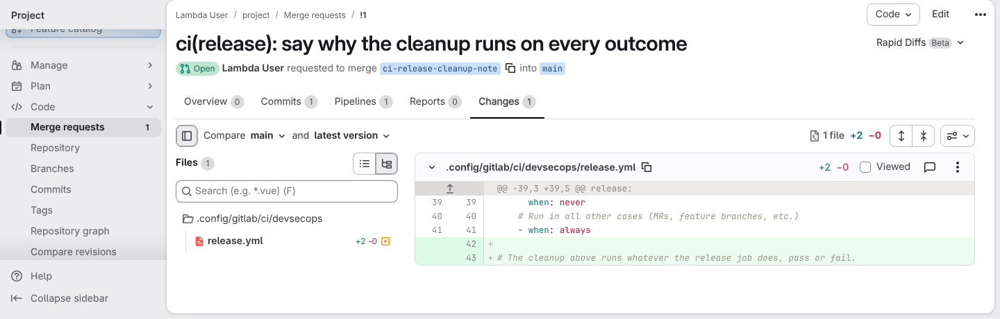](../../screenshots/base/03-evolution/test-discipline/changes-without-card.webp)

Everything this framework ships lives in files under .config/. This merge request changes one of them, .config/gitlab/ci/devsecops/release.yml, and the Changes tab shows all of it: "1 file", two added lines.
The rule of the house is that a change like this arrives with a proof card: a real screenshot the test suite takes to show the change doing its job. The file list on the left holds nothing under project/tests/, so no card came with it.

<details>
<summary>Command</summary>

```shell
http://gitlab/<lambda-user>/<project>/-/merge_requests/1/diffs
```

</details>

</td>
<td width="50%" valign="top">

[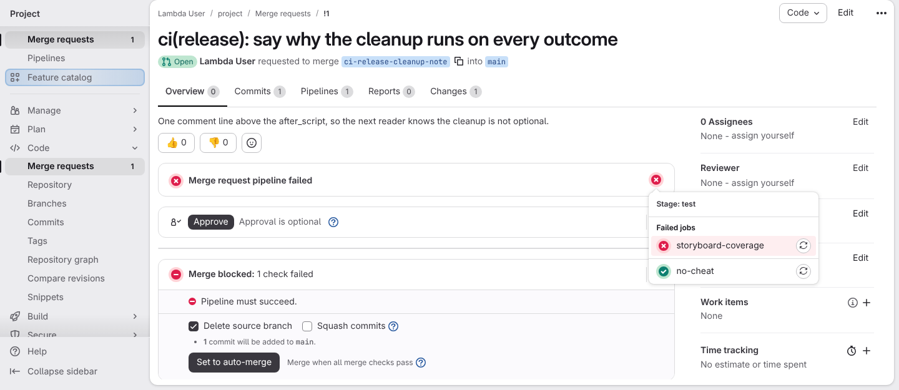](../../screenshots/base/03-evolution/test-discipline/merge-blocked.webp)

GitLab runs a pipeline on every push to a merge request. Its one stage is opened here, "Stage: test", and it names the two checks it ran: storyboard-coverage, the job that enforces the rule, sits under "Failed jobs" in red, and no-cheat is green.
So the merge request is stopped. The box below reads "Merge blocked: 1 check failed", with the reason under it: "Pipeline must succeed." Nobody had to notice the missing proof. The project refused the change on its own.

<details>
<summary>Command</summary>

```shell
http://gitlab/<lambda-user>/<project>/-/merge_requests/1
```

</details>

</td>
</tr>
</table>

<table width="100%">
<tr>
<th width="50%">

**3. And the failed job names the file left without proof**

</th>
<th width="50%">

**4. When the author pushes only a comment beside the framework change**

</th>
</tr>
<tr>
<td width="50%" valign="top">

[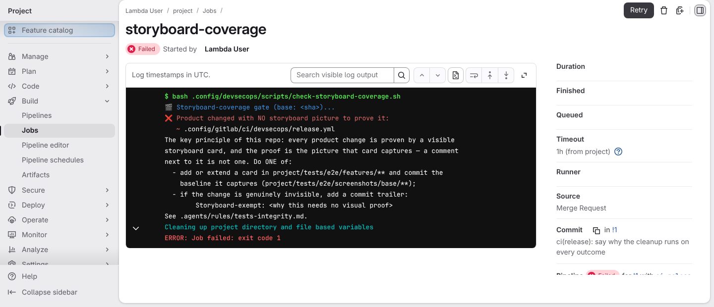](../../screenshots/base/03-evolution/test-discipline/gate-names-the-file.webp)

A red job is useless if it does not say why, so the author opens it. Its log spells the verdict out: "Product changed with NO storyboard picture to prove it", then names the file it caught.
It also says what counts as a proof: the picture the card captures, under project/tests/e2e/screenshots/base/. A comment written next to a card is not one. The only way around it is a line starting with "Storyboard-exempt:" in the commit message, so a reviewer reads the reason instead of guessing at it.
On the right, under "Related jobs", no-cheat is green: a plain framework change switches no test off.

<details>
<summary>Command</summary>

```shell
http://gitlab/<lambda-user>/<project>/-/jobs/<id>
```

</details>

</td>
<td width="50%" valign="top">

[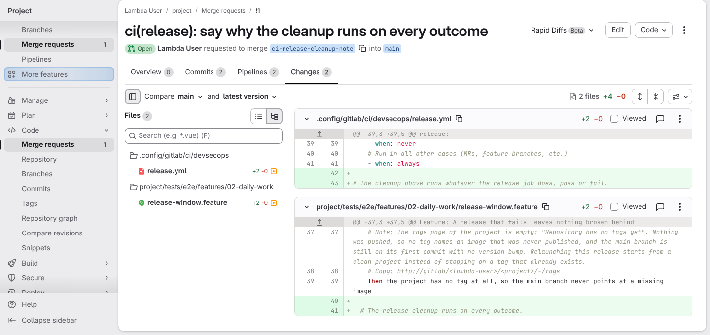](../../screenshots/base/03-evolution/test-discipline/changes-comment-only.webp)

First reflex, the cheapest one: type a line of text into an existing card and call it done. The Changes tab now holds two files, and the diff of that card is a single comment line. Still nothing under screenshots/base: no picture was taken.
It costs one second, it proves nothing, and a rule written in a document cannot stop it.

<details>
<summary>Command</summary>

```shell
http://gitlab/<lambda-user>/<project>/-/merge_requests/1/diffs
```

</details>

</td>
</tr>
</table>

<table width="100%">
<tr>
<th width="50%">

**5. Then the gate reads that comment and refuses it just the same**

</th>
<th width="50%">

**6. When the author adds the card and the picture it captured**

</th>
</tr>
<tr>
<td width="50%" valign="top">

[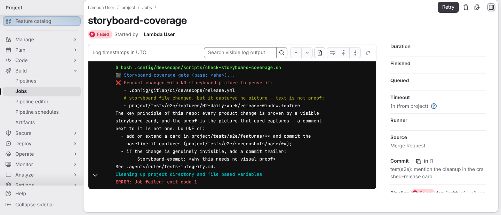](../../screenshots/base/03-evolution/test-discipline/gate-refuses-the-comment.webp)

Same job, same page as two cards ago, after the new push. The verdict has not moved by a word: "Product changed with NO storyboard picture to prove it".
It now also names the card file it read: "A storyboard file changed, but it captured no picture", then "text is not proof". The gate does not count files, it looks for a photograph, and a comment is text anyone can type in a second.

<details>
<summary>Command</summary>

```shell
http://gitlab/<lambda-user>/<project>/-/jobs/<id>
```

</details>

</td>
<td width="50%" valign="top">

[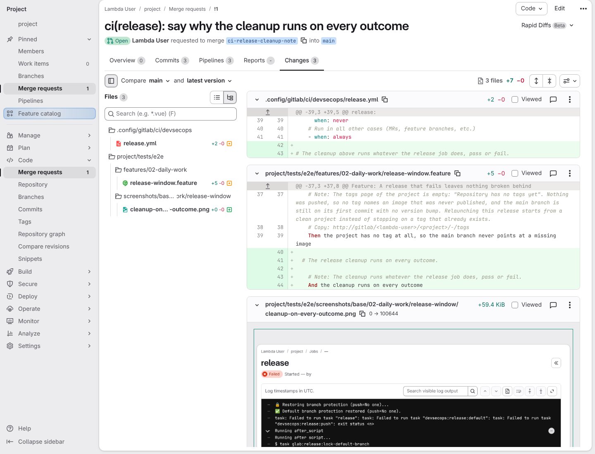](../../screenshots/base/03-evolution/test-discipline/changes-with-card.webp)

The author pushes the missing card to the same merge request, and changes nothing else. The Changes tab now lists three files: the framework file from before, untouched, the sentence added to the card, and the picture that sentence captured.
That picture is what the gate actually wants. A screenshot only exists because the test really ran and photographed something, so a comment typed next to a card can never stand in for it.

<details>
<summary>Command</summary>

```shell
http://gitlab/<lambda-user>/<project>/-/merge_requests/1/diffs
```

</details>

</td>
</tr>
</table>

<table width="100%">
<tr>
<th width="50%">

**7. Then the same job turns green and names the card that proved the change**

</th>
<th width="50%">

**8. And the merge request is green from end to end and can be merged**

</th>
</tr>
<tr>
<td width="50%" valign="top">

[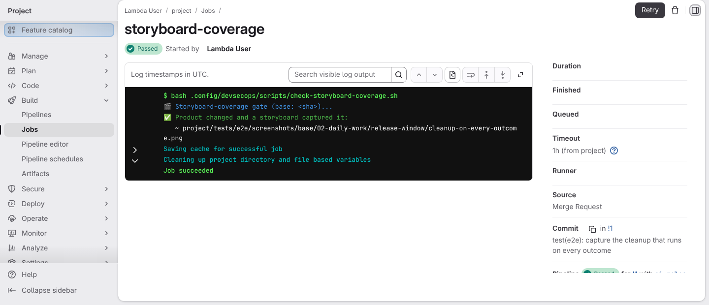](../../screenshots/base/03-evolution/test-discipline/gate-names-the-card.webp)

The very same job runs again on the new push, and this time it reads Passed. Its log carries the opposite verdict: "Product changed and a storyboard captured it".
The gate never leaves the reader guessing. It names the picture that made it green, so a reviewer can go and look at it for themselves.

<details>
<summary>Command</summary>

```shell
http://gitlab/<lambda-user>/<project>/-/jobs/<id>
```

</details>

</td>
<td width="50%" valign="top">

[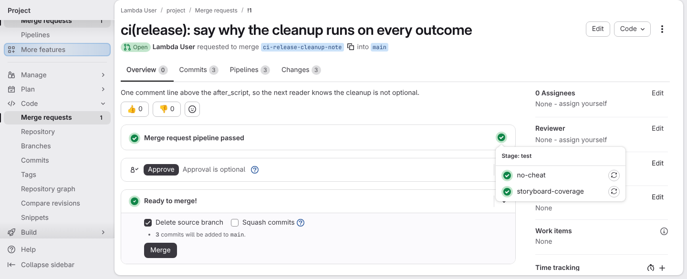](../../screenshots/base/03-evolution/test-discipline/merge-allowed.webp)

Back on the merge request, the same stage opened: no-cheat and storyboard-coverage are both green, and the box now reads "Ready to merge!" above the Merge button. The change that was refused a minute ago can now go in.
Nothing about the framework change moved between those two states. The only difference is that it now arrives with its picture, which is the whole point of the rule.

<details>
<summary>Command</summary>

```shell
http://gitlab/<lambda-user>/<project>/-/merge_requests/1
```

</details>

</td>
</tr>
</table>

<a name="storyboard-chapter-2"></a>

## The card is there, and the test behind it was switched off

<table width="100%">
<tr>
<th width="50%">

**9. When the author switches the test off instead of fixing what it caught**

</th>
<th width="50%">

**10. Then GitLab stops the merge request again, on the check a picture cannot satisfy**

</th>
</tr>
<tr>
<td width="50%" valign="top">

[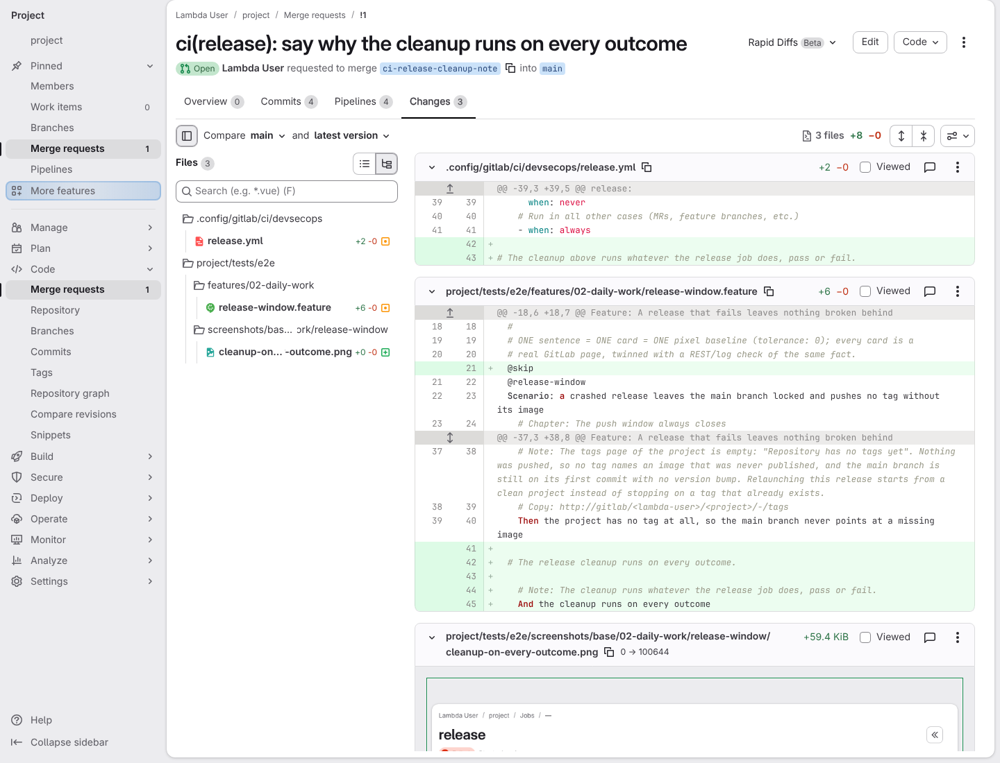](../../screenshots/base/03-evolution/test-discipline/changes-test-switched-off.webp)

One more push adds a single line to the card, line 21, right above the scenario: @skip. The file list on the left still holds the picture from before.
That word tells the test suite to walk past this scenario without running it. The scenario is still written down, the picture is still committed, and from now on neither is ever checked again. It is the cheapest way to turn a red pipeline green.

<details>
<summary>Command</summary>

```shell
http://gitlab/<lambda-user>/<project>/-/merge_requests/1/diffs
```

</details>

</td>
<td width="50%" valign="top">

[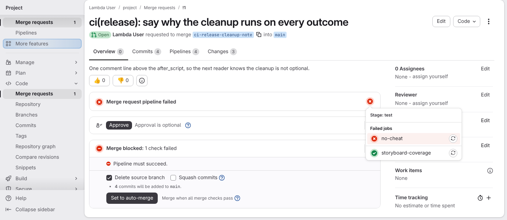](../../screenshots/base/03-evolution/test-discipline/merge-blocked-again.webp)

Back on the merge request, the stage opened once more, and the colours have swapped: no-cheat is now the one under "Failed jobs", and storyboard-coverage is green. It asks whether a picture came with the change, and one did.
The box is the same as in the first chapter: "Merge blocked: 1 check failed", "Pipeline must succeed." The change is stopped again, and this time the picture has nothing to do with it.

<details>
<summary>Command</summary>

```shell
http://gitlab/<lambda-user>/<project>/-/merge_requests/1
```

</details>

</td>
</tr>
</table>

<table width="100%">
<tr>
<th width="50%">

**11. And the second check reads the change itself and names the line that switched the test off**

</th>
<th width="50%">


</th>
</tr>
<tr>
<td width="50%" valign="top">

[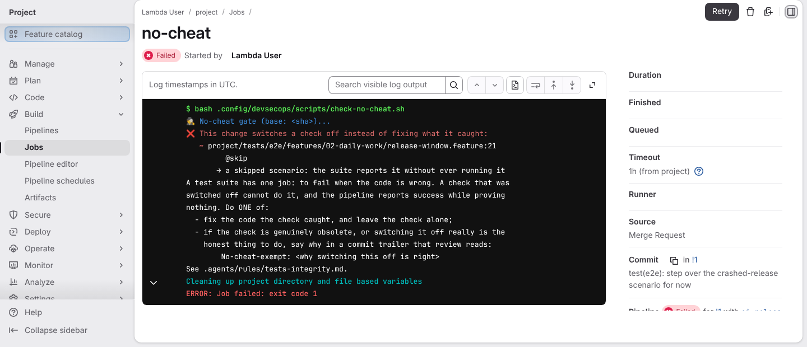](../../screenshots/base/03-evolution/test-discipline/no-cheat-names-the-line.webp)

The no-cheat job reads the change itself, line by line, and stops on the one that was added: "This change switches a check off instead of fixing what it caught". It names the file and the line, release-window.feature:21, quotes it, and says what it does: "a skipped scenario: the suite reports it without ever running it".
The only way past it is a visible one: a line starting with "No-cheat-exempt:" in the commit message, so a reviewer reads the reason instead of guessing at it.
Two checks, two questions. Did the change bring a picture? Does the test behind that picture still run? A change has to answer both before it reaches the main branch.

<details>
<summary>Command</summary>

```shell
http://gitlab/<lambda-user>/<project>/-/jobs/<id>
```

</details>

</td>
<td width="50%" valign="top">


</td>
</tr>
</table>

<a name="storyboard-replay"></a>

<details>
<summary>Replay this scenario · source and checks</summary>

```shell
task test -- --grep "@test-discipline"
```

**Source**

```text
project/tests/e2e/features/03-evolution/test-discipline.feature
```

Every frame is its own pixel baseline (tolerance: 0).

</details>
