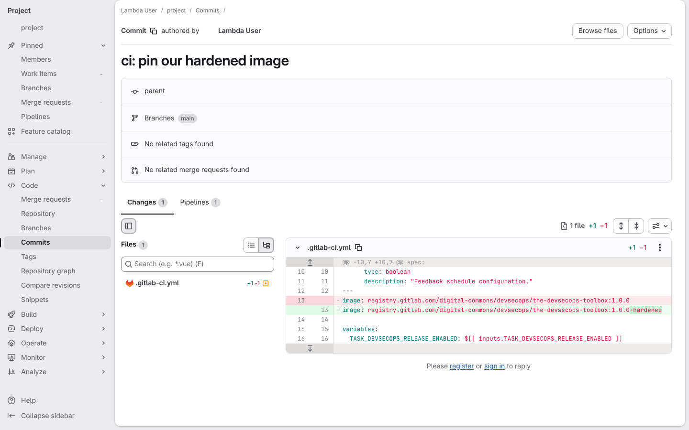
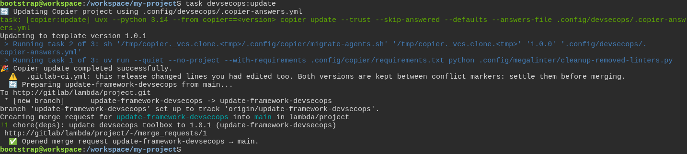
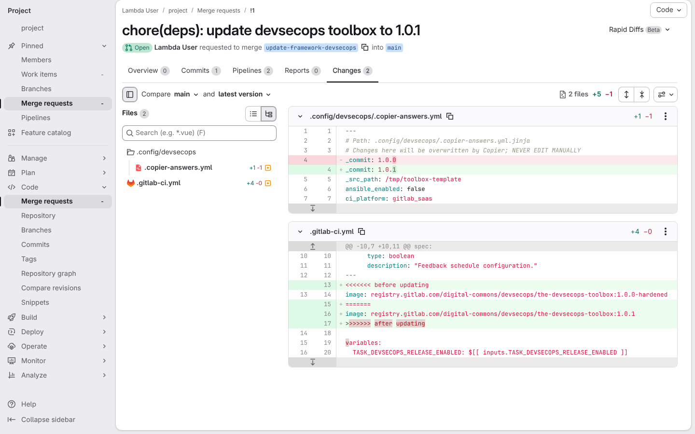
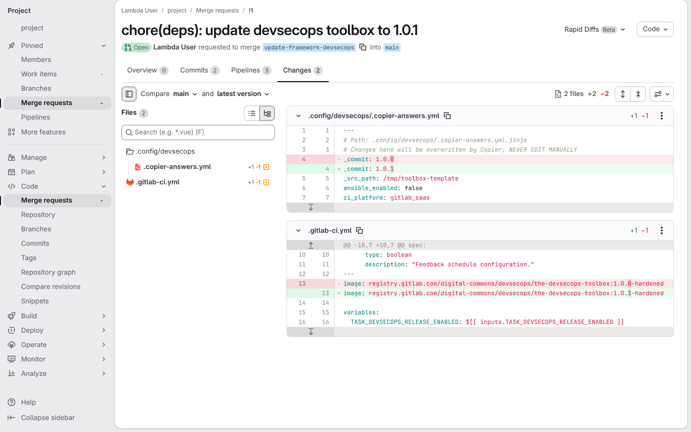

# A toolbox release changes a line I edited myself, and the update merge request shows both

**Scenario:** a toolbox update collides with my edit on a framework file, and I settle it in the merge request

<a name="storyboard-result"></a>

> [!tip] PASSED
> 4 steps · 4 frames

**On this page**

[Result](#storyboard-result) · [My edit and the release touch the same line](#storyboard-chapter-1) · [The merge request shows the clash, and the developer settles it](#storyboard-chapter-2) · [Replay and source](#storyboard-replay)

<a name="storyboard-chapter-1"></a>

## My edit and the release touch the same line

<table width="100%">
<tr>
<th width="50%">

**1. Given the developer swapped the toolbox's CI image for their own hardened tag on the main branch**

</th>
<th width="50%">

**2. When the developer runs the toolbox update and it warns that the release changes the same line**

</th>
</tr>
<tr>
<td width="50%" valign="top">

[](../../screenshots/base/03-evolution/toolbox-update-conflict/pin-commit.webp)

The project came from toolbox release 1.0.0, whose .gitlab-ci.yml runs every pipeline in the toolbox image tagged 1.0.0. The developer swapped that tag for their own build, 1.0.0-hardened, and pushed the commit to the main branch.
GitLab's page for that commit, "ci: pin our hardened image": the red line is the tag the release wrote, the green line is the developer's.

<details>
<summary>Command</summary>

```shell
sed -i 's/:1.0.0$/:1.0.0-hardened/' .gitlab-ci.yml && git commit -qam "ci: pin our hardened image" && git push -q
```

</details>

</td>
<td width="50%" valign="top">

[](../../screenshots/base/03-evolution/toolbox-update-conflict/update-run.webp)

Release 1.0.1 is out, and it moves the same image line to the tag 1.0.1. The developer asks for it with one command, from the main branch.
Copier applies the release, then a warning names .gitlab-ci.yml: "this release changed lines you had edited too". The update still pushes the branch update-framework-devsecops and opens merge request !1 into the main branch.

<details>
<summary>Command</summary>

```shell
task devsecops:update
```

</details>

</td>
</tr>
</table>

<a name="storyboard-chapter-2"></a>

## The merge request shows the clash, and the developer settles it

<table width="100%">
<tr>
<th width="50%">

**3. Then GitLab now holds an update merge request showing both image lines as a conflict**

</th>
<th width="50%">

**4. And once the developer fixes that line on the update branch, the merge request carries their hardened tag on the new release**

</th>
</tr>
<tr>
<td width="50%" valign="top">

[](../../screenshots/base/03-evolution/toolbox-update-conflict/conflict-in-mr.webp)

The Changes tab of merge request !1. The answers file moves from 1.0.0 to 1.0.1, and .gitlab-ci.yml keeps both image lines between conflict markers: the developer's 1.0.0-hardened under "&lt;&lt;&lt;&lt;&lt;&lt;&lt; before updating", the release's 1.0.1 above "&gt;&gt;&gt;&gt;&gt;&gt;&gt; after updating".
Nothing was dropped, and the main branch did not move.

<details>
<summary>Command</summary>

```shell
http://gitlab/<lambda-user>/<project>/-/merge_requests/1/diffs
```

</details>

</td>
<td width="50%" valign="top">

[](../../screenshots/base/03-evolution/toolbox-update-conflict/resolved-in-mr.webp)

On the update branch, the developer replaces the whole conflict with one line, their hardening on the new release (1.0.1-hardened), then commits and pushes it.
The same tab now shows one plain change, from 1.0.0-hardened to 1.0.1-hardened, with no marker left. Commits counts 2, the update and the fix, ready for review.

<details>
<summary>Command</summary>

```shell
sed -i '/^<<<<<<< /,/^>>>>>>> /c image: registry.gitlab.com/digital-commons/devsecops/the-devsecops-toolbox:1.0.1-hardened' .gitlab-ci.yml && git commit -qam "ci: keep our hardened image on 1.0.1" && git push -q
```

</details>

</td>
</tr>
</table>

<a name="storyboard-replay"></a>

<details>
<summary>Replay this scenario · source and checks</summary>

```shell
task test -- --grep "@toolbox-update-conflict"
```

**Source**

```text
project/tests/e2e/features/03-evolution/update-conflict.feature
```

Every frame is its own pixel baseline (tolerance: 0).

</details>
