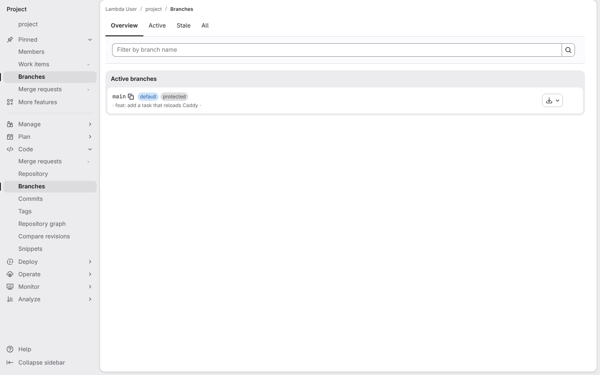
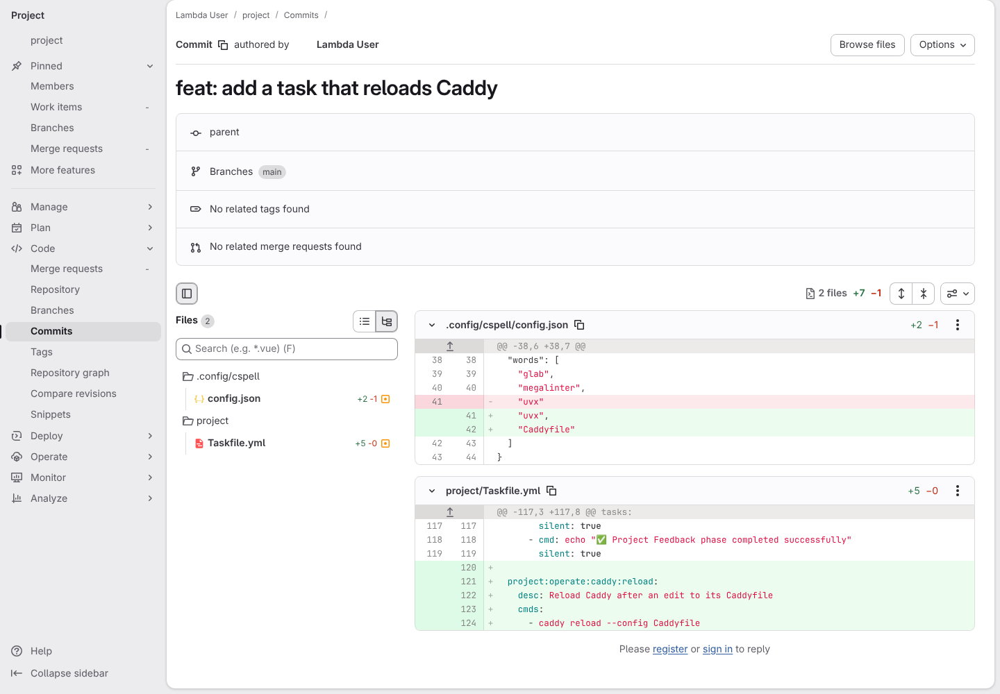
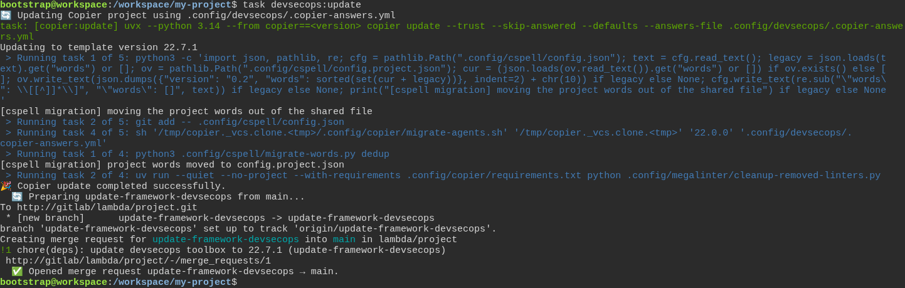
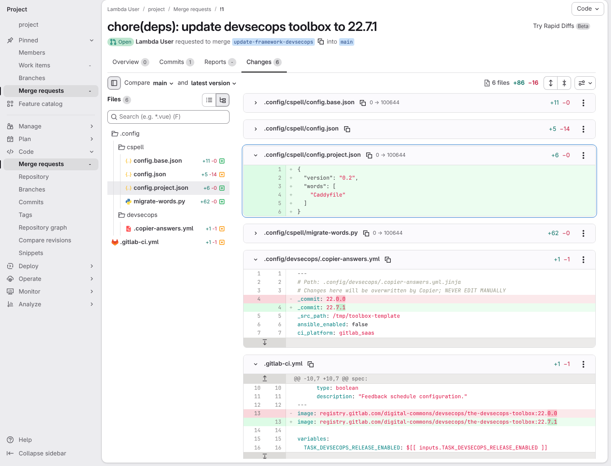
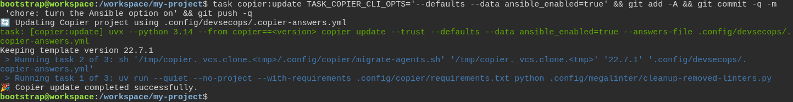
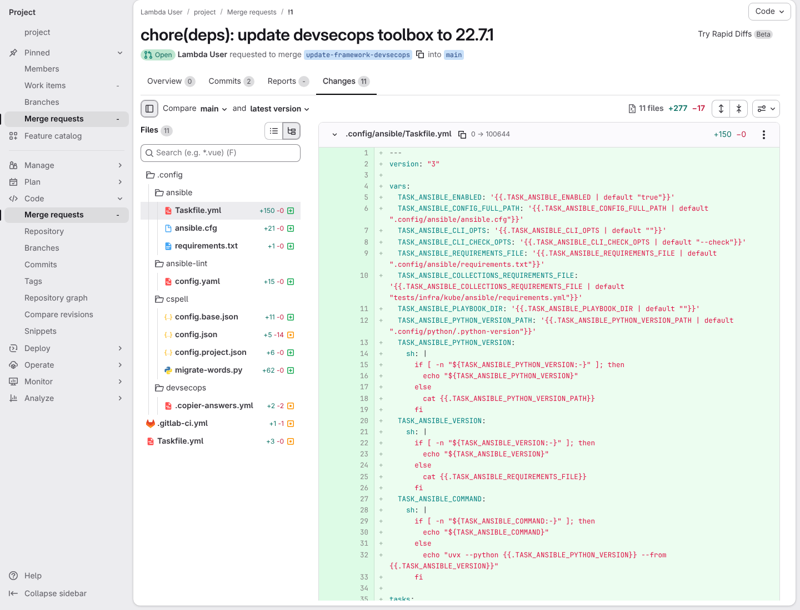
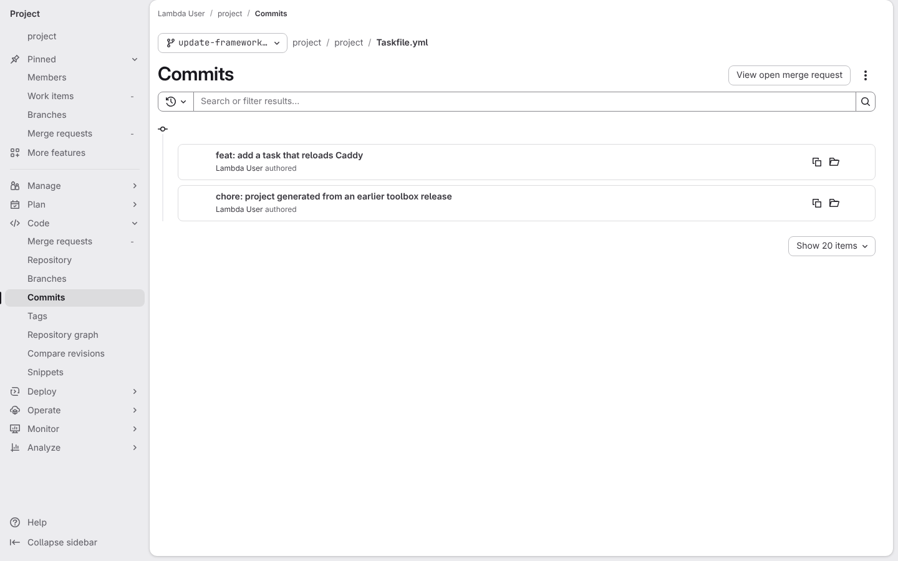
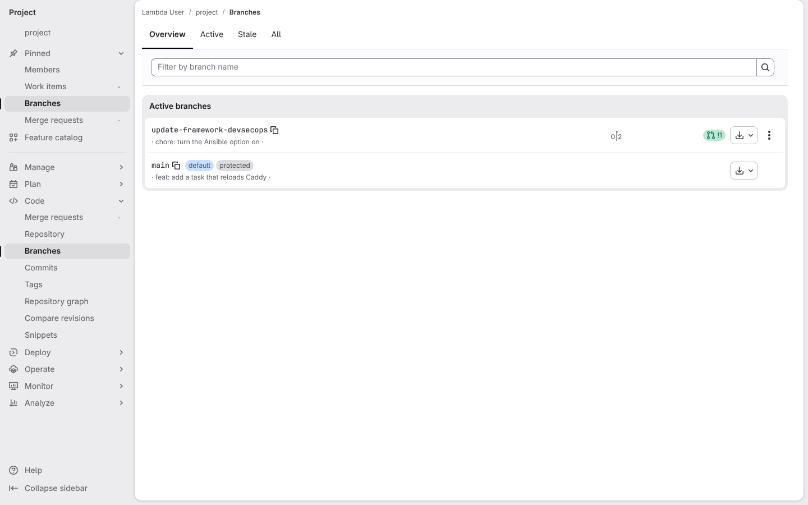

# A toolbox release arrives as a merge request and keeps my work

**Scenario:** a toolbox update arrives as a merge request, splits the dictionary and keeps my work

<a name="storyboard-result"></a>

> [!tip] PASSED
> 8 steps · 8 frames

**On this page**

[Result](#storyboard-result) · [Before the release, my project on GitLab carries my own changes](#storyboard-chapter-1) · [I ask for the release, and it arrives as a merge request](#storyboard-chapter-2) · [A changed answer adds tools, and my own task stays mine](#storyboard-chapter-3) · [Replay and source](#storyboard-replay)

<a name="storyboard-chapter-1"></a>

## Before the release, my project on GitLab carries my own changes

<table width="100%">
<tr>
<th width="50%">

**1. Given a developer's toolbox project sits on GitLab with only its main branch**

</th>
<th width="50%">

**2. And the developer has pushed their own spelling word and their own task to the main branch**

</th>
</tr>
<tr>
<td width="50%" valign="top">

[](../../screenshots/base/03-evolution/toolbox-update/branches-before.webp)

GitLab's branches page for the project. It lists one branch, the main branch, and its last commit is the developer's own, "feat: add a task that reloads Caddy".
Off camera, the project was generated from toolbox release 22.0.0 and pushed with that commit on top. CI is switched off for it, so no pipeline runs in this story. Its random name shows as "project", and dates and avatars are hidden.

<details>
<summary>Command</summary>

```shell
http://gitlab/<lambda-user>/<project>/-/branches
```

</details>

</td>
<td width="50%" valign="top">

[](../../screenshots/base/03-evolution/toolbox-update/developer-commit.webp)

The page of that commit. In project/Taskfile.yml the developer adds a task of their own, project:operate:caddy:reload.
Its description says "Caddyfile", a word the spell checker does not know. So the commit also adds "Caddyfile" to .config/cspell/config.json, the one dictionary file of release 22.0.0, after the framework's own words.

<details>
<summary>Command</summary>

```shell
http://gitlab/<lambda-user>/<project>/-/commit/<sha>
```

</details>

</td>
</tr>
</table>

<a name="storyboard-chapter-2"></a>

## I ask for the release, and it arrives as a merge request

<table width="100%">
<tr>
<th width="50%">

**3. When the developer asks for the new toolbox release from the main branch**

</th>
<th width="50%">

**4. Then GitLab holds a merge request that moves the project to the new release and gives the developer's word a file of its own**

</th>
</tr>
<tr>
<td width="50%" valign="top">

[](../../screenshots/base/03-evolution/toolbox-update/update-run.webp)

The developer's terminal, on the main branch. One command asks for the latest toolbox release. Copier says "Updating to template version 22.7.1" and runs the release's migration, which prints "\[cspell migration\] moving the project words out of the shared file".
The task then commits the change on a new branch, update-framework-devsecops, pushes it, and opens merge request !1, "chore(deps): update devsecops toolbox to 22.7.1".

<details>
<summary>Command</summary>

```shell
task devsecops:update
```

</details>

</td>
<td width="50%" valign="top">

[](../../screenshots/base/03-evolution/toolbox-update/merge-request-changes.webp)

The Changes tab of that merge request, the page a reviewer reads. The file list on the left shows the dictionary split in three: config.base.json and config.project.json are new, and config.json is changed.
The reviewer folds the three long diffs and clicks config.project.json, which GitLab frames in blue. That new file holds "Caddyfile", and the next update will never overwrite it. Below, the answers file moves from 22.0.0 to 22.7.1, and so does the toolbox image of the CI pipeline in .gitlab-ci.yml.

<details>
<summary>Command</summary>

```shell
http://gitlab/<lambda-user>/<project>/-/merge_requests/1/diffs
```

</details>

</td>
</tr>
</table>

<a name="storyboard-chapter-3"></a>

## A changed answer adds tools, and my own task stays mine

<table width="100%">
<tr>
<th width="50%">

**5. When the developer turns the Ansible option on and pushes the re-run update to the same merge request**

</th>
<th width="50%">

**6. Then the same merge request now also brings the Ansible tooling**

</th>
</tr>
<tr>
<td width="50%" valign="top">

[](../../screenshots/base/03-evolution/toolbox-update/ansible-run.webp)

The same terminal, still on the update branch. The developer runs the update again with one answer changed, ansible\_enabled\=true, and Copier says "Copier update completed successfully.".
The same line then commits the new files as "chore: turn the Ansible option on" and pushes them to the update branch, the branch of the same merge request.

<details>
<summary>Command</summary>

```shell
task copier:update TASK_COPIER_CLI_OPTS='--defaults --data ansible_enabled=true' && git add -A && git commit -q -m 'chore: turn the Ansible option on' && git push -q
```

</details>

</td>
<td width="50%" valign="top">

[](../../screenshots/base/03-evolution/toolbox-update/merge-request-ansible.webp)

The same Changes tab after that push, every diff open. The tab now reads "Commits 2", and the file list opens with the Ansible tooling: .config/ansible (Taskfile.yml, ansible.cfg, requirements.txt) and .config/ansible-lint. The root Taskfile.yml is changed too, to load the Ansible tasks.
Nothing under project/ is in the list: the developer's own files are not part of the update.

<details>
<summary>Command</summary>

```shell
http://gitlab/<lambda-user>/<project>/-/merge_requests/1/diffs
```

</details>

</td>
</tr>
</table>

<table width="100%">
<tr>
<th width="50%">

**7. And GitLab's history of the developer's task file shows neither update ever touched it**

</th>
<th width="50%">

**8. And the update branch stands next to a main branch nobody pushed to**

</th>
</tr>
<tr>
<td width="50%" valign="top">

[](../../screenshots/base/03-evolution/toolbox-update/task-file-history.webp)

GitLab's history of project/Taskfile.yml on the update branch, the page its History button opens. It lists two commits, the one that generated the project and the developer's own. Neither update commit is there.
Release 22.7.1 does reword a line of this file in the template. The file is listed as "skip if exists", so once a project has it, an update leaves it alone.

<details>
<summary>Command</summary>

```shell
http://gitlab/<lambda-user>/<project>/-/commits/update-framework-devsecops/project/Taskfile.yml
```

</details>

</td>
<td width="50%" valign="top">

[](../../screenshots/base/03-evolution/toolbox-update/branches-after.webp)

The branches page again, as on the first card. update-framework-devsecops now stands next to the main branch, two commits ahead of it, with its merge request !1.
The main branch still ends on the developer's own commit. Nobody pushed to it: the release reaches the main branch only once the merge request is reviewed and merged.

<details>
<summary>Command</summary>

```shell
http://gitlab/<lambda-user>/<project>/-/branches
```

</details>

</td>
</tr>
</table>

<a name="storyboard-replay"></a>

<details>
<summary>Replay this scenario · source and checks</summary>

```shell
task test -- --grep "@toolbox-update"
```

**Source**

```text
project/tests/e2e/features/03-evolution/update.feature
```

Every frame is its own pixel baseline (tolerance: 0).

</details>
